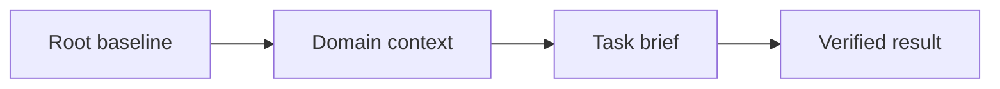
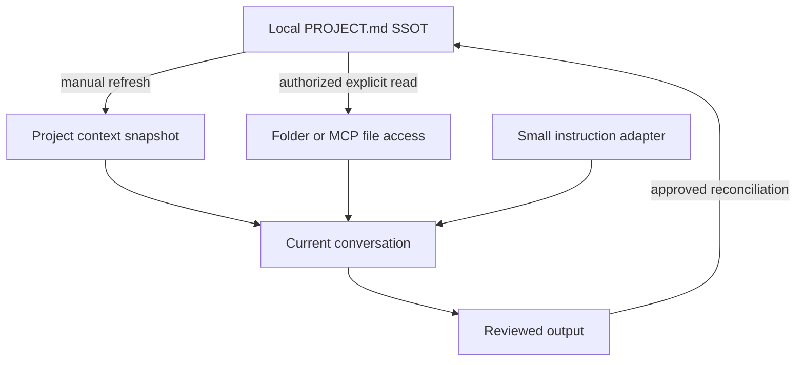

# Claude Desktop: Cheat Sheet and Reference Guide

**Application:** Claude Desktop by Anthropic, focusing on conversations, Projects, and Cowork.  
**Platforms:** Windows first; macOS differences noted. Linux availability is beta and feature dependent.  
**Documentation verified:** 27 October 2026. No installed Claude Desktop build or account features were runtime-tested for this guide.  
**Root baseline:** `PROJECT.md`, explicitly supplied or read through authorized file access.  
**Series:** Application 1, following the master source’s order.  
**Audience:** Beginners through advanced users maintaining durable project context.

This manual separates an authoritative file on disk from the mechanisms that make its contents available to Claude. Local files, uploaded copies, Project knowledge, instructions, skills, memory, and artifacts have different responsibilities.

## Contents

1. [Purpose and Capability Overview](#1-purpose-and-capability-overview)
2. [Universal Foundations and Root Markdown SSOT](#2-universal-foundations-and-root-markdown-ssot)
3. [Markdown Essentials and Application Markup](#3-markdown-essentials-and-application-markup)
4. [Workspace Architecture and Directory Hierarchy](#4-workspace-architecture-and-directory-hierarchy)
5. [Instruction Discovery, Loading, Scope, and Precedence](#5-instruction-discovery-loading-scope-and-precedence)
6. [References and Progressive Context Expansion](#6-references-and-progressive-context-expansion)
7. [Configuration, Tools, Skills, and Integrations](#7-configuration-tools-skills-and-integrations)
8. [Practical Workflows](#8-practical-workflows)
9. [Complete Templates and Worked Project](#9-complete-templates-and-worked-project)
10. [Troubleshooting and Limitations](#10-troubleshooting-and-limitations)
11. [Quick-Reference Tables and Checklists](#11-quick-reference-tables-and-checklists)
12. [Sources and Verification Notes](#12-sources-and-verification-notes)

## 1. Purpose and Capability Overview

### 1.1 Universal orientation

A project baseline answers five questions: what are we building, which constraints apply, where is supporting knowledge, what counts as success, and what remains to be done? A useful guide teaches both how to write those answers and how to supply them to the application.

Use three separate checks:

| Check | Question | Observable evidence |
| --- | --- | --- |
| Authoring | Is the authoritative instruction file current? | Its text, revision, and change history |
| Availability | Can this session access that revision? | Supplied text, accepted attachment, or successful file read |
| Application | Did the result follow the relevant instructions? | Output checked against the baseline and acceptance criteria |

Example request after supplying a baseline:

```text
Read the supplied project baseline. Report its revision, the task goal,
and the acceptance criteria you will use. Identify any missing source
before starting the task.
```

Expected result: a short context inventory and a task-specific interpretation. A confident answer alone is not proof that an unavailable file was read.

### 1.2 Claude Desktop capability snapshot

| Surface or feature | Supported use | Baseline implication |
| --- | --- | --- |
| Ordinary conversation | Supply instructions and accepted attachments | Paste or attach the baseline explicitly |
| Projects | Persistent Project instructions and shared knowledge | Maintain a small instruction adapter and current baseline copy |
| Cowork / unified conversation | Work with connected folders and other enabled capabilities | Connect the intended folder and request a root-file read |
| Skills | Upload reusable instruction packages through the Skills interface | Package a procedure; keep project policy in the baseline |
| Local MCP / desktop extensions | Expose tools and selected local resources | Verify tool availability and read the file explicitly |
| Remote connectors | Access authorized remote services | A connector does not grant arbitrary local disk access |
| Memory / chat search | Recall or retrieve selected prior information | Supplement the current baseline; reconcile stale recollections |
| Artifacts / Claude Docs | Create persistent deliverables beside the conversation | Export reviewed changes back to the authoring files |
| Code tab | A distinct Claude Code surface | Its instruction discovery rules are outside this manual’s workflows |

These surfaces are documented separately in Anthropic’s [Projects guide](https://support.claude.com/en/articles/9519177-how-can-i-create-and-manage-projects), [Cowork guide](https://support.claude.com/en/articles/13345190-get-started-with-claude-cowork), and [Skills guide](https://support.claude.com/en/articles/12512180-use-skills-in-claude).

**Why `PROJECT.md`?** The reviewed Chat/Projects/Cowork documentation does not establish a native root Markdown filename with automatic discovery. `PROJECT.md` is this guide’s explicit organizational convention. Anthropic documents automatic `CLAUDE.md` discovery for [Claude Code](https://code.claude.com/docs/en/memory); naming a file `CLAUDE.md` does not establish the same behavior in Desktop conversations.

**Platform and interface variation:** Anthropic’s installation page currently lists Windows 10+, macOS 13+, and a Linux beta. Cowork and Chat are being unified, so some accounts retain separate selectors while others use one conversation box. Use the feature labels present in your account; local-folder workflows below target Windows/macOS. See [installation](https://support.claude.com/en/articles/10065433-install-claude-desktop) and [the unified experience](https://support.claude.com/en/articles/16761823-claude-cowork-and-chat-are-one-claude).

## 2. Universal Foundations and Root Markdown SSOT

### 2.1 Universal foundation: authority, persistence, and context

The **Single Source of Truth (SSOT)** is the designated authoring location for project policy. Keep the baseline at the project root so people can find it before entering specialized directories. Store purpose, constraints, navigation, and verification requirements there; put detailed domain knowledge in supporting files.

Persistence has two meanings. A file persists because it remains on disk. An instruction persists in the application only when an applicable feature reloads or retains it. Creating a file does not, by itself, establish that any future conversation reads it.

Use one authoritative owner for each kind of information:

| Information | Authoritative location | Maintenance rule |
| --- | --- | --- |
| Project purpose and policy | Root baseline | Edit here before refreshing copies |
| Domain definitions | Relevant context document | Link from the baseline |
| Current task and acceptance criteria | Task brief | Update when the task changes |
| Session progress and next action | Handoff document | Refresh after meaningful work |
| Application instruction text | Supported instruction surface | Keep adapters small; mark copied policy with its source revision |
| Produced report or artifact | Reviewed output location | Reconcile policy changes into the baseline |

A compact baseline excerpt:

```markdown
# Atlas Project Baseline

Revision: atlas-r1

## Purpose
Produce a clear onboarding guide for a fictional documentation project.

## Constraints
- Write in English.
- Use relative Markdown links inside project documents.
- Preserve existing files unless the current task authorizes a change.

## Context map
- Domain: [Documentation rules](context/documentation.md)
- Task: [Onboarding brief](tasks/onboarding.md)
- Progress: [Handoff](HANDOFF.md)

## Verification
Check the requested output against the task acceptance checklist.
```

The links document relationships. Loading those targets requires the application’s actual reference, upload, retrieval, or file-access mechanism.

### 2.2 Universal foundation: progressive expansion

Expand context by relevance:

1. Read the root baseline to establish purpose and policy.
2. Read the domain document that defines the relevant terminology.
3. Read the current task brief and its acceptance criteria.
4. Read only the working files needed for that task.
5. Verify the output and record the next action in the handoff.

Example context request:

```text
Start with the project baseline, then the documentation rules and
onboarding task brief supplied here. List any additional files needed.
Do not assume that a Markdown link made its target available.
```

Treat uploaded copies, instruction-field copies, and generated summaries as **derived snapshots**. Label them with the source revision. After editing the SSOT, refresh affected snapshots and deliberately supply the revised content to the next session.

### 2.3 Application mapping: Claude Desktop

For Chat/Projects, keep `PROJECT.md` locally and supply its current contents through an accepted upload, a pasted message, or Project context. For Cowork or an enabled file tool, request an actual read of the authorized root file. Project instructions can hold the loading adapter shown in Section 5.

Do not mistake a Project title or description for instructions. Use **Set project instructions** and the Project’s knowledge area. Anthropic documents those as distinct controls in [Create and manage Projects](https://support.claude.com/en/articles/9519177-how-can-i-create-and-manage-projects).

## 3. Markdown Essentials and Application Markup

### 3.1 Universal Markdown essentials

Use ordinary Markdown as the portable source format. Headings, paragraphs, lists, links, images, block quotes, inline code, and fenced code belong to the CommonMark foundation. Tables, task lists, and strikethrough are GFM extensions; math and Mermaid require additional renderer support. These standards describe document syntax, not a promise about a particular application. See [CommonMark](https://spec.commonmark.org/0.31.2/) and [GFM](https://github.github.com/gfm/).

Copy this complete syntax sample into a Markdown document:

````markdown
# Document title

## Context

Use **bold** for emphasis, *italics* for a term, and `PROJECT.md` for a filename.

- First requirement
- Second requirement

1. Read the baseline.
2. Read the task brief.

> This quotation is reference material; label its source separately.

[Task brief](tasks/onboarding.md)


| Item | Meaning |
| --- | --- |
| Root | Project policy |
| Task | Current acceptance criteria |

- [ ] Read the current revision.
- [x] Identify the requested output.

~~Superseded wording~~

```python
print("Read the baseline before starting.")
```

---

Literal characters: \*asterisk\*, \[bracket\], and a table pipe: \|.
````

Expected result in a compatible viewer: structured text, a code block, and supported extensions. The sample image renders only if that asset exists and the viewer can access it; it is not a companion file supplied by this manual.

| Rule | Copyable example | Practical reason |
| --- | --- | --- |
| One document title | `# Atlas Baseline` | Establishes the document’s subject |
| Logical heading levels | `## Constraints`, then `### Writing` | Keeps navigation and accessibility predictable |
| Blank lines around blocks | Paragraph, blank line, list | Avoids ambiguous block boundaries |
| Language on code fences | Opening fence: three backticks followed by `json` | Helps readers recognize the format |
| Longer outer fence | Four backticks around a sample containing triple backticks | Preserves nested code examples |
| Relative project link | `[Rules](context/documentation.md)` | Keeps project navigation portable |
| URL containing a space | `[Draft](<drafts/first draft.md>)` | Makes the link destination unambiguous |
| Inline backticks inside code | Use two backticks around a span containing one backtick | Shows literal Markdown syntax |
| Standard newline | Write a separate paragraph for a separate idea | Avoids relying on invisible trailing spaces |
| Descriptive image text | `` | Preserves meaning when an image cannot be seen |

Use UTF-8, consistent filenames, and short paragraphs. Relative links resolve from the document containing the link, not automatically from the project root. Anchor generation varies across viewers; check the table of contents where the file will be read.

YAML frontmatter is a separate convention, not a universal instruction loader. This valid example can hold authoring metadata where a consumer supports it:

```yaml
---
title: Atlas Baseline
revision: atlas-r1
status: current
---
```

In a general project document, plain Markdown metadata is often clearer. Reserve required frontmatter schemas for features that document them, such as Skills.

### 3.2 Claude prompting: Markdown and user-defined XML

You can ask for Markdown without depending on a particular rendering engine:

```text
Return the answer as Markdown with one H1 title, H2 sections, a compact
table, and a final task checklist. Put all code in language-tagged fences.
Provide source text that remains readable if extensions do not render.
```

Anthropic recommends descriptive XML tags to separate prompt components. They organize text; they do not fetch files, install tools, or grant permissions. This complete prompt uses illustrative supplied content, not a live file reference. See [prompting best practices](https://platform.claude.com/docs/en/build-with-claude/prompt-engineering/claude-prompting-best-practices).

```xml
<context>
  <document>
    <source>PROJECT.md, revision atlas-r1</source>
    <content>The project creates an English onboarding guide.</content>
  </document>
</context>
<instructions>
  Use only the supplied facts. Identify missing context explicitly.
</instructions>
<task>
  Draft three onboarding steps and a verification checklist in Markdown.
</task>
```

Expected result: an organized response based on the text supplied. A `<source>` label names a source; it does not prove that Claude opened that file.

**Internal-looking tags:** Do not use `<antArtifact>`, `<antThinking>`, or `<antml:function_calls>` as user-facing commands. The reviewed public instructions do not establish them as supported controls for creating an artifact, requesting private reasoning, or invoking a tool. Ask for the outcome through the supported interface.

### 3.3 Mathematics: request notation and test the destination

The source’s exact default-delimiter and renderer-engine claims are not established by the reviewed user documentation. Use the following as a notation test, not a statement of native defaults:

```text
Show the same equation using these two source conventions, then tell me
which actually renders in this conversation. Preserve the source too.

Dollar convention: $E = mc^2$
Display dollars:
$$
E = mc^2
$$

Backslash convention: \(E = mc^2\)
Display backslashes:
\[
E = mc^2
\]

Plain-text fallback: E = m * c^2.
```

Expected result: visible source plus whatever the current view supports. Check rendering yourself; Claude’s statement that it rendered is not a UI test. Bare `[...]` is ordinary bracketed text, not a substitute for `\[...\]`. Copy a sample into the intended Markdown editor before standardizing a notation. The official [math article](https://support.claude.com/en/articles/10366421-how-does-claude-handle-mathematical-equations-and-calculations) does not specify a Desktop delimiter contract.

### 3.4 Mermaid, SVG, HTML, and artifacts

Preserve diagram source in the Markdown file even when a viewer cannot render it. This Mermaid diagram describes the project workflow:



The arrows mean “supply or read next.” They do not represent automatic Markdown imports. Mermaid’s syntax and accessibility fields are described in its [flowchart](https://mermaid.js.org/syntax/flowchart.html) and [accessibility](https://mermaid.js.org/config/accessibility.html) documentation.

To obtain a Claude visual:

```text
Create a diagram of baseline -> domain context -> task -> verification.
Also return the Mermaid source in a fenced block. If that source does not
render here, create a visual using the capabilities available in this
conversation and keep the source alongside it.
```

Complete SVG source, suitable for saving as `context-flow.svg` if needed:

```svg
<svg xmlns="http://www.w3.org/2000/svg" viewBox="0 0 360 80" role="img" aria-labelledby="title desc">
  <title id="title">Baseline to task</title>
  <desc id="desc">The task receives context from the root baseline.</desc>
  <rect x="10" y="20" width="125" height="40" fill="#e8eef7" stroke="#243b53"/>
  <text x="72" y="45" text-anchor="middle" fill="#102a43">Baseline</text>
  <path d="M135 40 H215 M205 32 L215 40 L205 48" fill="none" stroke="#243b53"/>
  <rect x="215" y="20" width="125" height="40" fill="#e8eef7" stroke="#243b53"/>
  <text x="277" y="45" text-anchor="middle" fill="#102a43">Task</text>
</svg>
```

Do not assume raw SVG or HTML pasted into a conversation executes or renders. An HTML fence preserves source; a generated visual uses a separate capability. For example:

```html
<!doctype html>
<html lang="en">
<meta charset="utf-8">
<title>Atlas context</title>
<main><h1>Atlas context</h1><p>Read the baseline before the task.</p></main>
</html>
```

Current Artifacts include Docs and other templates; the official guide distinguishes legacy artifacts created before 16 September 2026. Ask naturally for a document or visual and use the available export controls. Do not build workflows around private wrapper tags or a guaranteed automatic preview for every fence. See [Artifacts](https://support.claude.com/en/articles/17153992-what-are-artifacts-and-how-do-i-use-them) and [file creation](https://support.claude.com/en/articles/12111783-create-and-edit-files-with-claude).

## 4. Workspace Architecture and Directory Hierarchy

### 4.1 Universal architecture

Keep the root baseline small enough to review. Expand detailed context through ordinary files with explicit responsibilities. Directory layout is an authoring design; it becomes an instruction hierarchy only if the application documents that behavior.

```text
Atlas/
|-- PROJECT.md                  # Authoritative project baseline
|-- HANDOFF.md                  # Reviewed progress and next action
|-- context/
|   `-- documentation.md        # Domain definitions and writing rules
|-- tasks/
|   `-- onboarding.md           # Current task and acceptance criteria
`-- outputs/
    `-- onboarding-guide.md    # Reviewed task output
```

Example relationship: `PROJECT.md` links to `context/documentation.md`; the task brief links back with `../PROJECT.md`. File responsibility is explicit, and duplicate policy is minimized.

### 4.2 Claude Desktop: map disk to context surfaces



There are two primary paths: upload/paste a current snapshot, or read the local file through granted access. Generated policy changes return to the root only after review. A Project upload is not a filesystem watcher.

For the worked example, Windows uses `C:\AI-Workspaces\Atlas`. On macOS, use `/Users/yourname/AI-Workspaces/Atlas`; replace `yourname` with your account name. These are example locations, not application installation requirements.

## 5. Instruction Discovery, Loading, Scope, and Precedence

### 5.1 Universal loading contract

For every instruction source, record: its owner, scope, loading trigger, revision, and refresh method. Distinguish normative instructions from evidence or quoted source material.

```text
Context inventory:
- Baseline: PROJECT.md, revision atlas-r1, supplied in this conversation.
- Domain: context/documentation.md, revision docs-r1, supplied.
- Task: tasks/onboarding.md, revision task-r1, supplied.
- Handoff: not supplied; do not infer its contents.
```

Project policy operates within platform rules, account/workspace controls, and applicable user instructions. When supplied project documents disagree, identify the competing requirements and request a decision where needed. A filename does not create a new instruction priority.

### 5.2 Claude instruction surfaces

| Surface | Scope and trigger | Maintenance |
| --- | --- | --- |
| Personal instructions | Across applicable conversations | Keep preferences general |
| Project instructions | Chats started within that Project | Store the baseline-loading adapter |
| Project knowledge | Available within the Project; retrieval may select relevant content | Refresh changed source copies |
| Cowork folder instructions | Added context when selecting that local folder | Reconcile changes with the root baseline |
| Current message / pasted text | Current conversation context | Identify source and revision |
| Skill | Enabled reusable procedure selected for relevant tasks | Update the uploaded package when its source changes |
| Tool-returned file contents | After a successful permitted read | Re-read when the file changes |
| Memory / chat search | Selective recall or explicit retrieval | Check against current sources |

This table describes scope and entry points, not a documented total precedence order among all features. Anthropic documents [personalization](https://support.claude.com/en/articles/10185728-understanding-claude-s-personalization-features), [Projects](https://support.claude.com/en/articles/9519177-how-can-i-create-and-manage-projects), and [Cowork instructions](https://support.claude.com/en/articles/13345190-get-started-with-claude-cowork) separately.

Personal instructions appear under **Settings > Your Claude > Instructions** in the current layout; older layouts use **Settings > Account > Instructions for Claude**. For a Project, open it and choose **Set project instructions**. In older Cowork layouts, global instructions appear under **Settings > Cowork**; unified layouts combine them with personal instructions.

Use the following adapter in Project instructions or the available folder-instruction field. It is a workflow convention, not special markup:

```text
Use local PROJECT.md as the authoring source for this project.
Before beginning, read the current PROJECT.md supplied here or available
through the authorized project folder. Report its revision and the
supporting files you actually read.
Load the domain document and task brief relevant to the request.
If a referenced file is unavailable, name it and request its contents.
Flag conflicts with older uploads, memory, or copied instructions.
Propose baseline changes explicitly; do not silently rewrite project policy.
```

### 5.3 Supply the baseline in Chat or Projects

1. Open the intended Project, or start an ordinary conversation.
2. Add the adapter to Project instructions when using a Project.
3. Try adding `PROJECT.md` to Project knowledge or the conversation.
4. If the picker rejects `.md`, paste the full text. A `.txt` transfer copy is another option; keep the local `.md` as the SSOT.
5. Supply the needed context and task documents by the same method.
6. Ask Claude to identify their revisions and use the relevant sections.

The current [upload documentation](https://support.claude.com/en/articles/8241126-upload-files-to-claude) lists several text formats but does not explicitly promise `.md` acceptance in every interface. In a Project without an accepted Markdown upload, use **Add text** where offered, paste into instructions if the baseline fits, or supply the full baseline message at task start. A file label alone is insufficient.

Copyable paste fallback for a separate minimal demonstration. For the Atlas worked project, paste the full Section 9.1 baseline instead:

````text
The following is the complete demonstration PROJECT.md, revision paste-demo-r1.
Use it as the project baseline for this conversation.

```markdown
# Paste-Format Demonstration
Revision: paste-demo-r1
Purpose: Write an English onboarding guide.
Constraints: Use relative links and preserve unrelated files.
Acceptance: Include three steps and a verification checklist.
```

Before drafting, report the revision and the acceptance criteria.
````

### 5.4 Supply the baseline through Cowork or MCP

Connect/select the intended local folder using the available Desktop controls. If your interface still has separate Chat/Cowork modes, select Cowork for its folder workflow. Then request:

```text
Use the connected Atlas folder. Read its root PROJECT.md first, then
context/documentation.md and tasks/onboarding.md. Report each revision.
Read only; do not change files yet. If folder access is unavailable,
identify the problem instead of guessing file contents.
```

Use the tool activity and returned content to check what was read. On current Pro/Max accounts, new Cowork sessions run in Anthropic’s cloud; connected local files are reached through Desktop while it is open. Older local sessions and organization configurations can differ. See the date-specific [cross-surface Cowork guidance](https://support.claude.com/en/articles/15520349-use-claude-cowork-on-web-desktop-and-mobile).

### 5.5 Refresh, retrieval, and conflict handling

After changing `PROJECT.md`, increase its revision, replace obsolete uploaded knowledge, update any full instruction-field copies, and begin a fresh task or explicitly resupply the changed text. Restarting the app alone does not refresh an uploaded snapshot.

For example:

```text
The current baseline is atlas-r2, supplied below. The older atlas-r1 copy
is superseded. Compare the changed Constraints section, report any
conflict with the current task, and use atlas-r2 for subsequent work.
```

Large Project knowledge collections can use RAG, retrieving relevant excerpts rather than placing every file in every turn. Deliberately supply critical instructions and ask for the needed sources. See [Project RAG](https://support.claude.com/en/articles/11473015-retrieval-augmented-generation-rag-for-projects).

Conflict example:

```text
PROJECT.md requires English. An older handoff requests German.
Report this conflict and ask which language should govern this task.
Do not silently treat the older handoff as the current policy.
```

## 6. References and Progressive Context Expansion

### 6.1 Universal reference discipline

A useful reference records both location and purpose. Keep the context map specific:

```markdown
## Context map
- [Writing rules](context/documentation.md): terminology and link policy.
- [Task brief](tasks/onboarding.md): output and acceptance criteria.
- [Handoff](HANDOFF.md): verified progress and next action.
```

When context becomes large, supply the baseline and task first, then request relevant supporting files. If the assistant has tools, require successful reads; otherwise paste or attach the required text. Preserve meaningful section headings when supplying excerpts, and label omitted portions explicitly.

### 6.2 Claude reference mechanisms

| Mechanism | Example | What it actually establishes |
| --- | --- | --- |
| Markdown link | `[Rules](context/documentation.md)` | A source-text relationship; no automatic import |
| Pasted source | `Source: context/documentation.md; revision: docs-r1` followed by its text | The pasted text is available in the conversation |
| Attachment / Project knowledge | Add the accepted file or text through the UI | A supplied copy; retrieval can be selective |
| Cowork folder read | Ask to read `context/documentation.md` from the connected folder | Access only if the read succeeds |
| Local MCP read | Ask the named filesystem tool to read the absolute path | A tool-mediated read within its permissions |
| Remote connector | Ask a connected service to retrieve a named document | Remote retrieval within that service’s granted scope |
| Previous-chat search | Ask Claude to find the relevant earlier decision | Retrieval, where available; verify against current policy |

`@context/documentation.md`, `[[documentation]]`, `file://...`, and `mcp://...` are not universal Desktop file-import commands. Use only an interface’s documented picker or actual tool capabilities. In particular, Claude Code’s `@path` instruction imports are Code behavior, not a Chat instruction-loading contract.

### 6.3 A complete context expansion request

After supplying the three source documents from Section 9:

```text
Read the current PROJECT.md, context/documentation.md, and
tasks/onboarding.md supplied here. Report their revisions and check
whether the task's baseline reference matches the supplied baseline.

First return a table: source, revision, relevant sections, missing context.
Then draft outputs/onboarding-guide.md using the task acceptance criteria.
If you cannot access a required source, stop the draft and name it.
Do not follow unrelated links or assume access to sibling directories.
```

Expected result: a source inventory, then the requested draft if all necessary content is available. For this fictional task, no external facts are needed.

### 6.4 Memory and handoff

Project knowledge, memory, chat search, and the full conversation transcript are different mechanisms. Memory may retain selected topics; it is not a byte-for-byte baseline or a guarantee of complete prior context. Anthropic documents these distinctions in [chat search and memory](https://support.claude.com/en/articles/11817273-use-claude-s-chat-search-and-memory-to-build-on-previous-context).

After a long session, compaction, or a new conversation:

```text
Resume from the supplied PROJECT.md and HANDOFF.md. Report the current
baseline revision, completed checks, remaining uncertainty, and the next
action. If memory disagrees with these sources, identify the discrepancy.
```

Record durable decisions in the baseline or the appropriate context file. Record temporary progress in the handoff. Current context capacity and summarization behavior vary; do not build the workflow around a single assumed token limit. See [usage and length limits](https://support.claude.com/en/articles/11647753-how-do-usage-and-length-limits-work).

## 7. Configuration, Tools, Skills, and Integrations

### 7.1 Universal configuration principles

Instructions describe behavior; configuration enables capabilities; permissions control access. A Markdown sentence does not install a tool or make a write-capable tool read-only.

For each configuration example, identify the consuming feature, file location, prerequisites, substituted values, reload action, and a bounded verification step. Preserve unrelated settings. Keep credentials out of shared Markdown and use the integration’s supported authentication interface.

Example verification request after a tool is connected:

```text
Use the configured project file tool to read only PROJECT.md. Report its
title and revision. Do not modify files or search unrelated folders.
```

### 7.2 Desktop extensions and local MCP

The supported extension route currently appears under **Settings > Desktop app > Manage beside Extensions > Browse extensions**. Older layouts use **Settings > Extensions**. Select a trusted extension and complete its requested configuration. Custom extension packages use `.mcpb`; their installation controls appear under extension advanced settings. A downloaded package is not an installed or connected tool. See [local MCP and desktop extensions](https://support.claude.com/en/articles/10949351-getting-started-with-local-mcp-servers-on-claude-desktop).

Manual MCP configuration is an optional advanced route. It is not required for the upload/paste workflow.

| Platform | Manual config location | Logs |
| --- | --- | --- |
| Windows | `%APPDATA%\Claude\claude_desktop_config.json` | `%APPDATA%\Claude\logs` |
| macOS | `~/Library/Application Support/Claude/claude_desktop_config.json` | `~/Library/Logs/Claude` |
| Linux beta | Use its current app controls/documentation | Do not infer a path from another operating system |

For manual `npx` configuration, first ensure Node.js/npm are installed and the example workspace exists. These PowerShell checks do not install or connect anything:

```powershell
node --version
npx --version
Test-Path -LiteralPath 'C:\AI-Workspaces\Atlas'
```

Expected result: version output and `True`. If the folder check returns `False`, substitute an existing intended workspace in the configuration.

The following is a complete minimal configuration. If you already have settings, merge the `project-files` entry into the existing `mcpServers` object; preserve other fields and servers. Fully quit Claude Desktop before editing, keep a backup, then reopen after saving. The first use of `npx -y` may fetch the package.

```json
{
  "mcpServers": {
    "project-files": {
      "command": "npx",
      "args": [
        "-y",
        "@modelcontextprotocol/server-filesystem",
        "C:\\AI-Workspaces\\Atlas"
      ]
    }
  }
}
```

On macOS, replace the allowed-directory string with `/Users/yourname/AI-Workspaces/Atlas`. JSON requires doubled backslashes in Windows paths, no comments, no trailing commas, and no duplicate object keys. Shell variables such as `%APPDATA%` are not a substitute for an absolute allowed-directory value in this example.

The reference filesystem server can read **and modify** allowed files. Choosing one project folder limits its intended directory scope; requesting a read-only task does not remove its write capabilities. The setup and paths are documented in the [official local-server tutorial](https://modelcontextprotocol.io/docs/develop/connect-local-servers).

Read-only JSON syntax check on Windows, after your own edit:

```powershell
$claudeConfigPath = Join-Path $env:APPDATA 'Claude\claude_desktop_config.json'
Get-Content -LiteralPath $claudeConfigPath -Raw | ConvertFrom-Json | Out-Null
```

Expected result: no parse error. This checks syntax, not whether the server launches or has the intended permissions.

After reopening Claude, inspect the server status and available tools, then run:

```text
Using project-files, read C:\AI-Workspaces\Atlas\PROJECT.md.
Return its title and revision. Do not change any files.
```

Check `mcp.log` and the relevant `mcp-server-*.log` if startup fails. Use the current extension/local-server management interface; older Desktop builds expose **Developer > Edit Config**. Node bundled inside a desktop extension does not establish that manual `npx` is installed on your system.

### 7.3 Remote connectors

Remote connectors are configured through the account interface, currently **Customize > Connectors > + Add > Add custom connector** where available. Use the service’s actual endpoint and its authentication process. Organization provisioning may be required. Remote connections originate from Anthropic’s infrastructure; they are distinct from local `mcpServers` configuration. See [remote MCP connectors](https://support.claude.com/en/articles/11175166-get-started-with-custom-connectors-using-remote-mcp) and [desktop versus web connectors](https://support.claude.com/en/articles/11725091-when-to-use-desktop-and-web-connectors).

Example retrieval request after the intended connector is authenticated:

```text
Use the connected document service to find the Atlas writing policy.
Show the document title, source link, and relevant excerpt. Compare it
with the supplied PROJECT.md and flag any conflicting requirements.
```

Expected result: a retrieved source with attributable content, or an explicit access/search failure. Mentioning a service or its URL does not connect it.

### 7.4 A complete reusable Skill

A Skill packages a repeatable procedure. It is separate from project-specific policy and requires the supported upload/enablement workflow. This example contains two complete source files:

```text
context-check.zip
`-- context-check/
    |-- SKILL.md
    `-- references/
        `-- checklist.md
```

`context-check/SKILL.md`:

```markdown
---
name: context-check
description: Audit supplied project context for conflicts and missing sources. Use when the user requests a project context audit.
---

# Context Check

1. Read the project baseline supplied by the user.
2. Read [the checklist](references/checklist.md) from this skill package.
3. Identify missing sources, stale revisions, and conflicting instructions.
4. Return a table with issue, evidence, and suggested correction.
5. Ask for required context that is unavailable. Do not invent file contents.
6. Propose edits; do not change project policy without authorization.
```

`context-check/references/checklist.md`:

```markdown
# Context Audit Checklist

- Identify the supplied baseline filename and revision.
- Separate project instructions from quoted reference data.
- Record which referenced documents were supplied or successfully read.
- Compare task acceptance criteria with the baseline constraints.
- Identify stale uploaded copies and conflicting remembered instructions.
- State the smallest next action that resolves each missing source.
```

Here, the relative reference is inside an uploaded skill package with an instruction to read it. That package mechanism does not make arbitrary project Markdown links automatic imports.

To package these files yourself on Windows, start in the directory containing `context-check/` and run:

```powershell
Compress-Archive -LiteralPath '.\context-check' -DestinationPath '.\context-check.zip'
```

Expected result: a ZIP containing the folder and the two files. Inspect the archive before uploading; `SKILL.md` must remain inside the top-level skill folder.

Enable **Code execution and file creation**, called **Create and edit files** in newer Settings layouts, where needed. Open **Customize > Skills**, use **+ > + Create skill > Upload a skill**, select the ZIP, then enable the uploaded Skill. Organization policy and UI labels can differ. See [using Skills](https://support.claude.com/en/articles/12512180-use-skills-in-claude) and [creating Skills](https://support.claude.com/en/articles/12512198-how-to-create-custom-skills).

Trigger test, after supplying `PROJECT.md`:

```text
Use the context-check skill to audit the supplied PROJECT.md.
Report the baseline revision, missing sources, and conflicting instructions.
```

Verify enablement in the Skills interface and inspect explicit Skill activity where available. A checklist-shaped answer alone does not prove the Skill loaded; if invocation cannot be observed, report it as unverified. Keep local Skill source canonical; upload a revised package when it changes. A directory under `.claude/skills/` alone does not install a Skill into Desktop Chat.

**Frontmatter compatibility:** This example uses uppercase `SKILL.md`, a lowercase hyphenated name matching its folder, and a description under 200 characters. It follows the [official repository](https://github.com/anthropics/skills) while staying within the shorter description guidance in Help. Current first-party documents differ on casing and description limits; this is a conservative authoring choice, not a claimed universal limit.

### 7.5 Artifacts, Docs, and source reconciliation

For a persistent document, ask:

```text
Create a Claude Doc from the reviewed onboarding draft. Keep the title,
three ordered steps, relative-link text, and verification checklist.
When finished, export it as Markdown so I can review the source.
```

Claude Docs supports Markdown export through **Export**. Review that output before replacing a local file; rich-text edits and export can change source formatting. A local `.md` baseline and a cloud Doc are separate authoring surfaces. See [Claude Docs](https://support.claude.com/en/articles/16923645-get-started-with-claude-docs).

For a temporary diagram, ask “Show the context flow as a diagram.” Current [custom visuals](https://support.claude.com/en/articles/13979539-custom-visuals-in-chat-and-cowork) can be generated in conversations; use the available download or **Save as artifact** control to retain one. Neither a visual nor an artifact automatically updates `PROJECT.md`.

## 8. Practical Workflows

### 8.1 Universal workflow: initialize, expand, verify, resume

Use this sequence for every substantive task:

1. Establish the root baseline and give it a revision.
2. Supply it through the application’s actual loading mechanism.
3. Supply the relevant domain document and current task brief.
4. Confirm the sources and acceptance criteria.
5. Produce the requested output within the authorized scope.
6. Check the result against the task’s observable requirements.
7. Update the handoff and reconcile durable decisions into their authoritative files.

Copyable task-start request:

```text
Read the baseline and task brief supplied here. Summarize the goal,
constraints, required sources, output location, and acceptance criteria.
If everything needed is available, complete the task and report which
checks were actually performed. Record unresolved items separately.
```

### 8.2 Workflow A: ordinary conversation, without local tools

**Prerequisites:** The Section 9 templates are saved locally or available to paste.

1. Start a conversation in the intended Project, if using one.
2. Supply `PROJECT.md`, `context/documentation.md`, and `tasks/onboarding.md` using Section 5’s upload/paste methods.
3. Send Section 6.3’s context-expansion request.
4. Compare the response with Section 9.5’s expected output and the task checklist.
5. Save the approved Markdown locally as `outputs/onboarding-guide.md`.
6. Update local `HANDOFF.md`; refresh Project copies you intend to reuse.

Expected result: a reviewed local output and explicit handoff. A response containing a Windows path does not mean Claude wrote to that path.

### 8.3 Workflow B: connected-folder task

**Prerequisites:** Cowork/folder access is available, the Atlas folder is connected, and Desktop remains open when needed for local access.

```text
In the connected Atlas folder, read PROJECT.md,
context/documentation.md, and tasks/onboarding.md.
If their instructions are consistent, create outputs/onboarding-guide.md
only. Preserve the source files. Check each task acceptance item, then
report the exact file written and the checks performed.
```

Expected result: successful file reads and a write to the specified output, visible in task activity and verified on disk. If the folder cannot be reached, use the upload/paste workflow. This manual describes the workflow; it has not connected a folder or performed those writes for you.

### 8.4 Workflow C: refresh a changed requirement

1. Edit the local baseline, changing its revision to `atlas-r2`. For this example, require direct instructions addressed to the reader as “you.”
2. Update the task brief's `Baseline` to `atlas-r2`, its `Revision` to `task-r2`, and its acceptance checklist to include that wording requirement. Update the handoff's baseline/task references and record that the output needs rechecking.
3. Replace old Project knowledge or text snapshots; update any copied baseline instructions. Supply the revised baseline and task explicitly to the next task.
4. Request the following comparison before revising the output:

```text
Compare the supplied atlas-r2 baseline with the existing onboarding guide.
List the changes needed to satisfy the revised constraints. Apply those
changes to the output only and recheck the task acceptance criteria.
```

Expected result: changes traceable to the new baseline. Keep one current uploaded copy rather than relying on Claude to choose between indistinguishably named versions.

### 8.5 Workflow D: hand off and resume

Before finishing:

```text
Draft a HANDOFF.md update with the baseline revision, files read,
completed work, actual checks, unresolved issues, and one next action.
Distinguish proposed work from work already performed.
```

Review and save it. In the next conversation, supply the current baseline and handoff, then use Section 6.4’s resume request. Keep one active writer when multiple assistants share the same workspace; coordinate through reviewed files instead of assuming chats synchronize.

## 9. Complete Templates and Worked Project

### 9.1 Root baseline: `PROJECT.md`

Save the following complete content at `C:\AI-Workspaces\Atlas\PROJECT.md` when following this example. It is a project convention, not a special Claude configuration filename.

```markdown
# Atlas Project Baseline

Revision: atlas-r1
Owner: Project maintainer
Status: Current

## Purpose
Create a short onboarding guide for a fictional documentation project.

## Audience
A new contributor with basic Markdown knowledge.

## Constraints
- Write in English with direct, concrete instructions.
- Use relative Markdown links within project documents.
- Preserve baseline and reference files during output-only tasks.
- Identify missing information instead of inventing repository details.
- Propose changes to project policy separately for maintainer review.

## Context map
- [Documentation rules](context/documentation.md): domain conventions.
- [Onboarding task](tasks/onboarding.md): output and acceptance criteria.
- [Handoff](HANDOFF.md): progress and next action.

## Context loading
Supply or read the relevant linked files explicitly.
Do not assume that Markdown links import their contents.

## Output policy
Place approved task outputs under outputs/.
For conversation-only work, return Markdown for the maintainer to save.

## Verification
Check the task acceptance criteria and relative-link destinations.
Report checks actually performed and any remaining uncertainty.

## Change policy
Increase this revision when project policy changes.
Refresh derived instruction and upload copies after review.
```

### 9.2 Domain context: `context/documentation.md`

```markdown
# Atlas Documentation Rules

Revision: docs-r1
Applies to: Documentation tasks for Atlas

## Terms
- Baseline: the root PROJECT.md authoring source.
- Task brief: the document defining one output and its acceptance criteria.
- Handoff: the reviewed record of progress and next action.

## Writing rules
- Start each document with one H1 title.
- Use an ordered list for sequential onboarding steps.
- Explain what the reader should observe after each action.
- Use a task checklist for verification.

## Link rules
Resolve relative links from the document containing the link.
An output under outputs/ links to the baseline as ../PROJECT.md.
Do not add links to files that do not exist in the example workspace.

## Boundaries
This fictional task needs no package installation or external service.
```

### 9.3 Task brief: `tasks/onboarding.md`

```markdown
# Atlas Onboarding Task

Revision: task-r1
Baseline: atlas-r1
Domain: docs-r1

## Goal
Write a short guide that teaches a contributor to load and verify context.

## Output
outputs/onboarding-guide.md

## Required sources
- [Project baseline](../PROJECT.md)
- [Documentation rules](../context/documentation.md)

## Required content
Exactly three ordered steps:
1. Read the project baseline.
2. Supply the domain rules and this task brief to the assistant.
3. Check the resulting draft against the acceptance checklist.

## Acceptance criteria
- [ ] The document has one H1 title.
- [ ] The document is written in English.
- [ ] There are exactly three ordered onboarding steps.
- [ ] Each step includes an observable result.
- [ ] The baseline link resolves from outputs/.
- [ ] A final verification checklist is present.
- [ ] The guide does not claim automatic Markdown-link loading.
- [ ] No package installation or external service is required.
```

### 9.4 Handoff: `HANDOFF.md`

This is the truthful initial state before the worked task has run:

```markdown
# Atlas Handoff

Revision: handoff-r1
Baseline: atlas-r1
Task: tasks/onboarding.md, task-r1

## Completed
- The baseline, domain document, and task brief are prepared.

## Verified
- No application-side file access or generated output has been tested yet.

## Remaining
- Supply or read the three source documents.
- Create and inspect outputs/onboarding-guide.md.
- Check each task acceptance item.

## Open issues
None recorded. Report access failures if they occur.

## Next action
Read the three source documents and draft the onboarding guide.
```

After actual completion, revise it with the specific output, performed checks, unresolved issues, and next action. Do not copy a “verified” claim from an example unless you performed the check.

### 9.5 Expected output: `outputs/onboarding-guide.md`

This complete example satisfies the fictional task’s content requirements. It is illustrative expected output, not a claim that Claude Desktop generated it during this guide’s preparation.

```markdown
# Atlas Contributor Onboarding

1. Read the [project baseline](../PROJECT.md).
   Confirm its revision is atlas-r1 and identify its constraints.
   Expected result: you can state the project purpose and output policy.

2. Supply the [documentation rules](../context/documentation.md) and
   [task brief](../tasks/onboarding.md) to your assistant.
   Attach accepted files, paste their text, or request authorized file reads.
   Expected result: the assistant identifies docs-r1 and task-r1 and names
   any missing source. Markdown links alone do not load these files.

3. Check the draft against the task acceptance criteria.
   Inspect the three steps, expected results, links, and final checklist.
   Expected result: each criterion has a recorded pass or a specific issue.

## Verification checklist
- [ ] Baseline and source revisions match the supplied documents.
- [ ] There are exactly three ordered steps with expected results.
- [ ] Relative links point to the intended files.
- [ ] Every task acceptance criterion has been checked.
```

### 9.6 Walk through the complete example

1. Save Sections 9.1–9.4 into the illustrated directory layout; create `outputs/` as the output location.
2. Choose the conversation-only or connected-folder workflow from Section 8.
3. Supply/read the baseline, domain context, and task brief; check the revision inventory.
4. Generate the onboarding draft and compare it with the task criteria. Section 9.5 is a reference answer, not a required verbatim response.
5. Inspect the saved output’s links relative to `outputs/`.
6. Record the checks actually performed in `HANDOFF.md`.

Pass condition: one onboarding document with three actionable steps, observable results, correct links, and a final checklist, produced using explicitly supplied context.

## 10. Troubleshooting and Limitations

### 10.1 Universal troubleshooting method

Check failures in this order: source correctness, access, loading, interpretation, output, and verification. Record the failing step before changing settings.

```text
Diagnose this context problem. State which source was expected,
what access mechanism was used, what evidence confirms a read,
and the smallest correction needed. Do not invent missing content.
```

### 10.2 Claude Desktop symptom table

| Symptom | Likely cause | Check and remedy |
| --- | --- | --- |
| Root instructions ignored | File exists only on disk | Supply it or request an authorized read; verify revision |
| `CLAUDE.md` has no effect | Code behavior assumed in Chat | Use explicit baseline loading in this conversation surface |
| Linked file not read | Navigation link treated as an import | Supply the target or request a successful file read |
| Old policy reappears | Stale upload, instruction copy, or memory | Replace obsolete copies and state the new revision |
| `.md` upload rejected | Picker format support differs | Paste text or use a labeled TXT transfer copy |
| Project misses a detail | Wrong Project or selective retrieval | Confirm Project and supply the relevant section explicitly |
| Folder read fails after closing Desktop | Local bridge unavailable | Reopen Desktop and check the connected folder |
| Cowork UI differs from screenshots | Unified-experience rollout | Use current conversation controls or the remaining Cowork selector |
| Skill not used | Not uploaded, enabled, or matched to the task | Check Skills UI, package structure, and explicit trigger request |
| MCP config parses but no tool appears | Startup, runtime, path, or server failure | Check server status and logs; perform a bounded read after repair |
| Windows `npx` launch fails | Runtime/PATH or launcher resolution | Confirm Node/npm; use the server’s documented Windows launcher guidance |
| Mermaid remains source text | Viewer has not rendered that fence | Request a diagram separately and retain the Mermaid source |
| Math delimiters show literally | View does not support that notation | Test the alternate convention; include plain-text math |
| Download does not update the local baseline | Export is a separate snapshot | Review and save/reconcile it explicitly |
| File path printed but no file created | Conversation described a destination | Save manually or verify an actual tool write |

### 10.3 Limits to keep explicit

- No reviewed Chat/Cowork documentation establishes recursive loading of arbitrary root or nested Markdown instruction files.
- Project knowledge availability does not establish that every source is fully present in every answer.
- Tools and connectors must be installed/enabled, authenticated where needed, and verified separately.
- A successful Markdown parse does not establish that a particular Desktop view renders every extension.
- A generated summary, memory item, artifact, or exported file does not silently become the local SSOT.
- UI labels and availability depend on app build, plan, organization controls, and rollout state.

## 11. Quick-Reference Tables and Checklists

### 11.1 File and syntax reference

| Item | Location or syntax | Loading behavior |
| --- | --- | --- |
| Root baseline | `PROJECT.md` | Explicit upload/paste/read in this guide |
| Domain context | `context/documentation.md` | Supply/read for relevant tasks |
| Task brief | `tasks/onboarding.md` | Supply/read when starting that task |
| Handoff | `HANDOFF.md` | Supply/read when resuming |
| Project adapter | **Set project instructions** | Applies within that Project |
| Skill entry point | `context-check/SKILL.md` | Upload package, enable, then invoke/use |
| Manual local MCP | `claude_desktop_config.json` | Loaded through Desktop’s supported config route after restart |
| Project link | `[Rules](context/documentation.md)` | Navigation; not automatic context ingestion |
| User XML | `<context>supplied text</context>` | Prompt organization; not tool control |
| Diagram source | Fence labeled `mermaid` | Rendering depends on the viewer/capability |
| Math | `$...$`, `$$...$$`, `\(...\)`, `\[...\]` | Test the view; do not assume defaults |

### 11.2 Task-start checklist

- [ ] Select the intended Project or folder.
- [ ] Identify the current root baseline revision.
- [ ] Supply/read the baseline and required context explicitly.
- [ ] Confirm required sources and acceptance criteria.
- [ ] Resolve conflicts and missing inputs.
- [ ] State the output and authorized write scope.

### 11.3 Completion checklist

- [ ] Inspect the output against each acceptance criterion.
- [ ] Check relative links from the output’s actual directory.
- [ ] Separate performed tests from suggested tests.
- [ ] Review any proposed baseline changes.
- [ ] Save/reconcile approved outputs into the intended files.
- [ ] Refresh derived snapshots where needed.
- [ ] Update the handoff with one concrete next action.

### 11.4 Thirty-second reusable prompt

```text
Read the current PROJECT.md and relevant task/context documents supplied
here or accessible through the authorized folder. Report their revisions,
missing inputs, and conflicts. Complete the requested task using its
acceptance criteria. Distinguish actual file operations and tests from
proposals, then draft a truthful handoff. Do not assume links load files.
```

## 12. Sources and Verification Notes

### 12.1 Master-source use and corrections

The supplied `Official First-Party Clients & Agent Apps.md` establishes the application sequence and topic inventory. Its Claude Desktop column is baseline material to verify, not proof of every implementation claim. This guide covers Claude Desktop only.

| Master-source claim or implication | Treatment in this guide |
| --- | --- |
| Root `CLAUDE.md` context behavior applies generally to Desktop | Restrict automatic discovery to documented Claude Code behavior; use explicit `PROJECT.md` loading for Chat/Cowork |
| Specific renderer libraries are established Desktop facts | Omit unverified `remark`/`rehype`, KaTeX, Shiki/Prism implementation assertions |
| Private XML wrappers are usable UI controls | Teach user-defined prompt tags and supported natural-language feature requests |
| Default math/clipboard syntax is guaranteed | Provide notation tests and destination checks |
| Bare `[...]` is a display-math delimiter | Correct to the backslash form `\[...\]` when that convention is used |
| A Mermaid fence/raw SVG always renders in a particular panel | Preserve source and request supported visual generation separately |
| Every `.md` upload or export behaves identically | Use supported interfaces, paste/TXT fallbacks, and explicit refresh steps |

### 12.2 Verification status

**Documentation checked:** Public first-party pages were read on 27 October 2026. The guide’s structure, examples, and validation notes distinguish documentation support from installed-app behavior.

**Document checks:** Passed the twelve-section sequence, twelve internal navigation targets, 46 closed code blocks, eight worked-project links, JSON/YAML/SVG/HTML example checks, and Python/PowerShell syntax checks. Both Mermaid diagrams parsed and rendered with Mermaid 11 in an isolated browser. A separate reader review confirmed the loading, refresh, permissions, Skill, and worked-example instructions. These checks do not establish Claude Desktop runtime behavior.

**Not runtime-tested:** Account entitlements, Desktop instruction loading, uploads, Skill installation/invocation, MCP startup, local-folder access, native math rendering, clipboard serialization, and artifact exports. The manual provides observable verification steps for those features.

**Conservative interpretations:** Treating ordinary links as navigation, and using `PROJECT.md` for Chat/Cowork, are authoring decisions grounded in the documented access interfaces. They are not undocumented product guarantees.

### 12.3 Current-document discrepancies

- Some older official pages still describe Cowork as local. The specialized cross-surface guidance specifies the 6 October 2026 Pro/Max cloud transition; older local sessions and organization setups can differ.
- Older statements about Project chats not sharing context coexist with newer memory features. Shared knowledge, selective recall, and full transcript availability are treated separately here.
- Skill Help and first-party developer materials differ on filename casing and metadata limits. The example uses the conservative conventions explained in Section 7.4.
- Upload-size limits differ across official pages. This guide avoids a universal numeric limit; check the current upload interface for the operation you are performing.
- Current Artifacts documentation distinguishes new templates from legacy artifacts. Examples use ordinary feature requests and preserve portable source instead of relying on legacy implementation details.

### 12.4 Primary reference index

| Reference | What it supports |
| --- | --- |
| [Install Claude Desktop](https://support.claude.com/en/articles/10065433-install-claude-desktop) | Platforms and installation context |
| [Personalization features](https://support.claude.com/en/articles/10185728-understanding-claude-s-personalization-features) | Account and Project instruction surfaces |
| [Create and manage Projects](https://support.claude.com/en/articles/9519177-how-can-i-create-and-manage-projects) | Project instructions and knowledge |
| [Project RAG](https://support.claude.com/en/articles/11473015-retrieval-augmented-generation-rag-for-projects) | Selective retrieval of Project knowledge |
| [Upload files](https://support.claude.com/en/articles/8241126-upload-files-to-claude) | Documented upload formats and interface limits |
| [Get started with Cowork](https://support.claude.com/en/articles/13345190-get-started-with-claude-cowork) | Folder access and global/folder instructions |
| [Cowork and Chat unified](https://support.claude.com/en/articles/16761823-claude-cowork-and-chat-are-one-claude) | Current interface rollout |
| [Cowork across surfaces](https://support.claude.com/en/articles/15520349-use-claude-cowork-on-web-desktop-and-mobile) | Cloud/local distinction and Desktop bridge |
| [Chat search and memory](https://support.claude.com/en/articles/11817273-use-claude-s-chat-search-and-memory-to-build-on-previous-context) | Selective recall and retrieval |
| [Usage and length limits](https://support.claude.com/en/articles/11647753-how-do-usage-and-length-limits-work) | Context management and usage distinctions |
| [Prompting best practices](https://platform.claude.com/docs/en/build-with-claude/prompt-engineering/claude-prompting-best-practices) | Descriptive user-defined XML and examples |
| [Use Skills](https://support.claude.com/en/articles/12512180-use-skills-in-claude) | Desktop Skill availability and controls |
| [Create custom Skills](https://support.claude.com/en/articles/12512198-how-to-create-custom-skills) | Package creation and upload |
| [Anthropic Skills repository](https://github.com/anthropics/skills) | First-party Skill structure and `SKILL.md` |
| [Local MCP and extensions](https://support.claude.com/en/articles/10949351-getting-started-with-local-mcp-servers-on-claude-desktop) | Extension installation and management |
| [MCP local-server tutorial](https://modelcontextprotocol.io/docs/develop/connect-local-servers) | Manual config, filesystem example, restart, and debugging |
| [Remote custom connectors](https://support.claude.com/en/articles/11175166-get-started-with-custom-connectors-using-remote-mcp) | Account-side remote MCP configuration |
| [Desktop versus web connectors](https://support.claude.com/en/articles/11725091-when-to-use-desktop-and-web-connectors) | Local and remote access distinctions |
| [Artifacts](https://support.claude.com/en/articles/17153992-what-are-artifacts-and-how-do-i-use-them) | Current templates and legacy distinction |
| [Create and edit files](https://support.claude.com/en/articles/12111783-create-and-edit-files-with-claude) | File-generation capability and artifact content |
| [Claude Docs](https://support.claude.com/en/articles/16923645-get-started-with-claude-docs) | Document editing and Markdown export |
| [Custom visuals](https://support.claude.com/en/articles/13979539-custom-visuals-in-chat-and-cowork) | Conversational visuals and retention controls |
| [Mathematical equations](https://support.claude.com/en/articles/10366421-how-does-claude-handle-mathematical-equations-and-calculations) | Math capability; does not define Desktop delimiter defaults |
| [Claude Code memory](https://code.claude.com/docs/en/memory) | Boundary evidence for Code-specific `CLAUDE.md` behavior |
| [CommonMark specification](https://spec.commonmark.org/0.31.2/) | Portable core Markdown syntax |
| [GFM specification](https://github.github.com/gfm/) | Tables, task lists, and strikethrough extensions |
| [Mermaid flowcharts](https://mermaid.js.org/syntax/flowchart.html) | Flowchart source syntax |
| [Mermaid accessibility](https://mermaid.js.org/config/accessibility.html) | Accessible diagram titles and descriptions |
