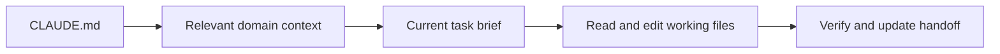
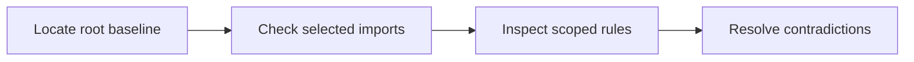

# Claude Code: Cheat Sheet and Reference Guide

**Application:** Claude Code; the native project-based development experience.  
**Platforms:** Windows first; local, WSL, macOS/Linux, terminal, and cloud distinctions are stated where relevant.  
**Documentation verified:** 31 October 2026, from official documentation. Native app/account behavior was not exhaustively runtime-tested.  
**Root baseline:** `CLAUDE.md`, the project's canonical Markdown policy file.  
**Series:** Master-list position 2, completed in the seven-application collection.  
**Audience:** Beginners through advanced users maintaining durable project context.

This standalone manual separates authoring authority, instruction discovery,
session availability, recommended project organization, and observed results.
All project files shown below are instructional examples until you save and
use them in an explicitly selected workspace.

## Contents

1. [Purpose and Capability Overview](#1-purpose-and-capability-overview)
2. [Universal Foundations and Root Markdown SSOT](#2-universal-foundations-and-root-markdown-ssot)
3. [Markdown Essentials and Application Markup](#3-markdown-essentials-and-application-markup)
4. [Workspace Architecture and Directory Hierarchy](#4-workspace-architecture-and-directory-hierarchy)
5. [Instruction Discovery, Loading, Scope, and Precedence](#5-instruction-discovery-loading-scope-and-precedence)
6. [References and Progressive Context Expansion](#6-references-and-progressive-context-expansion)
7. [Configuration, Tools, Skills, and Integrations](#7-configuration-tools-skills-and-integrations)
8. [Practical Workflows](#8-practical-workflows)
9. [Complete Templates and Worked Project](#9-complete-templates-and-worked-project)
10. [Troubleshooting and Limitations](#10-troubleshooting-and-limitations)
11. [Quick-Reference Tables and Checklists](#11-quick-reference-tables-and-checklists)
12. [Sources and Verification Notes](#12-sources-and-verification-notes)

## 1. Purpose and Capability Overview

### 1.1 Universal orientation

A project baseline answers five questions: what are we building, which constraints apply, where is supporting knowledge, what counts as success, and what remains to be done? A useful guide teaches both how to write those answers and how to supply them to the application.

Use three separate checks:

| Check | Question | Observable evidence |
| --- | --- | --- |
| Authoring | Is the authoritative instruction file current? | Its text, revision, and change history |
| Availability | Can this session access that revision? | Supplied text, accepted attachment, or successful file read |
| Application | Did the result follow the relevant instructions? | Output checked against the baseline and acceptance criteria |

Example request after supplying a baseline:

```text
Read the supplied project baseline. Report its revision, the task goal,
and the acceptance criteria you will use. Identify any missing source
before starting the task.
```

Expected result: a short context inventory and a task-specific interpretation. A confident answer alone is not proof that an unavailable file was read.

### 1.2 Claude Code on desktop

This guide concerns **Claude Code**, including the Code experience in the Claude desktop application. It is separate from ordinary Claude conversations and Cowork. Use a selected project and check whether the session runs locally, in WSL, or in the cloud before interpreting a path or command.

| Surface | Role in this manual | Verification |
| --- | --- | --- |
| Desktop Code session | Read, edit, and review project files | Confirm the selected folder and environment |
| Root `CLAUDE.md` | Canonical project instructions | Ask which instructions are present |
| File mentions/attachments | Supply task context | Check the actual file and current revision |
| Diff view | Review changed files | Inspect the resulting diff |
| Integrated terminal | Run project checks | Record command, directory, and result |
| Skills | Reusable procedures | Confirm the named skill loaded |
| Plugins/MCP | External capabilities | Verify the specific tool operation |

The [desktop documentation](https://code.claude.com/docs/en/desktop) describes the project-based Code workflow. Windows, macOS, Linux beta, WSL, local, and cloud capabilities are not interchangeable. This guide prioritizes Windows paths while keeping shell-specific examples labeled.

```text
For the selected Atlas project, report the execution environment and
working directory. Read CLAUDE.md and HANDOFF.md if available. Before
editing, state the task goal, applicable instructions, and missing context.
```

Expected result: concrete file reads and an environment-aware task interpretation. Creating the template folder does not install Claude Code or create a signed-in account.

## 2. Universal Foundations and Root Markdown SSOT

### 2.1 Universal foundation: authority, persistence, and context

The **Single Source of Truth (SSOT)** is the designated authoring location for project policy. Keep the baseline at the project root so people can find it before entering specialized directories. Store purpose, constraints, navigation, and verification requirements there; put detailed domain knowledge in supporting files.

Persistence has two meanings. A file persists because it remains on disk. An instruction persists in the application only when an applicable feature reloads or retains it. Creating a file does not, by itself, establish that any future conversation reads it.

Use one authoritative owner for each kind of information:

| Information | Authoritative location | Maintenance rule |
| --- | --- | --- |
| Project purpose and policy | Root baseline | Edit here before refreshing copies |
| Domain definitions | Relevant context document | Link from the baseline |
| Current task and acceptance criteria | Task brief | Update when the task changes |
| Session progress and next action | Handoff document | Refresh after meaningful work |
| Application instruction text | Supported instruction surface | Keep adapters small; mark copied policy with its source revision |
| Produced report or artifact | Reviewed output location | Reconcile policy changes into the baseline |

A compact baseline excerpt:

```markdown
# Atlas Project Baseline

Revision: atlas-r1

## Purpose
Produce a clear onboarding guide for a fictional documentation project.

## Constraints
- Write in English.
- Use relative Markdown links inside project documents.
- Preserve existing files unless the current task authorizes a change.

## Context map
- Domain: [Documentation rules](context/documentation.md)
- Task: [Onboarding brief](tasks/onboarding.md)
- Progress: [Handoff](HANDOFF.md)

## Verification
Check the requested output against the task acceptance checklist.
```

The links document relationships. Loading those targets requires the application’s actual reference, upload, retrieval, or file-access mechanism.

### 2.2 Universal foundation: progressive expansion

Expand context by relevance:

1. Read the root baseline to establish purpose and policy.
2. Read the domain document that defines the relevant terminology.
3. Read the current task brief and its acceptance criteria.
4. Read only the working files needed for that task.
5. Verify the output and record the next action in the handoff.

Example context request:

```text
Start with the project baseline, then the documentation rules and
onboarding task brief supplied here. List any additional files needed.
Do not assume that a Markdown link made its target available.
```

Treat uploaded copies, instruction-field copies, and generated summaries as **derived snapshots**. Label them with the source revision. After editing the SSOT, refresh affected snapshots and deliberately supply the revised content to the next session.

### 2.3 Application mapping: CLAUDE.md as authoring SSOT

Use root `CLAUDE.md` for this project's policy, with detailed context in explicit supporting files. Keep human-facing setup in `README.md`; avoid maintaining two independent versions of the same project rules.

```text
Atlas/
├── CLAUDE.md
├── context/documentation.md
├── tasks/onboarding.md
├── HANDOFF.md
└── outputs/
```

Recommended update request:

```text
CLAUDE.md is now atlas-r2. Read the saved file and the revised task brief.
Identify what changed before continuing. Use the handoff for progress;
do not treat its earlier policy summary as the current baseline.
```

Expected result: revision-aware continuation. A remembered preference is useful context, not a substitute for an intentionally maintained project source.

### 2.4 Portable policies and native adapters

For a shared multi-assistant repository, choose one policy owner. Current [Claude Code memory documentation](https://code.claude.com/docs/en/memory#agentsmd) also documents conditional `AGENTS.md` support. This guide uses the documented native `CLAUDE.md` baseline to avoid depending on fallback availability.

If a team already authors `AGENTS.md`, review that documentation's active discovery mode rather than duplicating its policy. An intentional Claude-specific adapter may import the canonical shared document:

```markdown
# Claude-specific project adapter

Shared project policy is authored in AGENTS.md.
@AGENTS.md

Keep Claude-specific notes here only when they do not duplicate that policy.
```

This is an alternative architecture, not a second baseline to add to the Atlas example. Confirm which files loaded, especially if a client can load both instruction names.

## 3. Markdown Essentials and Application Markup

### 3.1 Universal Markdown essentials

Use ordinary Markdown as the portable source format. Headings, paragraphs, lists, links, images, block quotes, inline code, and fenced code belong to the CommonMark foundation. Tables, task lists, and strikethrough are GFM extensions; math and Mermaid require additional renderer support. These standards describe document syntax, not a promise about a particular application. See [CommonMark](https://spec.commonmark.org/0.31.2/) and [GFM](https://github.github.com/gfm/).

Copy this complete syntax sample into a Markdown document:

````markdown
# Document title

## Context

Use **bold** for emphasis, *italics* for a term, and `PROJECT.md` for a filename.

- First requirement
- Second requirement

1. Read the baseline.
2. Read the task brief.

> This quotation is reference material; label its source separately.

[Task brief](tasks/onboarding.md)


| Item | Meaning |
| --- | --- |
| Root | Project policy |
| Task | Current acceptance criteria |

- [ ] Read the current revision.
- [x] Identify the requested output.

~~Superseded wording~~

```python
print("Read the baseline before starting.")
```

---

Literal characters: \*asterisk\*, \[bracket\], and a table pipe: \|.
````

Expected result in a compatible viewer: structured text, a code block, and supported extensions. The sample image renders only if that asset exists and the viewer can access it; it is not a companion file supplied by this manual.

| Rule | Copyable example | Practical reason |
| --- | --- | --- |
| One document title | `# Atlas Baseline` | Establishes the document’s subject |
| Logical heading levels | `## Constraints`, then `### Writing` | Keeps navigation and accessibility predictable |
| Blank lines around blocks | Paragraph, blank line, list | Avoids ambiguous block boundaries |
| Language on code fences | Opening fence: three backticks followed by `json` | Helps readers recognize the format |
| Longer outer fence | Four backticks around a sample containing triple backticks | Preserves nested code examples |
| Relative project link | `[Rules](context/documentation.md)` | Keeps project navigation portable |
| URL containing a space | `[Draft](<drafts/first draft.md>)` | Makes the link destination unambiguous |
| Inline backticks inside code | Use two backticks around a span containing one backtick | Shows literal Markdown syntax |
| Standard newline | Write a separate paragraph for a separate idea | Avoids relying on invisible trailing spaces |
| Descriptive image text | `` | Preserves meaning when an image cannot be seen |

Use UTF-8, consistent filenames, and short paragraphs. Relative links resolve from the document containing the link, not automatically from the project root. Anchor generation varies across viewers; check the table of contents where the file will be read.

YAML frontmatter is a separate convention, not a universal instruction loader. This valid example can hold authoring metadata where a consumer supports it:

```yaml
---
title: Atlas Baseline
revision: atlas-r1
status: current
---
```

In a general project document, plain Markdown metadata is often clearer. Reserve required frontmatter schemas for features that document them, such as Skills.

### 3.2 Ordinary links versus native imports

These two forms do different work:

```markdown
[Documentation rules](context/documentation.md)

@context/documentation.md
```

The first is a Markdown hyperlink. The second is native import syntax **inside a Claude Code instruction file**. Imports resolve relative to the containing instruction file and expand context; they are not a general Markdown feature. Keep imports selective and do not import a handoff containing frequently changing or obsolete policy summaries.

Example root fragment:

```markdown
## Shared domain rules
@context/documentation.md

## Current task
Read tasks/onboarding.md explicitly before drafting.
```

Placement: root `CLAUDE.md`. Prerequisite: the domain file exists. Expected result: the imported domain content is available with the baseline; the separate task brief still needs its own read. See [imports](https://code.claude.com/docs/en/memory#import-additional-files).

### 3.3 Desktop file mentions and literal paths

The desktop prompt box supports file mentions. Type `@`, select the actual project file, then explain its role:

```text
Use the selected tasks/onboarding.md as the current task contract.
Read its acceptance checklist before editing outputs/onboarding-guide.md.
```

A typed `@path` in the composer and an `@path` import in `CLAUDE.md` have different contexts. Check the accepted file in the prompt rather than assuming that plain text selected it. Cloud and WSL attachment behavior can differ; use the session's documented file-access surface.

### 3.4 Code, math, diagrams, and references

Preserve portable source when requesting a visual or mathematical explanation:

```text
Explain the context workflow with Mermaid source and an accompanying
plain-language description. Save the source in the output Markdown.
If this surface cannot display a diagram, keep the source readable.
```



The diagram depicts this manual's recommended sequence. Reference-site previews do not prove the same rendering exists in a native chat.

```latex
\text{remaining work} = \text{required checks} - \text{completed checks}
```

Write JSON, YAML, Python, HTML, or SVG in language-labeled fences and save approved source as files. An XML tag in an example is not an internal tool-call instruction.

## 4. Workspace Architecture and Directory Hierarchy

### 4.1 Universal architecture

Keep the root baseline small enough to review. Expand detailed context through ordinary files with explicit responsibilities. Directory layout is an authoring design; it becomes an instruction hierarchy only if the application documents that behavior.

```text
Atlas/
|-- PROJECT.md                  # Authoritative project baseline
|-- HANDOFF.md                  # Reviewed progress and next action
|-- context/
|   `-- documentation.md        # Domain definitions and writing rules
|-- tasks/
|   `-- onboarding.md           # Current task and acceptance criteria
`-- outputs/
    `-- onboarding-guide.md    # Reviewed task output
```

Example relationship: `PROJECT.md` links to `context/documentation.md`; the task brief links back with `../PROJECT.md`. File responsibility is explicit, and duplicate policy is minimized.

### 4.2 Claude Code workspace map

```text
Atlas/
├── CLAUDE.md
├── README.md
├── HANDOFF.md
├── .claude/
│   ├── settings.json               # optional shared settings
│   ├── rules/
│   │   └── outputs.md              # optional path-scoped rule
│   └── skills/
│       └── atlas-context-review/
│           └── SKILL.md
├── context/documentation.md
├── tasks/onboarding.md
├── tools/check_atlas.py
├── outputs/
├── #Old/
└── #Temp/
```

`context`, `tasks`, `outputs`, `HANDOFF.md`, `#Old`, and `#Temp` are project conventions. `.claude` files have native roles described in the relevant sections. A conventional folder name does not make everything inside it automatically available.

Create the conventional directories in an empty example location:

```powershell
$atlasRoot = Join-Path $env:USERPROFILE 'Documents\Atlas-Claude-Code'
New-Item -ItemType Directory -Path $atlasRoot -Force | Out-Null
foreach ($atlasPart in @('context','tasks','outputs','tools','#Old','#Temp')) {
    New-Item -ItemType Directory -Path (Join-Path $atlasRoot $atlasPart) -Force | Out-Null
}
```

Save the complete section 9 templates next. The command creates directories, not a Claude installation or account connection.

### 4.3 Worktrees and environment boundaries

For a separate checkout, verify the actual path and saved instructions before editing. A local instruction change in one checkout is not automatically saved into another. In WSL, Linux paths and executables differ from native Windows ones.

```text
Report the current checkout path and shell. Read the saved CLAUDE.md
from that checkout. If a linked file exists only in another environment,
report the mismatch instead of assuming it was loaded.
```

Expected result: a concrete environment inventory, with no silent path substitution.

## 5. Instruction Discovery, Loading, Scope, and Precedence

### 5.1 Universal loading contract

For every instruction source, record: its owner, scope, loading trigger, revision, and refresh method. Distinguish normative instructions from evidence or quoted source material.

```text
Context inventory:
- Baseline: PROJECT.md, revision atlas-r1, supplied in this conversation.
- Domain: context/documentation.md, revision docs-r1, supplied.
- Task: tasks/onboarding.md, revision task-r1, supplied.
- Handoff: not supplied; do not infer its contents.
```

Project policy operates within platform rules, account/workspace controls, and applicable user instructions. When supplied project documents disagree, identify the competing requirements and request a decision where needed. A filename does not create a new instruction priority.

### 5.2 Discovery, scope, and refresh

Claude Code loads applicable ancestor/current `CLAUDE.md` instructions at startup and discovers descendant instruction files as it works in their areas. Files are combined as context; do not assume a nearer file erases contradictory earlier prose. Save changes, explicitly reread revised files, and start a fresh session when validating startup loading. See [instruction loading](https://code.claude.com/docs/en/memory#how-claudemd-files-load).

| Source | Role | Recommended check |
| --- | --- | --- |
| User `~/.claude/CLAUDE.md` | Personal context | Identify applicable global preferences |
| Root `CLAUDE.md` | Shared policy | Confirm revision and project |
| Descendant `CLAUDE.md` | Local-area context | Inspect it before editing that area |
| `.claude/rules/*.md` | Topic/path rules | Confirm applicability and avoid conflicts |
| `HANDOFF.md` | Progress snapshot | Read explicitly during resumption |

Managed instructions and account policy may constrain the workspace. An instruction file describes desired behavior; it does not grant filesystem or tool permissions.

### 5.3 Complete scoped-rule example

Save `.claude/rules/outputs.md`:

```markdown
---
paths:
  - "outputs/**/*.md"
---

# Atlas output rules
- Follow the current task brief's acceptance criteria.
- Preserve the three ordered onboarding steps.
- Use relative links from each output's actual location.
- Do not claim that a Markdown link automatically loaded its target.
```

Placement: the project's `.claude/rules` folder. Usage: request the onboarding draft under `outputs/`. Expected result: the path-specific rules apply to that area. Keep root purpose and policy in `CLAUDE.md`; use the scoped rule for details that belong only to outputs.

### 5.4 Conflict and discovery audit

```text
Before revising the Atlas output, list relevant CLAUDE.md files, imports,
and path-scoped rules. Identify contradictions between them and the
task brief. Propose a correction in the authoritative source before
silently choosing between incompatible requirements.
```

If the selected Claude Code surface offers instruction/memory inspection, use it to confirm the inventory. CLI commands such as `/memory` are terminal-session inspection tools; do not assume every desktop mode exposes every CLI command.



This diagram is an instruction-audit workflow, not an assertion that prose
files form a strict configuration-precedence system.

## 6. References and Progressive Context Expansion

### 6.1 Universal reference discipline

A useful reference records both location and purpose. Keep the context map specific:

```markdown
## Context map
- [Writing rules](context/documentation.md): terminology and link policy.
- [Task brief](tasks/onboarding.md): output and acceptance criteria.
- [Handoff](HANDOFF.md): verified progress and next action.
```

When context becomes large, supply the baseline and task first, then request relevant supporting files. If the assistant has tools, require successful reads; otherwise paste or attach the required text. Preserve meaningful section headings when supplying excerpts, and label omitted portions explicitly.

### 6.2 Complete progressive-expansion request

```text
Read these saved Atlas files from the selected project:
1. CLAUDE.md
2. context/documentation.md, if not already loaded by the root import
3. tasks/onboarding.md
4. HANDOFF.md

Report revisions, missing context, applicable output rules, and acceptance
criteria. Then perform the authorized task on outputs/onboarding-guide.md.
Verify the result and record evidence plus the next action in HANDOFF.md.
```

Expected result: targeted reads and a bounded output, with the actual current task contract. Avoid importing every possible task brief into the root baseline.

### 6.3 Source inventories and snapshots

```markdown
| Source | State | Role |
| --- | --- | --- |
| CLAUDE.md | atlas-r1, read this session | Project policy |
| context/documentation.md | docs-r1, loaded/read | Domain rules |
| tasks/onboarding.md | task-r1, read now | Acceptance |
| HANDOFF.md | handoff-r1, read now | Resume point |
```

If a source was attached rather than read from disk, label it as an attachment snapshot. After editing the authoring source, refresh the attached copy or explicitly reread the saved revision.

### 6.4 Resume after context loss

```text
Resume from HANDOFF.md. Re-read the root baseline and current task brief.
Identify what has actually been verified and continue from the recorded
next action. Do not infer completed work from an earlier planned checklist.
```

Expected result: a fresh, evidence-based context reconstruction. Auto memory may contain useful preferences, but Atlas's policy and current task remain in their named source files.

## 7. Configuration, Tools, Skills, and Integrations

### 7.1 Universal configuration principles

Instructions describe behavior; configuration enables capabilities; permissions control access. A Markdown sentence does not install a tool or make a write-capable tool read-only.

For each configuration example, identify the consuming feature, file location, prerequisites, substituted values, reload action, and a bounded verification step. Preserve unrelated settings. Keep credentials out of shared Markdown and use the integration’s supported authentication interface.

Example verification request after a tool is connected:

```text
Use the configured project file tool to read only PROJECT.md. Report its
title and revision. Do not modify files or search unrelated folders.
```

### 7.2 Settings are JSON, instructions are Markdown

The [settings documentation](https://code.claude.com/docs/en/settings) distinguishes shared project settings, user settings, local project settings, and managed controls. Merge a needed setting deliberately rather than replacing an existing configuration file with a template.

Minimal optional `.claude/settings.json` example:

```json
{
  "permissions": {
    "deny": ["Read(./.env)"]
  }
}
```

Prerequisites: review the current schema and actual environment; this example is a read-denial configuration shape, not a substitute for secure secret storage. Expected observable result: an attempted tool read of the matching file is denied when the setting applies. Do not create a real secret merely to test an example.

For an existing project, inspect first:

```text
Identify the effective project settings and applicable managed controls.
Do not change them. Explain whether this example belongs in a shared or
local file and how you would verify it in the current environment.
```

### 7.3 Complete skill example

Save `.claude/skills/atlas-context-review/SKILL.md`:

```markdown
---
name: atlas-context-review
description: Review Atlas onboarding documents against their saved baseline and task brief; use for Atlas documentation checks, not unrelated development tasks.
disable-model-invocation: true
---

# Atlas context review
1. Read CLAUDE.md, context/documentation.md, and tasks/onboarding.md.
2. Read outputs/onboarding-guide.md if it exists.
3. Return a criterion/evidence/status table.
4. A review-only request must not change the draft.
5. For an authorized revision, update the output and rerun relevant checks.
6. Report exact files read, actual checks, and remaining judgments.
```

Usage in a Claude Code surface that supports skill commands:

```text
/atlas-context-review
```

The [Skills guide](https://code.claude.com/docs/en/skills) documents the format and invocation controls. In this example, disabling model invocation makes the procedure explicitly selected. If the desktop mode does not offer the command, read the supplied procedure explicitly and label that fallback accurately.

### 7.4 Plugins, tools, and external context

Installation does not establish tool availability, authentication, or successful access to a particular record. Before using a plugin as evidence:

```text
Check the selected documentation connection with one approved read-only
lookup. Report the tool used, requested source, and result. If setup or
authentication is incomplete, identify that stage without claiming success.
```

This manual does not supply an MCP server or account credentials. Use the relevant developer's documented configuration for the actual server. Keep project policy in `CLAUDE.md`, procedural guidance in a skill, and tool configuration in its supported settings surface.

## 8. Practical Workflows

### 8.1 Universal workflow: initialize, expand, verify, resume

Use this sequence for every substantive task:

1. Establish the root baseline and give it a revision.
2. Supply it through the application’s actual loading mechanism.
3. Supply the relevant domain document and current task brief.
4. Confirm the sources and acceptance criteria.
5. Produce the requested output within the authorized scope.
6. Check the result against the task’s observable requirements.
7. Update the handoff and reconcile durable decisions into their authoritative files.

Copyable task-start request:

```text
Read the baseline and task brief supplied here. Summarize the goal,
constraints, required sources, output location, and acceptance criteria.
If everything needed is available, complete the task and report which
checks were actually performed. Record unresolved items separately.
```

### 8.2 Initialize the worked example

1. Create the conventional directories from section 4.
2. Save the baseline, domain, task, initial handoff, and checker from section 9.
3. Select the Atlas folder in Claude Code.
4. Submit the complete section 6.2 request.
5. Verify the reported root revision is `atlas-r1`.

Keep section 9.5's expected output as a reference until the drafting task runs. The initial handoff truthfully says the output has not yet been created and verified.

### 8.3 Execute and verify

```text
Draft outputs/onboarding-guide.md using the saved Atlas baseline, domain,
and task brief. Include exactly three ordered steps with expected results,
the correct relative baseline link, and the final verification checklist.
Run the supplied checker if Python is available, then review all remaining
acceptance items that require judgment. Update HANDOFF.md with evidence.
```

Expected result: a saved draft, a real check result, and a handoff that distinguishes preparation from verification.

### 8.4 Update a requirement

Revise `tasks/onboarding.md` to `task-r2`, adding a required relative link to `../HANDOFF.md`, then ask:

```text
Read task-r2 and identify the new acceptance item. Revise the draft to
meet it, inspect the link from outputs/, and record the updated task
revision and check result in HANDOFF.md.
```

The old structural checker does not automatically learn the new criterion. Inspect it manually or intentionally extend the checker before claiming automated coverage.

### 8.5 Review-only and resume

```text
Review the output against task-r2 without changing files. Return each
criterion, observed evidence, status, and the recommended next action.
```

Start a new conversation and use the section 6.4 resume prompt to demonstrate continuity through files rather than an assumed shared chat context.

## 9. Complete Templates and Worked Project

### 9.1 Root baseline: CLAUDE.md

Save at the Atlas project root:

```markdown
# Atlas Project Instructions

Revision: atlas-r1

## Purpose
Produce a clear onboarding guide for a fictional documentation project.

## Constraints
- Write in English.
- Preserve existing files unless the current task authorizes a change.
- Use relative Markdown links in project documents.
- Do not treat fictional examples as verified external product facts.

## Domain instructions
@context/documentation.md

## Context map
- Task: [Onboarding brief](tasks/onboarding.md)
- Progress: [Handoff](HANDOFF.md)

## Working procedure
Read the current task brief before writing. Inspect applicable output rules.
Keep this file as policy authority; keep progress in HANDOFF.md.

## Verification
Check every acceptance item. Report actual command results separately
from judgment. Update HANDOFF.md with the result and next action.
```

### 9.2 Domain context: `context/documentation.md`

```markdown
# Atlas Documentation Rules

Revision: docs-r1
Applies to: Documentation tasks for Atlas

## Terms
- Baseline: the root CLAUDE.md authoring source.
- Task brief: the document defining one output and its acceptance criteria.
- Handoff: the reviewed record of progress and next action.

## Writing rules
- Start each document with one H1 title.
- Use an ordered list for sequential onboarding steps.
- Explain what the reader should observe after each action.
- Use a task checklist for verification.

## Link rules
Resolve relative links from the document containing the link.
An output under outputs/ links to the baseline as ../CLAUDE.md.
Do not add links to files that do not exist in the example workspace.

## Boundaries
This fictional task needs no package installation or external service.
```

### 9.3 Task brief: `tasks/onboarding.md`

```markdown
# Atlas Onboarding Task

Revision: task-r1
Baseline: atlas-r1
Domain: docs-r1

## Goal
Write a short guide that teaches a contributor to load and verify context.

## Output
outputs/onboarding-guide.md

## Required sources
- [Project baseline](../CLAUDE.md)
- [Documentation rules](../context/documentation.md)

## Required content
Exactly three ordered steps:
1. Read the project baseline.
2. Supply the domain rules and this task brief to the assistant.
3. Check the resulting draft against the acceptance checklist.

## Acceptance criteria
- [ ] The document has one H1 title.
- [ ] The document is written in English.
- [ ] There are exactly three ordered onboarding steps.
- [ ] Each step includes an observable result.
- [ ] The baseline link resolves from outputs/.
- [ ] A final verification checklist is present.
- [ ] The guide does not claim automatic Markdown-link loading.
- [ ] No package installation or external service is required.
```

### 9.4 Handoff: `HANDOFF.md`

This is the truthful initial state before the worked task has run:

```markdown
# Atlas Handoff

Revision: handoff-r1
Baseline: atlas-r1
Task: tasks/onboarding.md, task-r1

## Completed
- The baseline, domain document, and task brief are prepared.

## Verified
- No application-side file access or generated output has been tested yet.

## Remaining
- Supply or read the three source documents.
- Create and inspect outputs/onboarding-guide.md.
- Check each task acceptance item.

## Open issues
None recorded. Report access failures if they occur.

## Next action
Read the three source documents and draft the onboarding guide.
```

After actual completion, revise it with the specific output, performed checks, unresolved issues, and next action. Do not copy a “verified” claim from an example unless you performed the check.

### 9.5 Expected output: `outputs/onboarding-guide.md`

This complete example satisfies the fictional task’s content requirements. It is illustrative expected output, not a claim that Claude Code generated it during this guide’s preparation.

```markdown
# Atlas Contributor Onboarding

1. Read the [project baseline](../CLAUDE.md) and supply it to your assistant.
   Paste its full text, attach it, or request an authorized file read.
   Confirm its revision is atlas-r1 and identify its constraints.
   Expected result: you can state the project purpose and output policy.

2. Supply the [documentation rules](../context/documentation.md) and
   [task brief](../tasks/onboarding.md) to your assistant.
   Attach accepted files, paste their text, or request authorized file reads.
   Expected result: the assistant identifies docs-r1 and task-r1 and names
   any missing source. Markdown links alone do not load these files.

3. Check the draft against the task acceptance criteria.
   Inspect the three steps, expected results, links, and final checklist.
   Expected result: each criterion has a recorded pass or a specific issue.

## Verification checklist
- [ ] Baseline and source revisions match the supplied documents.
- [ ] There are exactly three ordered steps with expected results.
- [ ] Relative links point to the intended files.
- [ ] Every task acceptance criterion has been checked.
```


### 9.6 Complete structural checker: tools/check_atlas.py

Prerequisite: Python 3.9 or newer in the example environment. Save this
complete script and run it from the project root after drafting. It reads
local files only and makes no changes.

```python
from pathlib import Path
import re
import sys

root = Path(__file__).resolve().parent.parent
baseline = "CLAUDE.md"
required = [baseline, "context/documentation.md", "tasks/onboarding.md", "HANDOFF.md"]
errors = ["Missing: " + name for name in required if not (root / name).is_file()]
output = root / "outputs/onboarding-guide.md"
if not output.is_file():
    errors.append("Missing: outputs/onboarding-guide.md")
else:
    text = output.read_text(encoding="utf-8")
    if len(re.findall(r"^# [^#].+", text, re.M)) != 1:
        errors.append("Expected exactly one H1 title")
    if re.findall(r"^(\d+)\. ", text, re.M) != ["1", "2", "3"]:
        errors.append("Expected exactly three ordered steps")
    if text.count("Expected result:") < 3:
        errors.append("Each step needs an expected result")
    if "../" + baseline not in text:
        errors.append("Missing relative link to the project baseline")
    if "## Verification checklist" not in text:
        errors.append("Missing final verification checklist")
if errors:
    print("FAIL\n" + "\n".join(errors))
    sys.exit(1)
print("PASS: required files and structural onboarding criteria are present.")
```

```powershell
python .\tools\check_atlas.py
```

Expected initial failure: the output has not been created yet. Expected
success after drafting: `PASS` and exit code 0. The checker does not prove
English prose quality, the truth of a product claim, or every possible
future acceptance item. Review those criteria separately.


### 9.7 Worked project sequence

| Stage | Action | Expected evidence |
| --- | --- | --- |
| Initialize | Save 9.1–9.4 and the checker | Named sources exist with current revisions |
| Expand | Submit section 6.2 | Relevant sources and output rules reported |
| Execute | Request the draft | Authorized output appears |
| Verify | Run checker and read acceptance list | Exit status plus judgment-based review |
| Hand off | Update HANDOFF.md | Actual result and next action |
| Resume | Re-read saved files in a new session | Context rebuilt from current disk state |

Recommended completion record, only after the checks have actually run:

```markdown
Revision: handoff-r2
Baseline: atlas-r1
Task: task-r1
Changed: outputs/onboarding-guide.md
Verified: supplied structural checker passed; remaining task items reviewed.
Remaining: owner review of wording.
Next action: obtain owner feedback before marking the draft approved.
```

## 10. Troubleshooting and Limitations

### 10.1 Universal troubleshooting method

Check failures in this order: source correctness, access, loading, interpretation, output, and verification. Record the failing step before changing settings.

```text
Diagnose this context problem. State which source was expected,
what access mechanism was used, what evidence confirms a read,
and the smallest correction needed. Do not invent missing content.
```

### 10.2 Claude Code troubleshooting table

| Symptom | Inspect | Next action |
| --- | --- | --- |
| Baseline missing from behavior | Selected project, saved file, instruction inventory | Read it explicitly and validate startup loading in a fresh session |
| Import target missing | Path relative to containing instruction file | Correct that path and reread |
| Context grows unexpectedly | Imported documents and broad rules | Keep imports selective; move task-specific facts out of the root |
| Scoped rule not applied | YAML validity and path pattern | Match the actual output path and inspect applicability |
| Contradictory instructions | Root, descendants, imports, task brief | Correct the authoritative source rather than relying on last-read prose |
| Skill unavailable | Location, frontmatter, invocation surface | Confirm discovery or explicitly supply the procedure |
| Tool lookup not performed | Setup, connection, authentication, runtime tools | Report the missing stage |
| WSL/native path confusion | Execution environment and real working directory | Use matching paths and executables |

### 10.3 Limits and unsupported assumptions

Do not transfer ordinary Claude Chat, Cowork, or Codex instruction discovery to Claude Code. Do not assume that a CLI command is a desktop menu item. Do not treat a rendered source document as executed code or a plugin installation as account authorization.

```text
The saved Atlas sources were read and the local checker passed. No
external service or native account feature was tested. The diagram is
a reference preview, and the source remains in the Markdown output.
```

That is an example of a bounded evidence statement, not a claim about work already performed in your environment.

## 11. Quick-Reference Tables and Checklists

### 11.1 File and markup reference

| Mechanism | Meaning | Example |
| --- | --- | --- |
| `CLAUDE.md` | Root project instructions | `Atlas/CLAUDE.md` |
| Native import in instruction file | Expand additional instruction content | `@context/documentation.md` |
| Markdown link | Human/document navigation | `[Task](tasks/onboarding.md)` |
| Composer file mention | Select project context | Type `@` and select the actual file |
| Path-scoped rule | Conditional project guidance | `.claude/rules/outputs.md` with `paths` |
| Skill | Reusable procedure | `.claude/skills/atlas-context-review/SKILL.md` |
| JSON settings | Runtime configuration | `.claude/settings.json` |
| `HANDOFF.md` | Recommended progress snapshot | Explicitly read on resume |

### 11.2 Task-start checklist

- [ ] Select the intended project and environment.
- [ ] Confirm the real working directory.
- [ ] Verify the root revision and applicable imported/scoped instructions.
- [ ] Read the current task brief and handoff.
- [ ] Name the output and acceptance criteria.
- [ ] Identify unavailable context or tools explicitly.

### 11.3 Completion checklist

- [ ] Inspect actual changed files and their diff.
- [ ] Run relevant available checks and record results.
- [ ] Review acceptance items requiring judgment.
- [ ] Refresh derived copies after editing the SSOT.
- [ ] Record the next action in HANDOFF.md.
- [ ] Keep installation, account access, and successful use distinct.

### 11.4 Reusable prompt

```text
Read CLAUDE.md, relevant domain rules, the current task brief, and
HANDOFF.md. Confirm revisions, scope, and applicable rules. Perform the
authorized task, verify every acceptance item, inspect the resulting
diff, and update the handoff with evidence and the next action.
```

## 12. Sources and Verification Notes

### 12.1 Sources and identity corrections

This guide covers master-list position 2, Claude Code on desktop, added to the seven-application collection at the user's request. It does not describe every Claude Desktop conversation as a Claude Code session.

| Official source | Evidence used |
| --- | --- |
| [Desktop application](https://code.claude.com/docs/en/desktop) | Code session workflow and file-context surface |
| [Instruction memory](https://code.claude.com/docs/en/memory) | Native instruction files, imports, scoped rules, current AGENTS.md alternatives |
| [Skills](https://code.claude.com/docs/en/skills) | Skill format, project location, explicit invocation controls |
| [Settings](https://code.claude.com/docs/en/settings) | Project/user/local settings and effective scope |

The source comparison's internal renderer names, stream tags, and wire payloads are not actionable user syntax. This manual teaches ordinary Markdown, documented project conventions, and explicit file-access verification instead.

### 12.2 Verification notes

Official documentation was reviewed on 31 October 2026. Web-page rendering, source-download integrity, and packaging are validated separately in the collection report. No reading or template-generation step installs Claude Code, signs into an account, starts an external service, or establishes that all native features were runtime-tested.

The Atlas task, checker, and source files are instructional examples. The checker validates a limited structural subset; prose quality and product behavior require separate review.

### 12.3 SSOT and template maintenance

An editable guide project's `content/guide.md` is the guide-text authoring source. An Atlas Claude Code workspace's root `CLAUDE.md` is the project-policy source. Rebuild the HTML after changing guide text. Refresh a diagram preview after changing its Mermaid source; the builder checks snapshot hashes and shows source rather than presenting a stale preview as current.

