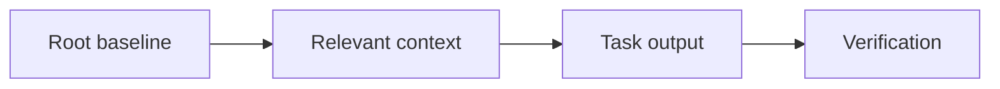
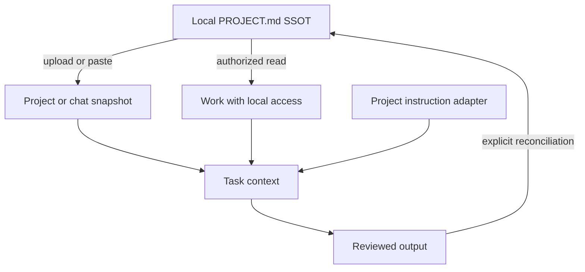

# ChatGPT Desktop: Cheat Sheet and Reference Guide

**Application:** ChatGPT Desktop, covering Chat, Projects, and ChatGPT Work.  
**Platforms:** Windows first; macOS/Linux distinctions noted where documented.  
**Documentation verified:** 27 October 2026. Account entitlements and installed-app behavior were not runtime-tested.  
**Root baseline:** `PROJECT.md`, explicitly supplied or read through authorized access.  
**Series:** Master-list position 3; ChatGPT precedes the Codex Desktop guide, now included at master-list position 4.  
**Audience:** Beginners through advanced users maintaining durable project context.

This manual explains portable Markdown, persistent project instructions, selective context expansion, reusable Skills, and connected tools. It distinguishes an authoritative local file from uploaded snapshots, memory, previews, and files produced in a cloud environment.

## Contents

1. [Purpose and Capability Overview](#1-purpose-and-capability-overview)
2. [Universal Foundations and Root Markdown SSOT](#2-universal-foundations-and-root-markdown-ssot)
3. [Markdown Essentials and Application Markup](#3-markdown-essentials-and-application-markup)
4. [Workspace Architecture and Directory Hierarchy](#4-workspace-architecture-and-directory-hierarchy)
5. [Instruction Discovery, Loading, Scope, and Precedence](#5-instruction-discovery-loading-scope-and-precedence)
6. [References and Progressive Context Expansion](#6-references-and-progressive-context-expansion)
7. [Configuration, Tools, Skills, and Integrations](#7-configuration-tools-skills-and-integrations)
8. [Practical Workflows](#8-practical-workflows)
9. [Complete Templates and Worked Project](#9-complete-templates-and-worked-project)
10. [Troubleshooting and Limitations](#10-troubleshooting-and-limitations)
11. [Quick-Reference Tables and Checklists](#11-quick-reference-tables-and-checklists)
12. [Sources and Verification Notes](#12-sources-and-verification-notes)

## 1. Purpose and Capability Overview

### 1.1 Universal orientation

A project baseline answers five questions: what are we building, which constraints apply, where is supporting knowledge, what counts as success, and what remains to be done? A useful guide teaches both how to write those answers and how to supply them to the application.

Use three separate checks:

| Check | Question | Observable evidence |
| --- | --- | --- |
| Authoring | Is the authoritative instruction file current? | Its text, revision, and change history |
| Availability | Can this session access that revision? | Supplied text, accepted attachment, or successful file read |
| Application | Did the result follow the relevant instructions? | Output checked against the baseline and acceptance criteria |

Example request after supplying a baseline:

```text
Read the supplied project baseline. Report its revision, the task goal,
and the acceptance criteria you will use. Identify any missing source
before starting the task.
```

Expected result: a short context inventory and a task-specific interpretation. A confident answer alone is not proof that an unavailable file was read.

### 1.2 ChatGPT Desktop capability snapshot

| Surface or feature | Intended use | Root-baseline implication |
| --- | --- | --- |
| Chat | Questions, explanations, brainstorming, short drafts | Supply the necessary baseline and task text |
| ChatGPT Work | Multi-step tasks with reviewable outputs | Name the sources, output, checks, and execution location |
| ChatGPT Project | Shared instructions, uploaded sources, related chats | Maintain current derived baseline copies |
| Local project | Attached folders on a computer | Request actual reads from the intended folder |
| Skills | Reusable procedures with `SKILL.md` | Keep project policy in the root; load the procedure when needed |
| Plugins | Distributed Skills and connected tools | Installation, account connection, and runtime availability are separate |
| Memories | Selected useful context from prior work | Check against current source documents |
| File previews and annotations | Review generated content and request targeted edits | Save approved Markdown to its authoritative location |
| Visualize | Interactive explanations where enabled | Preserve portable diagram source separately |
| Codex selection | Developer-oriented interface and workflows | Its native instruction discovery is documented separately |

The current [quickstart](https://learn.chatgpt.com/docs/quickstart) describes selecting **ChatGPT**, then **Chat** or **Work** above the composer. Codex is a separate selection. The [Windows guide](https://learn.chatgpt.com/docs/windows/windows-app) documents Windows-native operation; the quickstart also lists macOS and Linux. Platform availability does not imply identical features.

**Why `PROJECT.md`?** Reviewed Chat/Work documentation does not establish a universally auto-discovered root instruction filename. `PROJECT.md` is this guide’s authoring convention. The [AGENTS.md discovery page](https://learn.chatgpt.com/docs/agent-configuration/agents-md) explicitly describes Codex. Do not transfer those discovery and precedence rules to every Chat or Work conversation.

If an existing workspace already designates another root Markdown file as its SSOT, explicitly load that file rather than creating a competing baseline. The workflows remain the same: identify authority, supply current content, expand selectively, and verify the result.

## 2. Universal Foundations and Root Markdown SSOT

### 2.1 Universal foundation: authority, persistence, and context

The **Single Source of Truth (SSOT)** is the designated authoring location for project policy. Keep the baseline at the project root so people can find it before entering specialized directories. Store purpose, constraints, navigation, and verification requirements there; put detailed domain knowledge in supporting files.

Persistence has two meanings. A file persists because it remains on disk. An instruction persists in the application only when an applicable feature reloads or retains it. Creating a file does not, by itself, establish that any future conversation reads it.

Use one authoritative owner for each kind of information:

| Information | Authoritative location | Maintenance rule |
| --- | --- | --- |
| Project purpose and policy | Root baseline | Edit here before refreshing copies |
| Domain definitions | Relevant context document | Link from the baseline |
| Current task and acceptance criteria | Task brief | Update when the task changes |
| Session progress and next action | Handoff document | Refresh after meaningful work |
| Application instruction text | Supported instruction surface | Keep adapters small; mark copied policy with its source revision |
| Produced report or artifact | Reviewed output location | Reconcile policy changes into the baseline |

A compact baseline excerpt:

```markdown
# Atlas Project Baseline

Revision: atlas-r1

## Purpose
Produce a clear onboarding guide for a fictional documentation project.

## Constraints
- Write in English.
- Use relative Markdown links inside project documents.
- Preserve existing files unless the current task authorizes a change.

## Context map
- Domain: [Documentation rules](context/documentation.md)
- Task: [Onboarding brief](tasks/onboarding.md)
- Progress: [Handoff](HANDOFF.md)

## Verification
Check the requested output against the task acceptance checklist.
```

The links document relationships. Loading those targets requires the application’s actual reference, upload, retrieval, or file-access mechanism.

### 2.2 Universal foundation: progressive expansion

Expand context by relevance:

1. Read the root baseline to establish purpose and policy.
2. Read the domain document that defines the relevant terminology.
3. Read the current task brief and its acceptance criteria.
4. Read only the working files needed for that task.
5. Verify the output and record the next action in the handoff.

Example context request:

```text
Start with the project baseline, then the documentation rules and
onboarding task brief supplied here. List any additional files needed.
Do not assume that a Markdown link made its target available.
```

Treat uploaded copies, instruction-field copies, and generated summaries as **derived snapshots**. Label them with the source revision. After editing the SSOT, refresh affected snapshots and deliberately supply the revised content to the next session.

### 2.3 Application mapping: ChatGPT Desktop

For Chat and cloud Projects, supply the baseline as accepted file/text context. Keep Project instructions focused on how to use that baseline. For Work with local access, request a read of the root file from the selected folder.

A ChatGPT Project shares uploaded files, instructions, and connected sources across its chats. A local project attaches folders. These are different access arrangements: naming a Project does not grant disk access, and a synced chat does not copy its entire local folder. See [Projects and chats](https://learn.chatgpt.com/docs/projects).

An uploaded root file is a snapshot. A successful local read obtains the contents available at that moment. Neither arrangement automatically establishes that every linked document is present in the model’s current context.

## 3. Markdown Essentials and Application Markup

### 3.1 Universal Markdown essentials

Use ordinary Markdown as the portable source format. Headings, paragraphs, lists, links, images, block quotes, inline code, and fenced code belong to the CommonMark foundation. Tables, task lists, and strikethrough are GFM extensions; math and Mermaid require additional renderer support. These standards describe document syntax, not a promise about a particular application. See [CommonMark](https://spec.commonmark.org/0.31.2/) and [GFM](https://github.github.com/gfm/).

Copy this complete syntax sample into a Markdown document:

````markdown
# Document title

## Context

Use **bold** for emphasis, *italics* for a term, and `PROJECT.md` for a filename.

- First requirement
- Second requirement

1. Read the baseline.
2. Read the task brief.

> This quotation is reference material; label its source separately.

[Task brief](tasks/onboarding.md)


| Item | Meaning |
| --- | --- |
| Root | Project policy |
| Task | Current acceptance criteria |

- [ ] Read the current revision.
- [x] Identify the requested output.

~~Superseded wording~~

```python
print("Read the baseline before starting.")
```

---

Literal characters: \*asterisk\*, \[bracket\], and a table pipe: \|.
````

Expected result in a compatible viewer: structured text, a code block, and supported extensions. The sample image renders only if that asset exists and the viewer can access it; it is not a companion file supplied by this manual.

| Rule | Copyable example | Practical reason |
| --- | --- | --- |
| One document title | `# Atlas Baseline` | Establishes the document’s subject |
| Logical heading levels | `## Constraints`, then `### Writing` | Keeps navigation and accessibility predictable |
| Blank lines around blocks | Paragraph, blank line, list | Avoids ambiguous block boundaries |
| Language on code fences | Opening fence: three backticks followed by `json` | Helps readers recognize the format |
| Longer outer fence | Four backticks around a sample containing triple backticks | Preserves nested code examples |
| Relative project link | `[Rules](context/documentation.md)` | Keeps project navigation portable |
| URL containing a space | `[Draft](<drafts/first draft.md>)` | Makes the link destination unambiguous |
| Inline backticks inside code | Use two backticks around a span containing one backtick | Shows literal Markdown syntax |
| Standard newline | Write a separate paragraph for a separate idea | Avoids relying on invisible trailing spaces |
| Descriptive image text | `` | Preserves meaning when an image cannot be seen |

Use UTF-8, consistent filenames, and short paragraphs. Relative links resolve from the document containing the link, not automatically from the project root. Anchor generation varies across viewers; check the table of contents where the file will be read.

YAML frontmatter is a separate convention, not a universal instruction loader. This valid example can hold authoring metadata where a consumer supports it:

```yaml
---
title: Atlas Baseline
revision: atlas-r1
status: current
---
```

In a general project document, plain Markdown metadata is often clearer. Reserve required frontmatter schemas for features that document them, such as Skills.

### 3.2 ChatGPT output and prompt structure

Use Markdown to state purpose, constraints, sources, and acceptance criteria. This is ordinary prompt text, not a special configuration grammar:

```text
## Goal
Draft a three-step onboarding guide for a new contributor.

## Sources
Use the supplied PROJECT.md, documentation rules, and task brief.
Report their revisions and identify missing sources.

## Output
UTF-8 Markdown with one H1 title, three ordered steps, and a checklist.

## Verification
Check every task acceptance criterion. Distinguish actual file operations
from content that I must save myself.
```

Expected result: a draft governed by supplied context, with a clear statement of what was checked. OpenAI’s [prompting guide](https://learn.chatgpt.com/docs/prompting) recommends specifying the result, sources, audience, and review criteria.

For literal source output:

```text
Return Markdown source in a fenced block labeled markdown. Preserve
relative links and fenced code examples. If the content itself contains
triple-backtick fences, use four backticks for the enclosing block.
```

A code fence labels content; it does not execute a command or write a named file. A heading such as `## Instructions` helps readers organize text but does not create a new platform instruction priority.

### 3.3 Mathematics: preserve source and test rendering

The reviewed product documentation does not establish one Desktop-wide math delimiter, renderer, or clipboard serialization contract. Use this capability test:

```text
Show these examples and preserve their exact source:

Inline dollars: $E = mc^2$
Display dollars:
$$
E = mc^2
$$

Inline backslashes: \(E = mc^2\)
Display backslashes:
\[
E = mc^2
\]

Plain-text fallback: E = m * c^2.
I will check rendering in this view and in my destination editor.
```

Expected result: notation samples plus readable fallback text. Check the actual view yourself. Bare `[...]` is ordinary bracketed text, not `\[...\]`. Do not confuse mathematical source with shell variables such as `$PATH`; protect literal examples with code formatting.

When exporting, inspect both appearance and source. An equation that looks correct in chat can still need delimiter adjustment in another Markdown editor.

### 3.4 Mermaid, Visualize, SVG, and HTML

Keep a portable Mermaid source block even when the chat does not render it:



The diagram describes actions to perform; arrows do not mean automatic imports. A plain-text equivalent is `baseline -> relevant context -> task output -> verification`.

For a rendered interactive explanation, type `@`, enter **Visualize**, and select the matching suggestion under Plugins when available. The documented Desktop preview is rolling out; the suggestion is the practical availability check. See [Visualizations](https://learn.chatgpt.com/docs/visualizations).

```text
@Visualize Show how a root Markdown baseline supplies project policy,
while a task brief supplies acceptance criteria. Let me select upload,
paste, or local read as the context-loading method. Explain each route.
Also return a portable Mermaid source block and a text description.
```

Select the actual suggestion; merely typing a name does not prove the capability is enabled. If unavailable, keep the Mermaid source or use a supported file-generation workflow. Do not assume a `mermaid` fence always opens a particular panel.

Complete SVG source for an optional `context-flow.svg`:

```svg
<svg xmlns="http://www.w3.org/2000/svg" viewBox="0 0 360 80" role="img" aria-labelledby="title desc">
  <title id="title">Baseline to task</title>
  <desc id="desc">The root baseline supplies policy to the task.</desc>
  <rect x="10" y="20" width="125" height="40" fill="#e8eef7" stroke="#243b53"/>
  <text x="72" y="45" text-anchor="middle" fill="#102a43">Baseline</text>
  <path d="M135 40 H215 M205 32 L215 40 L205 48" fill="none" stroke="#243b53"/>
  <rect x="215" y="20" width="125" height="40" fill="#e8eef7" stroke="#243b53"/>
  <text x="277" y="45" text-anchor="middle" fill="#102a43">Task</text>
</svg>
```

For an optional standalone HTML preview:

```html
<!doctype html>
<html lang="en">
<meta charset="utf-8">
<title>Atlas context</title>
<main><h1>Atlas context</h1><p>Read the baseline before starting the task.</p></main>
</html>
```

Source text is not a promise of raw-HTML execution. Current documentation describes conditional HTML previews and file annotation in the Desktop viewer. See [Work with files](https://learn.chatgpt.com/docs/artifacts-viewer).

### 3.5 Citations, internal markers, and Canvas

Use ordinary Markdown links for portable attribution:

```markdown
The current project workflow is described in
[Projects and chats](https://learn.chatgpt.com/docs/projects).
```

For evidence from supplied files, request named sections:

```text
For each requirement, name its source file and heading. For web claims,
include a direct source link. Flag unsupported claims instead of inventing
citations or quoting a file you could not access.
```

Native citation pills and internal-looking citation/stream tokens are not portable authoring syntax. API event names, private tool wrappers, and invented `canvas.update` payloads do not create Desktop panels or grant access.

The master source mentions Canvas. The current reviewed Desktop documentation establishes file previews, annotations, and generated deliverables; it does not establish one universal Canvas menu, Mermaid wrapper, or Markdown-export procedure across builds. Use the actual controls available, preserve source, and use the file workflow in Section 7.6. A feature named Canvas elsewhere is not evidence of the same Desktop behavior.

## 4. Workspace Architecture and Directory Hierarchy

### 4.1 Universal architecture

Keep the root baseline small enough to review. Expand detailed context through ordinary files with explicit responsibilities. Directory layout is an authoring design; it becomes an instruction hierarchy only if the application documents that behavior.

```text
Atlas/
|-- PROJECT.md                  # Authoritative project baseline
|-- HANDOFF.md                  # Reviewed progress and next action
|-- context/
|   `-- documentation.md        # Domain definitions and writing rules
|-- tasks/
|   `-- onboarding.md           # Current task and acceptance criteria
`-- outputs/
    `-- onboarding-guide.md    # Reviewed task output
```

Example relationship: `PROJECT.md` links to `context/documentation.md`; the task brief links back with `../PROJECT.md`. File responsibility is explicit, and duplicate policy is minimized.

### 4.2 ChatGPT Desktop: authority and access routes



Use `C:\AI-Workspaces\Atlas` for the Windows worked example. On macOS, substitute `/Users/yourname/AI-Workspaces/Atlas`; on Linux, an intended folder such as `/home/yourname/AI-Workspaces/Atlas`. Replace `yourname`; none of these are mandatory installation locations.

Keep policy in `PROJECT.md`, definitions in `context/`, task details in `tasks/`, progress in `HANDOFF.md`, and reviewed results in `outputs/`. A local project may have several attached folders; confirm which one is primary and where each relative path resolves before asking for edits.

## 5. Instruction Discovery, Loading, Scope, and Precedence

### 5.1 Universal loading contract

For every instruction source, record: its owner, scope, loading trigger, revision, and refresh method. Distinguish normative instructions from evidence or quoted source material.

```text
Context inventory:
- Baseline: PROJECT.md, revision atlas-r1, supplied in this conversation.
- Domain: context/documentation.md, revision docs-r1, supplied.
- Task: tasks/onboarding.md, revision task-r1, supplied.
- Handoff: not supplied; do not infer its contents.
```

Project policy operates within platform rules, account/workspace controls, and applicable user instructions. When supplied project documents disagree, identify the competing requirements and request a decision where needed. A filename does not create a new instruction priority.

### 5.2 ChatGPT instruction surfaces

| Surface | Documented role | Recommended practice |
| --- | --- | --- |
| Personal / Custom Instructions | Preferences across applicable chats | Keep general preferences separate from project policy |
| Project instructions | Shared instructions for that Project’s chats | Use a concise baseline-loading adapter |
| Project Sources | Uploaded files and connected context | Label revisions and refresh changed copies |
| Current message | The task and supplied text | State outcome, sources, and acceptance criteria |
| Local folder access | Files available through the chosen environment | Request successful reads of relevant paths |
| Skill | A reusable procedure loaded when selected | Confirm availability and use its supported invocation |
| Memory | Useful recalled context | Check against the current baseline |
| Plugin / MCP tool result | Retrieved evidence or tool output | Confirm actual tool execution and source identity |

These roles are documented in [Projects](https://learn.chatgpt.com/docs/projects), [Personalize ChatGPT](https://learn.chatgpt.com/docs/personalize), and [Build skills](https://learn.chatgpt.com/docs/build-skills). They do not establish a total precedence ranking among every possible instruction surface.

Use **Settings > Personalization** where Custom Instructions are offered. Desktop settings can expose machine-specific instruction editing; documentation for Codex assigns personal instructions to global `AGENTS.md`. Do not assume that editing a machine’s agent guidance changes all hosted ChatGPT conversations. See [Settings](https://learn.chatgpt.com/docs/reference/settings).

For a selected Project, use its available instruction editor in its settings/menu. Exact labels vary; if the control is absent or inaccessible, put the adapter at the start of the chat and supply the baseline directly.

### 5.3 A complete baseline-loading adapter

Copy this into the applicable Project instruction field, or send it as the opening task instruction:

```text
Use the current PROJECT.md as this project's authoring source.
Read the copy supplied in this chat or read the root file through the
authorized local project. Report its revision and the files actually read.
Read the relevant domain document and current task brief explicitly.
If a linked source is unavailable, name it and request its contents.
Flag contradictions between current sources, older uploads, and memory.
Keep project policy changes separate for review. Do not silently rewrite
the baseline or claim that a link automatically loaded its target.
```

This is an authoring convention. It does not install a watcher, change permissions, create a tool, or establish automatic filename discovery.

### 5.4 Load through Chat or Project Sources

1. Select the intended ChatGPT Project or start a self-contained chat.
2. Choose **Chat** for a short draft or **Work** for a multi-step deliverable.
3. Add the adapter and supply the baseline using the attachment/source controls.
4. If the picker rejects `.md`, paste the complete text. A labeled TXT transfer copy is another option; keep local Markdown authoritative.
5. Supply the domain document and task brief by the same mechanism.
6. Ask for source revisions, missing inputs, and acceptance criteria before drafting.

The reviewed documentation establishes file/source attachment, but not every picker’s extension list or an automatic refresh contract. The paste workflow works without relying on either claim.

Minimal paste-format demonstration, separate from the full Atlas project:

````text
The following is the complete demonstration PROJECT.md, revision paste-demo-r1.
Use it as the baseline for this demonstration only.

```markdown
# Paste-Format Demonstration
Revision: paste-demo-r1
Purpose: Create an English onboarding guide.
Constraints: Use relative links and preserve unrelated files.
Acceptance: Include three ordered steps and a verification checklist.
```

Report the revision and acceptance criteria, then draft the guide.
````

For the worked project, paste the full Section 9.1 baseline rather than this miniature.

### 5.5 Load through Work with local access

Use a local project when the task needs files on your computer. The [Projects guide](https://learn.chatgpt.com/docs/projects) documents **Edit project > Add folder** and **Make primary** for attached folders. Choose the intended execution/local-access option offered for the task, then request:

```text
Read C:\AI-Workspaces\Atlas\PROJECT.md from the authorized local project,
then context/documentation.md and tasks/onboarding.md in that folder.
Report their revisions and any access failure. Read only at this stage;
do not modify files or substitute remembered text.
```

Expected result: actual read activity and identifiable current content. A printed path or a confident summary does not prove a read.

Eligible Work Cloud tasks can use approved local computer access where enabled. That computer must be available for local resources; chat synchronization alone does not upload every file or move every tool. Existing tasks do not necessarily gain a newly enabled mode. See [Get started with Work](https://learn.chatgpt.com/docs/get-started-with-work) and [local computer access](https://learn.chatgpt.com/docs/enterprise/cloud-local-access).

### 5.6 Refresh and reconcile

After editing the baseline, increase its revision, replace obsolete source copies, refresh any full instruction-field copies, and explicitly resupply changed content. Restarting Desktop is not a documented upload-refresh mechanism.

```text
Use the supplied atlas-r2 baseline and revised task brief. The previous
atlas-r1 snapshot is superseded. Confirm that the task's Baseline field
matches atlas-r2, identify conflicts, and revise only the requested output.
```

If current project policy and older remembered context disagree, show both sources and resolve the conflict before applying an uncertain requirement. Do not invent a native hierarchy for nested `PROJECT.md` files.

## 6. References and Progressive Context Expansion

### 6.1 Universal reference discipline

A useful reference records both location and purpose. Keep the context map specific:

```markdown
## Context map
- [Writing rules](context/documentation.md): terminology and link policy.
- [Task brief](tasks/onboarding.md): output and acceptance criteria.
- [Handoff](HANDOFF.md): verified progress and next action.
```

When context becomes large, supply the baseline and task first, then request relevant supporting files. If the assistant has tools, require successful reads; otherwise paste or attach the required text. Preserve meaningful section headings when supplying excerpts, and label omitted portions explicitly.

### 6.2 Reference mechanisms and their limits

| Mechanism | Copyable example | Meaning |
| --- | --- | --- |
| Markdown link | `[Rules](context/documentation.md)` | Navigation relationship, not automatic ingestion |
| Supplied text | `Source: documentation.md; revision: docs-r1` followed by content | That text is available in this conversation |
| Project Source | Add the current baseline through the Project’s source controls | A Project-accessible source, with access/retrieval behavior to verify |
| Local file read | Ask Work to read the intended absolute path | Current file contents only if access succeeds |
| Plugin selection | Type `@`, select the installed document plugin | An explicit choice of available capability |
| Skill selection | Type `@`, select the desired Skill | Request the available reusable procedure |
| Memory | Recalled preferences or prior work | Supplementary context, not a versioned file copy |

An `@` picker selection is application syntax for a recognized item. Arbitrary text such as `@context/documentation.md` is not proof of a file-import mechanism. Likewise, `[[note]]`, `file://...`, and a local path do not themselves grant access. Use a documented picker selection, accepted attachment, supplied text, or successful file read.

### 6.3 Expand context for a concrete task

After supplying the Section 9 documents:

```text
Read the current PROJECT.md, context/documentation.md, and
tasks/onboarding.md supplied here or available through the authorized
Atlas folder. Report each revision and verify the task's baseline reference.

Return a source inventory: file, revision, relevant headings, missing inputs.
If all required sources are available, create the onboarding guide against
the task acceptance criteria. Identify whether the result is a download,
a local file, or Markdown text I must save.
```

Expected result: an evidence-based inventory followed by the draft or a precise missing-input report. The fictional Atlas task needs no external research.

For a larger hierarchy, expand one topic at a time:

```text
The root baseline identifies documentation rules and a separate API domain.
This task concerns onboarding prose. Read the documentation rules and task
brief first. List any additional necessary source before opening unrelated
API material. Explain what the extra source would resolve.
```

The folder depth organizes material; it does not automatically override project instructions. Read domain-specific rules explicitly and reconcile their scope with the root baseline.

### 6.4 Memory, context limits, and handoff

Work can use ChatGPT account/workspace memory settings; do not treat local Codex memory storage or controls as identical. Memory is supplementary context, not a complete transcript or a reliable byte-for-byte policy copy. See [Memories](https://learn.chatgpt.com/docs/customization/memories).

After a new chat, long task, or summarized context:

```text
Resume from the supplied PROJECT.md and HANDOFF.md. Report the current
baseline and task revisions, verified work, unresolved items, and the next
action. Flag remembered information that conflicts with these sources.
```

Keep durable policy in the baseline and progress in the handoff. Do not assume one context capacity across models or modes. Where a large source collection is available, explicitly request the required sections rather than treating availability as proof that every byte is present in the answer’s context.

## 7. Configuration, Tools, Skills, and Integrations

### 7.1 Universal configuration principles

Instructions describe behavior; configuration enables capabilities; permissions control access. A Markdown sentence does not install a tool or make a write-capable tool read-only.

For each configuration example, identify the consuming feature, file location, prerequisites, substituted values, reload action, and a bounded verification step. Preserve unrelated settings. Keep credentials out of shared Markdown and use the integration’s supported authentication interface.

Example verification request after a tool is connected:

```text
Use the configured project file tool to read only PROJECT.md. Report its
title and revision. Do not modify files or search unrelated folders.
```

### 7.2 Configuration surfaces and environment boundaries

| Configuration | Where it belongs | Verification |
| --- | --- | --- |
| Project adapter | Applicable Project instruction editor or task-start message | Start a Project chat and confirm the baseline-loading behavior |
| Personal preferences | Available Personalization controls | Test a preference in the intended surface |
| Attached folders | Local Project’s folder settings | Confirm the intended primary folder and a bounded read |
| Plugins | Plugins directory and connection controls | Install, connect as needed, then test in a new chat |
| Reusable workflow | Skill source and supported creation/distribution route | Confirm selection and observable Skill activity |
| Direct local MCP | Desktop’s MCP settings for the selected host | Check status, authentication, and an actual tool call |

Do not invent a general `chatgpt_config.json` file or edit operating-system application storage as an instruction mechanism. The root baseline is a document; its name does not make it application configuration.

Windows paths such as `C:\AI-Workspaces\Atlas\PROJECT.md` must refer to the computer actually executing the local step. A Windows path is not directly usable inside an unrelated Linux cloud container. On macOS/Linux, use the corresponding authorized absolute path.

### 7.3 Plugins and connected sources

Current [plugin documentation](https://learn.chatgpt.com/docs/plugins) gives this workflow:

1. Open **Plugins** and locate the desired plugin.
2. Open its card and choose the offered install control.
3. Complete a service connection if the plugin requires one.
4. Start a new chat so newly installed capabilities become available.
5. Type `@` and select the plugin, then request one bounded read.

For example, after connecting an intended document service:

```text
Use the selected document plugin to find the Atlas documentation policy.
Return its title, direct source link, and the relevant writing rules.
Compare them with the supplied PROJECT.md and identify conflicts.
Do not edit, share, publish, or send anything.
```

Expected result: retrieved evidence or the actual access/search failure. Installing a plugin does not authenticate its upstream service. A Desktop-only plugin can require the appropriate local environment; a hosted conversation does not automatically inherit local tools.

### 7.4 A complete reusable Skill

OpenAI documents a Skill as a directory containing `SKILL.md` with `name` and `description`, plus optional references and scripts. Metadata is available first; full instructions load when the Skill is used. In ChatGPT, select Skills with `@`; local Codex directory-discovery rules are a separate documented scope. See [Build skills](https://learn.chatgpt.com/docs/build-skills).

Complete authoring layout:

```text
context-check/
|-- SKILL.md
|-- references/
|   `-- checklist.md
`-- agents/
    `-- openai.yaml             # Optional supported UI metadata
```

`context-check/SKILL.md`:

```markdown
---
name: context-check
description: Audit supplied project context for conflicts and missing sources. Use when the user requests a project context audit.
---

# Context Check

1. Read the supplied project baseline and current task brief.
2. Read [the checklist](references/checklist.md) from this Skill package.
3. Report source revisions and whether the task matches the baseline.
4. Identify missing files, stale copies, and conflicting requirements.
5. Return a table with issue, evidence, and proposed correction.
6. Do not invent linked-file contents or silently rewrite project policy.
```

`context-check/references/checklist.md`:

```markdown
# Context Audit Checklist

- Identify the baseline filename and revision.
- Identify the task revision and its Baseline reference.
- Separate instructions from quoted reference data.
- Record sources actually supplied or successfully read.
- Identify obsolete uploads and conflicting remembered information.
- State one next action for each missing source or unresolved conflict.
```

Optional `context-check/agents/openai.yaml`:

```yaml
interface:
  display_name: "Context Check"
  short_description: "Audit project sources, revisions, and conflicts"
  default_prompt: "Use the context-check skill to audit the supplied project baseline and task brief."
```

No scripts, external accounts, images, or network dependency are required by this Skill. Its internal relative reference does not turn unrelated project Markdown links into automatic imports.

For a supported creation route, use **Work**, select `@skill-creator`, and provide the complete source above:

```text
@skill-creator Create an instruction-only context-check Skill from the
supplied SKILL.md and checklist. Preserve their workflow and reference.
Include the optional UI metadata if supported. Tell me where it is saved,
how this ChatGPT surface makes it available, and how to test it.
Do not install external tools or connect accounts.
```

Use the Desktop **Skills** sidebar to inspect available Skills. Select the actual `context-check` item with `@`, then test:

```text
Audit the supplied PROJECT.md and task brief. Report their revisions,
missing sources, conflicts, and whether the task's baseline reference matches.
```

Check explicit Skill activity where shown. A checklist-shaped answer alone does not establish invocation. If the Skill cannot be selected or loading cannot be observed, report that status and use the manual prompt as a fallback.

Standalone Skills are documented for Desktop; plugin-bundled Skills distribute workflows across supported Chat/Work surfaces. A raw folder is authoring material, not proof that every plain Chat scans it. Keep local sources canonical, update the supported installed/distributed copy deliberately, and verify it in a new chat. Do not reuse another product’s ZIP-upload procedure without a documented ChatGPT route.

### 7.5 Direct MCP and hosted-tool distinctions

The Desktop app offers **Settings > MCP servers > Add server**. Choose **STDIO** or **Streamable HTTP**, enter the command or URL, save, and use the offered **Restart** action. Authenticate if required. The documentation ties shared configuration to the **same Codex host**, not every account and cloud environment. See [Model Context Protocol](https://learn.chatgpt.com/docs/extend/mcp).

A verified first-party documentation-server example uses Streamable HTTP:

| Field | Value |
| --- | --- |
| Server name | `openai_docs` |
| Transport | Streamable HTTP |
| URL | `https://developers.openai.com/mcp` |

Equivalent minimal host configuration:

```toml
[mcp_servers.openai_docs]
url = "https://developers.openai.com/mcp"
```

The host’s documented configuration is normally `~/.codex/config.toml`; trusted projects can have `.codex/config.toml`. On a default Windows host, the user path is `%USERPROFILE%\.codex\config.toml`; macOS/Linux use the home-directory path. This is shared agent-host configuration, not a universal ChatGPT cloud config file. Preserve existing settings and avoid configuring the same server twice.

The endpoint and configuration pattern are documented in [OpenAI Docs MCP](https://developers.openai.com/learn/docs-mcp) and the MCP guide. This optional setup is not needed for the Atlas worked example.

After configuration, inspect connected-server status in the intended surface; use `/mcp` where the documented Desktop command is available. Then request:

```text
Use the openai_docs documentation tool to find the official guidance for
project instructions. Return the source URL and the behavior it documents.
If that tool is unavailable here, report that rather than implying a lookup.
```

This tests documentation retrieval, not local filesystem access. For a separate project-file tool, request a read of `PROJECT.md` and inspect the returned content. A read-only prompt is not a permission boundary for a write-capable tool.

Hosted ChatGPT uses plugins for MCP-backed tools; it does not read your local configuration file. Some local transports are unavailable when a task runs in a cloud container. Check the execution environment, connected server, authentication, and actual tool call separately.

### 7.6 Create, review, and preserve Markdown files

Ask for a file with explicit acceptance criteria:

```text
Using the supplied PROJECT.md, documentation rules, and task brief,
create outputs/onboarding-guide.md as UTF-8 Markdown. Preserve relative
links and fenced examples. Check every task acceptance item.
Report the actual save location. If the result is a cloud download rather
than a write to my local folder, say so explicitly.
```

Open the generated file, inspect its source and rendered view where available, and annotate or describe a targeted change. For example:

```text
In step 2, replace the claim that links automatically load files with an
explicit upload, paste, or authorized-read instruction. Preserve the other
steps and recheck the final task checklist.
```

Review/download the revised result or verify the local file. Do not assume a cloud-generated file, rich editor, or preview writes back to the root baseline. [Work with files](https://learn.chatgpt.com/docs/artifacts-viewer) documents previews and targeted refinement; source validation remains a separate check.

## 8. Practical Workflows

### 8.1 Universal workflow: initialize, expand, verify, resume

Use this sequence for every substantive task:

1. Establish the root baseline and give it a revision.
2. Supply it through the application’s actual loading mechanism.
3. Supply the relevant domain document and current task brief.
4. Confirm the sources and acceptance criteria.
5. Produce the requested output within the authorized scope.
6. Check the result against the task’s observable requirements.
7. Update the handoff and reconcile durable decisions into their authoritative files.

Copyable task-start request:

```text
Read the baseline and task brief supplied here. Summarize the goal,
constraints, required sources, output location, and acceptance criteria.
If everything needed is available, complete the task and report which
checks were actually performed. Record unresolved items separately.
```

### 8.2 Workflow A: Chat without local access

**Prerequisites:** The Section 9 documents are available to upload or paste.

1. Select the intended Project, or start a self-contained Chat.
2. Supply the complete baseline, domain rules, and task brief.
3. Use Section 6.3’s context-expansion request.
4. Compare the draft with the task acceptance checklist.
5. Save the approved source locally as `outputs/onboarding-guide.md`.
6. Review/save a handoff and refresh any Project copies you intend to reuse.

Expected result: one reviewed Markdown output and an explicit next action. This workflow does not require a local tool, plugin, Skill, or connected account.

### 8.3 Workflow B: Work with a local project

**Prerequisites:** Atlas exists, the intended folder is attached, and the task has authorized local access in its chosen environment.

```text
In the authorized Atlas folder, read PROJECT.md,
context/documentation.md, and tasks/onboarding.md.
Report their revisions and any conflict. If the context is complete,
create outputs/onboarding-guide.md only. Preserve the source documents.
Check every task acceptance criterion and report the actual file written.
```

Inspect read/write activity and the resulting file on disk. If local access is unavailable, use Workflow A or a generated download, then save it manually.

For eligible cloud-coordinated local access, keep the connected computer running and online for steps that need its resources. If a new turn falls back to a cloud container, do not assume it can read local files or enforce the computer’s local execution requirements. Follow the specialized [local-access guidance](https://learn.chatgpt.com/docs/enterprise/cloud-local-access).

### 8.4 Workflow C: update a requirement and refresh copies

1. Change the root policy to require direct instructions addressed to the reader as “you,” and increase the baseline revision to `atlas-r2`.
2. Update the task to `task-r2`, set its `Baseline` to `atlas-r2`, and add the wording requirement to acceptance criteria.
3. Update handoff references and record that the output needs rechecking. Update revision references embedded in the output to `atlas-r2` and `task-r2`; keep `docs-r1` unless the domain rules also changed.
4. Replace obsolete uploads or copied policy; explicitly supply the revised documents.
5. Request:

```text
Use atlas-r2 and task-r2. Confirm their revision references agree.
Compare the existing onboarding guide with the revised acceptance criteria,
apply only the required output changes, and report the checks performed.
Check revision references inside the saved output as well as the handoff.
```

Expected result: a revision-aligned output. A conversation mentioning the new revision is not evidence that an older uploaded file was replaced.

### 8.5 Workflow D: hand off and resume

Before ending the task:

```text
Draft HANDOFF.md with the baseline/task revisions, sources actually read,
completed output, checks actually performed, unresolved issues, and one
next action. Separate completed work from proposals and untested steps.
```

Review and save that handoff. In a new conversation, supply/read the current baseline and handoff and use Section 6.4’s resume request. Keep one active writer for shared local files; separate Chat, Work, and Codex histories do not provide automatic multi-writer coordination.

## 9. Complete Templates and Worked Project

### 9.1 Root baseline: `PROJECT.md`

Save the following complete content at `C:\AI-Workspaces\Atlas\PROJECT.md` when following this example. It is a project convention, not a special ChatGPT configuration filename.

```markdown
# Atlas Project Baseline

Revision: atlas-r1
Owner: Project maintainer
Status: Current

## Purpose
Create a short onboarding guide for a fictional documentation project.

## Audience
A new contributor with basic Markdown knowledge.

## Constraints
- Write in English with direct, concrete instructions.
- Use relative Markdown links within project documents.
- Preserve baseline and reference files during output-only tasks.
- Identify missing information instead of inventing repository details.
- Propose changes to project policy separately for maintainer review.

## Context map
- [Documentation rules](context/documentation.md): domain conventions.
- [Onboarding task](tasks/onboarding.md): output and acceptance criteria.
- [Handoff](HANDOFF.md): progress and next action.

## Context loading
Supply or read the relevant linked files explicitly.
Do not assume that Markdown links import their contents.

## Output policy
Place approved task outputs under outputs/.
For conversation-only work, return Markdown for the maintainer to save.

## Verification
Check the task acceptance criteria and relative-link destinations.
Report checks actually performed and any remaining uncertainty.

## Change policy
Increase this revision when project policy changes.
Refresh derived instruction and upload copies after review.
```

### 9.2 Domain context: `context/documentation.md`

```markdown
# Atlas Documentation Rules

Revision: docs-r1
Applies to: Documentation tasks for Atlas

## Terms
- Baseline: the root PROJECT.md authoring source.
- Task brief: the document defining one output and its acceptance criteria.
- Handoff: the reviewed record of progress and next action.

## Writing rules
- Start each document with one H1 title.
- Use an ordered list for sequential onboarding steps.
- Explain what the reader should observe after each action.
- Use a task checklist for verification.

## Link rules
Resolve relative links from the document containing the link.
An output under outputs/ links to the baseline as ../PROJECT.md.
Do not add links to files that do not exist in the example workspace.

## Boundaries
This fictional task needs no package installation or external service.
```

### 9.3 Task brief: `tasks/onboarding.md`

```markdown
# Atlas Onboarding Task

Revision: task-r1
Baseline: atlas-r1
Domain: docs-r1

## Goal
Write a short guide that teaches a contributor to load and verify context.

## Output
outputs/onboarding-guide.md

## Required sources
- [Project baseline](../PROJECT.md)
- [Documentation rules](../context/documentation.md)

## Required content
Exactly three ordered steps:
1. Read the project baseline.
2. Supply the domain rules and this task brief to the assistant.
3. Check the resulting draft against the acceptance checklist.

## Acceptance criteria
- [ ] The document has one H1 title.
- [ ] The document is written in English.
- [ ] There are exactly three ordered onboarding steps.
- [ ] Each step includes an observable result.
- [ ] The baseline link resolves from outputs/.
- [ ] A final verification checklist is present.
- [ ] The guide does not claim automatic Markdown-link loading.
- [ ] No package installation or external service is required.
```

### 9.4 Handoff: `HANDOFF.md`

This is the truthful initial state before the worked task has run:

```markdown
# Atlas Handoff

Revision: handoff-r1
Baseline: atlas-r1
Task: tasks/onboarding.md, task-r1

## Completed
- The baseline, domain document, and task brief are prepared.

## Verified
- No application-side file access or generated output has been tested yet.

## Remaining
- Supply or read the three source documents.
- Create and inspect outputs/onboarding-guide.md.
- Check each task acceptance item.

## Open issues
None recorded. Report access failures if they occur.

## Next action
Read the three source documents and draft the onboarding guide.
```

After actual completion, revise it with the specific output, performed checks, unresolved issues, and next action. Do not copy a “verified” claim from an example unless you performed the check.

### 9.5 Expected output: `outputs/onboarding-guide.md`

This complete example satisfies the fictional task’s content requirements. It is illustrative expected output, not a claim that ChatGPT Desktop generated it during this guide’s preparation.

```markdown
# Atlas Contributor Onboarding

1. Read the [project baseline](../PROJECT.md) and supply it to your assistant.
   Paste its full text, attach it, or request an authorized file read.
   Confirm its revision is atlas-r1 and identify its constraints.
   Expected result: you can state the project purpose and output policy.

2. Supply the [documentation rules](../context/documentation.md) and
   [task brief](../tasks/onboarding.md) to your assistant.
   Attach accepted files, paste their text, or request authorized file reads.
   Expected result: the assistant identifies docs-r1 and task-r1 and names
   any missing source. Markdown links alone do not load these files.

3. Check the draft against the task acceptance criteria.
   Inspect the three steps, expected results, links, and final checklist.
   Expected result: each criterion has a recorded pass or a specific issue.

## Verification checklist
- [ ] Baseline and source revisions match the supplied documents.
- [ ] There are exactly three ordered steps with expected results.
- [ ] Relative links point to the intended files.
- [ ] Every task acceptance criterion has been checked.
```

### 9.6 Walk through the complete example

1. Save Sections 9.1–9.4 into the illustrated directory layout; create `outputs/` as the output location.
2. Choose the conversation-only or connected-folder workflow from Section 8.
3. Supply/read the baseline, domain context, and task brief; check the revision inventory.
4. Generate the onboarding draft and compare it with the task criteria. Section 9.5 is a reference answer, not a required verbatim response.
5. Inspect the saved output’s links relative to `outputs/`.
6. Record the checks actually performed in `HANDOFF.md`.

Pass condition: one onboarding document with three actionable steps, observable results, correct links, and a final checklist, produced using explicitly supplied context.

## 10. Troubleshooting and Limitations

### 10.1 Universal troubleshooting method

Check failures in this order: source correctness, access, loading, interpretation, output, and verification. Record the failing step before changing settings.

```text
Diagnose this context problem. State which source was expected,
what access mechanism was used, what evidence confirms a read,
and the smallest correction needed. Do not invent missing content.
```

### 10.2 ChatGPT Desktop symptom table

| Symptom | Likely cause | Check and remedy |
| --- | --- | --- |
| Root policy ignored | File exists only on disk | Supply the text or request an authorized read; confirm revision |
| Linked source missing | Markdown link treated as automatic import | Attach, paste, or read the target explicitly |
| Wrong baseline used | Stale snapshot or remembered requirement | Replace obsolete copies and resupply the current revision |
| `.md` picker rejects file | Surface-specific acceptance | Paste full text or supply a labeled TXT transfer copy |
| Project has sources but no disk access | Cloud Project confused with local project | Attach the intended folder or use uploaded content |
| Local read fails in cloud task | No approved computer bridge or offline computer | Check task mode, local access, and computer availability |
| `@name` does nothing | No recognized picker selection | Select the actual installed Skill/plugin item |
| Skill folder exists but no invocation | Authoring confused with installation/discovery | Use the supported creation/distribution route and verify activity |
| Plugin installed but service unavailable | Authentication or permissions incomplete | Inspect connection status and run one bounded lookup |
| Local MCP missing on web | Host configuration does not transfer to hosted chat | Use an available plugin and verify its connection separately |
| Diagram remains source | Fence not rendered in this viewer | Keep Mermaid source; use Visualize if available |
| Visualize missing | Preview unavailable in this account/build | Preserve source; use another supported visual workflow |
| Math looks different after copy | Renderer/source conventions differ | Inspect copied text and test target-editor notation |
| Output path printed but no local file | Download/text response confused with local write | Inspect actual tool activity and save/verify the file |
| Canvas instructions do not match UI | Different surface or feature version | Use documented file previews/annotations and actual available controls |
| AGENTS hierarchy does not behave as expected in Chat | Codex rules assumed to apply universally | Load the designated baseline explicitly; verify this surface’s rules |

### 10.3 Limits to keep explicit

- No reviewed Chat/Work documentation establishes universal automatic root or nested Markdown instruction discovery.
- Source availability, retrieval, and complete current-model context are distinct.
- Plugin installation, Skill selection, service authentication, and successful runtime use are separate states.
- Desktop location does not prove local execution; cloud coordination does not copy all local files or tools.
- A rendered preview is not proof of portable Markdown source or a write to the local SSOT.
- Account, plan, platform, organization controls, and rollout can change the available interfaces.

## 11. Quick-Reference Tables and Checklists

### 11.1 File and syntax reference

| Item | Location or syntax | Loading behavior |
| --- | --- | --- |
| Root baseline | `PROJECT.md` | Explicit supply/read in this guide |
| Domain context | `context/documentation.md` | Supply/read for the relevant task |
| Task brief | `tasks/onboarding.md` | Confirm acceptance criteria and baseline revision |
| Handoff | `HANDOFF.md` | Supply/read when resuming |
| Project adapter | Applicable Project instruction field | Shared project behavior; not a disk watcher |
| Skill | `context-check/SKILL.md` | Supported creation/distribution plus observed use |
| Skill UI metadata | `agents/openai.yaml` inside the Skill | Optional supported display metadata |
| ChatGPT Skill/plugin selection | `@` plus the actual picker item | Explicit request for an available capability |
| Host MCP configuration | `~/.codex/config.toml` | Selected host scope; not automatically hosted Chat |
| Markdown reference | `[Rules](context/documentation.md)` | Navigation, not automatic ingestion |
| Mermaid | Fence labeled `mermaid` | Portable source; rendering must be checked |
| Math | `$...$`, `$$...$$`, `\(...\)`, `\[...\]` | Test the view and copied source |

### 11.2 Task-start checklist

- [ ] Select the intended Project or folder.
- [ ] Identify the current root baseline revision.
- [ ] Supply/read the baseline and required context explicitly.
- [ ] Confirm required sources and acceptance criteria.
- [ ] Resolve conflicts and missing inputs.
- [ ] State the output and authorized write scope.

### 11.3 Completion checklist

- [ ] Inspect the output against each acceptance criterion.
- [ ] Check relative links from the output’s actual directory.
- [ ] Separate performed tests from suggested tests.
- [ ] Review any proposed baseline changes.
- [ ] Save/reconcile approved outputs into the intended files.
- [ ] Refresh derived snapshots where needed.
- [ ] Update the handoff with one concrete next action.

### 11.4 Thirty-second reusable prompt

```text
Read the current PROJECT.md and relevant task/context documents supplied
here or accessible through the authorized folder. Report their revisions,
missing inputs, and conflicts. Complete the requested task using its
acceptance criteria. Distinguish actual file operations and tests from
proposals, then draft a truthful handoff. Do not assume links load files.
```

## 12. Sources and Verification Notes

### 12.1 Master-source use and corrections

The supplied `Official First-Party Clients & Agent Apps.md` provides topic inventory and master-list position. Its ChatGPT column requires current verification. This file covers ChatGPT Desktop; Codex Desktop remains a separate manual.

| Master-source claim or implication | Treatment here |
| --- | --- |
| ChatGPT Desktop is only a simple conversation client | Cover current Chat/Work/local-project capabilities with surface boundaries |
| A universal renderer/library stack is established | Do not assert internal KaTeX, TextKit, remark, or WebView implementation details |
| Exact default math and clipboard delimiters are guaranteed | Preserve source and provide a rendering/copy test |
| Bare `[...]` is display-math syntax | Distinguish it from `\[...\]` |
| Canvas wrappers or stream events control UI | Use supported feature requests, previews, and actual controls |
| Native citations are portable source markup | Use direct Markdown links and named file sections |
| Root `AGENTS.md` discovery applies across all ChatGPT modes | Keep documented Codex discovery distinct from explicit Chat/Work loading |
| Plugins/Skills/local tools are absent or automatically shared everywhere | Describe current support, environment limits, installation, and authentication separately |

### 12.2 Verification status

**Documentation:** Official OpenAI product pages were read on 27 October 2026. Surface-specific statements were separated from the app/web/CLI/IDE variants that can appear on one documentation page. General Markdown material is repeated in full from the series baseline.

**Document checks:** Passed the twelve-section sequence, twelve internal navigation targets, 48 closed code blocks, eight worked-project links, three YAML examples, and TOML/SVG/HTML/Python example checks. Both Mermaid diagrams parsed and rendered with Mermaid 11 in an isolated browser. Ten shared content blocks match the preceding guide verbatim. A separate reader review checked loading, revision refresh, environment boundaries, Skills, MCP, and the worked example. These checks do not establish account availability or ChatGPT runtime behavior.

**Not runtime-tested:** Project instruction application, account Custom Instructions, extension acceptance in upload pickers, automatic file discovery, Skill creation/invocation, plugins, MCP connections, Work local access, native math/diagram rendering, clipboard serialization, and exports.

**Authoring decisions:** `PROJECT.md`, the Atlas directory layout, revision labels, and manual refresh workflow are guide conventions. Exact Project editor labels, every picker’s `.md` support, a total cross-feature precedence order, and a universal Canvas export contract were not established by the reviewed sources.

### 12.3 Compatibility and scope notes

- Current documentation describes a shared Desktop app with separate Chat/Work and Codex selections; older interfaces can differ.
- AGENTS discovery and repository Skill-scanning sections explicitly describe Codex. Generic app-wide references are insufficient to establish identical automatic behavior in every Chat/Work task.
- Specialized Work local-access guidance governs eligible cloud/local bridging; selecting Desktop or syncing a chat alone does not establish access.
- Product pages establish workflow capabilities, not a complete renderer specification or clipboard format contract.
- Preserve source and use the upload/paste/manual-save workflow when a more advanced capability is unavailable.

### 12.4 Primary reference index

| Reference | What it supports |
| --- | --- |
| [Desktop app](https://learn.chatgpt.com/docs/app) | Current desktop product overview |
| [Quickstart](https://learn.chatgpt.com/docs/quickstart) | Chat/Work selection and platform overview |
| [Windows app](https://learn.chatgpt.com/docs/windows/windows-app) | Windows-native app and supported features |
| [Use ChatGPT](https://learn.chatgpt.com/docs/use-chatgpt) | Chat, Work, sources, plugins, and result review |
| [Get started with Work](https://learn.chatgpt.com/docs/get-started-with-work) | Delegated outcomes and execution choices |
| [Projects and chats](https://learn.chatgpt.com/docs/projects) | Shared Sources/instructions and attached local folders |
| [Personalize ChatGPT](https://learn.chatgpt.com/docs/personalize) | Preferences and persistence boundaries |
| [Settings](https://learn.chatgpt.com/docs/reference/settings) | Desktop settings and machine-specific controls |
| [Prompting](https://learn.chatgpt.com/docs/prompting) | Source, outcome, and acceptance-focused requests |
| [Memories](https://learn.chatgpt.com/docs/customization/memories) | Memory versus required project guidance |
| [Work local computer access](https://learn.chatgpt.com/docs/enterprise/cloud-local-access) | Eligible cloud/local bridge and availability requirements |
| [Work with files](https://learn.chatgpt.com/docs/artifacts-viewer) | Previews, annotations, generated-file review |
| [Visualizations](https://learn.chatgpt.com/docs/visualizations) | Visualize picker and Desktop rollout |
| [Build skills](https://learn.chatgpt.com/docs/build-skills) | SKILL.md, metadata, selection, and authoring |
| [Skills and Plugins](https://learn.chatgpt.com/docs/skills-and-plugins) | Reusable workflows and supported surfaces |
| [Plugins](https://learn.chatgpt.com/docs/plugins) | Installation, connections, and new-chat use |
| [Model Context Protocol](https://learn.chatgpt.com/docs/extend/mcp) | Desktop MCP controls and selected-host configuration |
| [OpenAI Docs MCP](https://developers.openai.com/learn/docs-mcp) | First-party documentation-server endpoint |
| [AGENTS.md instructions](https://learn.chatgpt.com/docs/agent-configuration/agents-md) | Boundary evidence for Codex-specific discovery |
| [CommonMark specification](https://spec.commonmark.org/0.31.2/) | Portable core Markdown syntax |
| [GFM specification](https://github.github.com/gfm/) | Tables, task lists, and strikethrough |
| [Mermaid flowcharts](https://mermaid.js.org/syntax/flowchart.html) | Portable flowchart source syntax |
| [Mermaid accessibility](https://mermaid.js.org/config/accessibility.html) | Accessible title and description fields |
