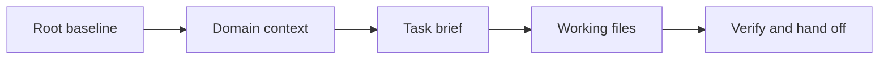

# Codex Desktop: Cheat Sheet and Reference Guide

**Application:** Codex Desktop; the native project-based development experience.  
**Platforms:** Windows first; local, WSL, macOS/Linux, terminal, and cloud distinctions are stated where relevant.  
**Documentation verified:** 31 October 2026, from official documentation. Native app/account behavior was not exhaustively runtime-tested.  
**Root baseline:** `AGENTS.md`, the project's canonical Markdown policy file.  
**Series:** Master-list position 4, completed in the seven-application collection.  
**Audience:** Beginners through advanced users maintaining durable project context.

This standalone manual separates authoring authority, instruction discovery,
session availability, recommended project organization, and observed results.
All project files shown below are instructional examples until you save and
use them in an explicitly selected workspace.

## Contents

1. [Purpose and Capability Overview](#1-purpose-and-capability-overview)
2. [Universal Foundations and Root Markdown SSOT](#2-universal-foundations-and-root-markdown-ssot)
3. [Markdown Essentials and Application Markup](#3-markdown-essentials-and-application-markup)
4. [Workspace Architecture and Directory Hierarchy](#4-workspace-architecture-and-directory-hierarchy)
5. [Instruction Discovery, Loading, Scope, and Precedence](#5-instruction-discovery-loading-scope-and-precedence)
6. [References and Progressive Context Expansion](#6-references-and-progressive-context-expansion)
7. [Configuration, Tools, Skills, and Integrations](#7-configuration-tools-skills-and-integrations)
8. [Practical Workflows](#8-practical-workflows)
9. [Complete Templates and Worked Project](#9-complete-templates-and-worked-project)
10. [Troubleshooting and Limitations](#10-troubleshooting-and-limitations)
11. [Quick-Reference Tables and Checklists](#11-quick-reference-tables-and-checklists)
12. [Sources and Verification Notes](#12-sources-and-verification-notes)

## 1. Purpose and Capability Overview

### 1.1 Universal orientation

A project baseline answers five questions: what are we building, which constraints apply, where is supporting knowledge, what counts as success, and what remains to be done? A useful guide teaches both how to write those answers and how to supply them to the application.

Use three separate checks:

| Check | Question | Observable evidence |
| --- | --- | --- |
| Authoring | Is the authoritative instruction file current? | Its text, revision, and change history |
| Availability | Can this session access that revision? | Supplied text, accepted attachment, or successful file read |
| Application | Did the result follow the relevant instructions? | Output checked against the baseline and acceptance criteria |

Example request after supplying a baseline:

```text
Read the supplied project baseline. Report its revision, the task goal,
and the acceptance criteria you will use. Identify any missing source
before starting the task.
```

Expected result: a short context inventory and a task-specific interpretation. A confident answer alone is not proof that an unavailable file was read.

### 1.2 Codex Desktop capability snapshot

This manual uses **Codex Desktop** for the Codex development experience in the desktop application. Current official documentation also describes it within the ChatGPT desktop app. Select the Codex experience and check the actual project and execution location; an ordinary Chat conversation is a different context surface.

| Surface | Use in this guide | Observable check |
| --- | --- | --- |
| Local project | Read and change the selected working folder | Ask for the absolute working directory |
| Codex conversation | Carry out the current task | Review the proposed output and actual file changes |
| Root `AGENTS.md` | Durable project instructions | Ask which instruction sources were loaded |
| Terminal | Run project checks | Inspect command, directory, exit status, and output |
| Diff/review view | Inspect resulting changes | Compare intended and actual modified files |
| Git worktree | Isolate an explicitly chosen development task | Confirm branch and checkout path |
| Skills | Supply a reusable procedure | Confirm the selected skill and its actual file |
| Plugins/MCP | Make connected capabilities available | Distinguish installed, connected, and successful tool use |

Windows can use the native sandbox and PowerShell; WSL is a separate environment, not an automatic requirement. Match paths and executables to the chosen environment. See the [Windows sandbox documentation](https://learn.chatgpt.com/docs/windows/windows-sandbox).

Example first request in a selected project:

```text
Before changing anything, report the working directory, execution
environment, relevant project instruction files, and current task goal.
Read AGENTS.md and HANDOFF.md if available. Report missing files explicitly.
```

Expected result: concrete paths and a source inventory, followed by a task interpretation. This is a recommended verification prompt, not a command that changes the app's permissions.

## 2. Universal Foundations and Root Markdown SSOT

### 2.1 Universal foundation: authority, persistence, and context

The **Single Source of Truth (SSOT)** is the designated authoring location for project policy. Keep the baseline at the project root so people can find it before entering specialized directories. Store purpose, constraints, navigation, and verification requirements there; put detailed domain knowledge in supporting files.

Persistence has two meanings. A file persists because it remains on disk. An instruction persists in the application only when an applicable feature reloads or retains it. Creating a file does not, by itself, establish that any future conversation reads it.

Use one authoritative owner for each kind of information:

| Information | Authoritative location | Maintenance rule |
| --- | --- | --- |
| Project purpose and policy | Root baseline | Edit here before refreshing copies |
| Domain definitions | Relevant context document | Link from the baseline |
| Current task and acceptance criteria | Task brief | Update when the task changes |
| Session progress and next action | Handoff document | Refresh after meaningful work |
| Application instruction text | Supported instruction surface | Keep adapters small; mark copied policy with its source revision |
| Produced report or artifact | Reviewed output location | Reconcile policy changes into the baseline |

A compact baseline excerpt:

```markdown
# Atlas Project Baseline

Revision: atlas-r1

## Purpose
Produce a clear onboarding guide for a fictional documentation project.

## Constraints
- Write in English.
- Use relative Markdown links inside project documents.
- Preserve existing files unless the current task authorizes a change.

## Context map
- Domain: [Documentation rules](context/documentation.md)
- Task: [Onboarding brief](tasks/onboarding.md)
- Progress: [Handoff](HANDOFF.md)

## Verification
Check the requested output against the task acceptance checklist.
```

The links document relationships. Loading those targets requires the application’s actual reference, upload, retrieval, or file-access mechanism.

### 2.2 Universal foundation: progressive expansion

Expand context by relevance:

1. Read the root baseline to establish purpose and policy.
2. Read the domain document that defines the relevant terminology.
3. Read the current task brief and its acceptance criteria.
4. Read only the working files needed for that task.
5. Verify the output and record the next action in the handoff.

Example context request:

```text
Start with the project baseline, then the documentation rules and
onboarding task brief supplied here. List any additional files needed.
Do not assume that a Markdown link made its target available.
```

Treat uploaded copies, instruction-field copies, and generated summaries as **derived snapshots**. Label them with the source revision. After editing the SSOT, refresh affected snapshots and deliberately supply the revised content to the next session.

### 2.3 Application mapping: a native root baseline

Use root `AGENTS.md` as the Atlas project's authoring SSOT. Keep it short enough to read before detailed task material. A separate `README.md` can explain the project to humans; it should not duplicate policy that can drift.

```text
Atlas/
├── AGENTS.md                 # canonical project policy
├── context/documentation.md  # domain facts
├── tasks/onboarding.md       # current task contract
├── HANDOFF.md                # progress and next action
└── outputs/                  # reviewed results
```

Recommended request after a policy update:

```text
AGENTS.md is now revision atlas-r2. Read the saved file again and
summarize the changed requirement before continuing. Treat an earlier
summary as a snapshot of atlas-r1, not as the current source.
```

Expected result: the new revision and its actual changed rule. For automatic discovery, use a fresh run/session after changes and verify the chain. Explicit reads are useful even when automatic loading exists.

### 2.4 A shared repository with several assistants

Choose ownership deliberately. For this Codex project, `AGENTS.md` owns the policy. If another assistant requires a different filename, keep that adapter small and describe how its source is supplied. Do not assume another application implements Codex discovery.

```markdown
# Other-assistant adapter

Authoring SSOT: ../AGENTS.md, revision atlas-r2.
Load that file using this assistant's supported file-access mechanism.
This adapter is a navigation instruction, not an automatic Markdown import.
```

Place an adapter only where the other assistant actually looks for it. Confirm its behavior separately.

## 3. Markdown Essentials and Application Markup

### 3.1 Universal Markdown essentials

Use ordinary Markdown as the portable source format. Headings, paragraphs, lists, links, images, block quotes, inline code, and fenced code belong to the CommonMark foundation. Tables, task lists, and strikethrough are GFM extensions; math and Mermaid require additional renderer support. These standards describe document syntax, not a promise about a particular application. See [CommonMark](https://spec.commonmark.org/0.31.2/) and [GFM](https://github.github.com/gfm/).

Copy this complete syntax sample into a Markdown document:

````markdown
# Document title

## Context

Use **bold** for emphasis, *italics* for a term, and `PROJECT.md` for a filename.

- First requirement
- Second requirement

1. Read the baseline.
2. Read the task brief.

> This quotation is reference material; label its source separately.

[Task brief](tasks/onboarding.md)


| Item | Meaning |
| --- | --- |
| Root | Project policy |
| Task | Current acceptance criteria |

- [ ] Read the current revision.
- [x] Identify the requested output.

~~Superseded wording~~

```python
print("Read the baseline before starting.")
```

---

Literal characters: \*asterisk\*, \[bracket\], and a table pipe: \|.
````

Expected result in a compatible viewer: structured text, a code block, and supported extensions. The sample image renders only if that asset exists and the viewer can access it; it is not a companion file supplied by this manual.

| Rule | Copyable example | Practical reason |
| --- | --- | --- |
| One document title | `# Atlas Baseline` | Establishes the document’s subject |
| Logical heading levels | `## Constraints`, then `### Writing` | Keeps navigation and accessibility predictable |
| Blank lines around blocks | Paragraph, blank line, list | Avoids ambiguous block boundaries |
| Language on code fences | Opening fence: three backticks followed by `json` | Helps readers recognize the format |
| Longer outer fence | Four backticks around a sample containing triple backticks | Preserves nested code examples |
| Relative project link | `[Rules](context/documentation.md)` | Keeps project navigation portable |
| URL containing a space | `[Draft](<drafts/first draft.md>)` | Makes the link destination unambiguous |
| Inline backticks inside code | Use two backticks around a span containing one backtick | Shows literal Markdown syntax |
| Standard newline | Write a separate paragraph for a separate idea | Avoids relying on invisible trailing spaces |
| Descriptive image text | `` | Preserves meaning when an image cannot be seen |

Use UTF-8, consistent filenames, and short paragraphs. Relative links resolve from the document containing the link, not automatically from the project root. Anchor generation varies across viewers; check the table of contents where the file will be read.

YAML frontmatter is a separate convention, not a universal instruction loader. This valid example can hold authoring metadata where a consumer supports it:

```yaml
---
title: Atlas Baseline
revision: atlas-r1
status: current
---
```

In a general project document, plain Markdown metadata is often clearer. Reserve required frontmatter schemas for features that document them, such as Skills.

### 3.2 Markdown instructions and literal references

`AGENTS.md` is an ordinary Markdown document with instruction-bearing meaning supplied by Codex's discovery mechanism. It does not require YAML frontmatter. Use explicit verbs, filenames, and acceptance criteria.

```markdown
## Before writing
- Read context/documentation.md and tasks/onboarding.md.
- Preserve existing output until the current task authorizes replacement.

## Completion
- Verify every task acceptance criterion.
- Update HANDOFF.md with changed files and the next action.
```

Placement: inside root `AGENTS.md`. Usage: start Codex in that project, confirm the instruction inventory, then request the task. Expected result: a plan that names the context and verification steps.

| Notation | Meaning | What supplies content |
| --- | --- | --- |
| `` `AGENTS.md` `` | Literal filename | Discovery or an explicit file read |
| `[Domain](context/documentation.md)` | Markdown hyperlink | A separate supported read/attachment |
| `# Heading` | Document structure | The Markdown renderer |
| A quoted instruction | Reference material | The surrounding request determines its role |
| A code fence | Literal example | It runs only through a separately authorized execution action |

### 3.3 File mentions, skills, and CLI notation

Use the desktop composer's file/context selector when available, then verify the chosen file. Plain text containing a path is a request to inspect it, not proof that it was read.

```text
Read tasks/onboarding.md from the selected project, not a similarly named
attachment from another conversation. Report its revision and acceptance list.
```

For Skills, use the desktop Skills selector or identify the local skill explicitly. `$skill-name` and `/skills` are documented Codex CLI/IDE invocation surfaces; do not assume a desktop composer parses every terminal command. The complete skill example appears in section 7.

### 3.4 Math, diagrams, and code output

Ask for portable source when a particular rendering matters:

```text
Return the equation as LaTeX source and include the Mermaid source for
the workflow. Preserve both in the output Markdown even if a preview is available.
```

```latex
\text{coverage} = \frac{\text{verified criteria}}{\text{total criteria}}
```



The diagram depicts the recommended context workflow. A rendered diagram in this reference website is a website feature; it does not establish native rendering in every Codex surface. Save code, XML, SVG, and JSON as source files when they must remain editable.

## 4. Workspace Architecture and Directory Hierarchy

### 4.1 Universal architecture

Keep the root baseline small enough to review. Expand detailed context through ordinary files with explicit responsibilities. Directory layout is an authoring design; it becomes an instruction hierarchy only if the application documents that behavior.

```text
Atlas/
|-- PROJECT.md                  # Authoritative project baseline
|-- HANDOFF.md                  # Reviewed progress and next action
|-- context/
|   `-- documentation.md        # Domain definitions and writing rules
|-- tasks/
|   `-- onboarding.md           # Current task and acceptance criteria
`-- outputs/
    `-- onboarding-guide.md    # Reviewed task output
```

Example relationship: `PROJECT.md` links to `context/documentation.md`; the task brief links back with `../PROJECT.md`. File responsibility is explicit, and duplicate policy is minimized.

### 4.2 Codex workspace map

The following layout separates native instruction/configuration locations from project organization:

```text
Atlas/
├── AGENTS.md
├── README.md
├── HANDOFF.md
├── .codex/
│   └── config.toml                 # optional trusted project configuration
├── .agents/skills/
│   └── atlas-context-review/
│       └── SKILL.md                # optional reusable procedure
├── context/documentation.md
├── tasks/onboarding.md
├── tools/check_atlas.py
├── outputs/
│   └── AGENTS.md                   # instructions for this output area
├── #Old/                           # optional archive convention
└── #Temp/                          # optional scratch convention
```

`context`, `tasks`, `outputs`, `HANDOFF.md`, `#Old`, and `#Temp` are this manual's recommended organization. They are not promises of automatic discovery.

Prerequisite: work on a copy or an empty project directory. Create the conventional directories with PowerShell:

```powershell
$atlasRoot = Join-Path $env:USERPROFILE 'Documents\Atlas-Codex'
New-Item -ItemType Directory -Path $atlasRoot -Force | Out-Null
foreach ($atlasPart in @('context','tasks','outputs','tools','#Old','#Temp')) {
    New-Item -ItemType Directory -Path (Join-Path $atlasRoot $atlasPart) -Force | Out-Null
}
```

Then save the complete templates in section 9 at those relative locations. The command creates directories only; it does not install Codex or configure accounts.

### 4.3 Worktrees and filesystem authority

A worktree is another checkout, not a live mirror of unsaved files. The official [worktree guide](https://learn.chatgpt.com/docs/environments/git-worktrees) documents the supported isolation workflow. Use it when the task calls for isolated Git work, and inspect the actual checkout before editing.

```text
For this task, identify the active checkout and branch. Read its saved
AGENTS.md. If the intended policy change exists only in another checkout,
report that mismatch before using an outdated copy.
```

Expected result: the exact checkout path and current revision. Keep a single writer per active task or assign separate files explicitly when coordinating work.

## 5. Instruction Discovery, Loading, Scope, and Precedence

### 5.1 Universal loading contract

For every instruction source, record: its owner, scope, loading trigger, revision, and refresh method. Distinguish normative instructions from evidence or quoted source material.

```text
Context inventory:
- Baseline: PROJECT.md, revision atlas-r1, supplied in this conversation.
- Domain: context/documentation.md, revision docs-r1, supplied.
- Task: tasks/onboarding.md, revision task-r1, supplied.
- Handoff: not supplied; do not infer its contents.
```

Project policy operates within platform rules, account/workspace controls, and applicable user instructions. When supplied project documents disagree, identify the competing requirements and request a decision where needed. A filename does not create a new instruction priority.

### 5.2 Native instruction discovery

The [AGENTS.md guide](https://learn.chatgpt.com/docs/agent-configuration/agents-md) documents a chain built when a run starts: global guidance, then project-root-to-working-directory guidance. At each level, an override file can replace the ordinary file; fallback names are configurable. Closer project instructions occur later in the chain. The default combined project-document budget is 32 KiB. Empty files are skipped.

| Level | Candidate | Verification example |
| --- | --- | --- |
| Codex home | `AGENTS.override.md`, otherwise `AGENTS.md` | Ask which global source loaded |
| Repository root | `AGENTS.override.md`, otherwise `AGENTS.md` | Check the selected checkout's root |
| Path to working directory | Applicable instruction file at each directory | Ask for the root-to-current-directory chain |
| Other linked document | Not an instruction-discovery candidate merely because linked | Request a real read |

Treat the chain as startup behavior, not a recursive read of every future subdirectory. For a task entering an area not in the initial path, explicitly inspect its applicable instructions before editing.

### 5.3 Nested instructions without a competing baseline

Root file, `AGENTS.md`:

```markdown
# Atlas project instructions
Revision: atlas-r1
- Use English.
- Read tasks/onboarding.md before drafting.
- Check output against that task and update HANDOFF.md.
```

Scoped file, `outputs/AGENTS.md`:

```markdown
# Output-area instructions
Scope: outputs/ and descendants.
- Keep generated documents in Markdown.
- Use the three ordered onboarding steps required by tasks/onboarding.md.
- Preserve existing approved reports unless replacement is requested.
```

Usage request:

```text
Before editing outputs/onboarding-guide.md, read outputs/AGENTS.md and
explain how it supplements the root baseline. Report any conflict.
```

Expected result: both scopes are named. Do not silently use a scoped rule to authorize unrelated changes elsewhere.


This conceptual inventory keeps project policy, scoped guidance, and task
context separate. It does not imply that every descendant was read at startup.

### 5.4 Refresh and conflict resolution

When instructions change, save the file, start a fresh run/session for rediscovery where necessary, and ask for the current inventory. For an ongoing task, explicitly request a reread of changed material. Resolve contradictions in the authoring source, then refresh derived copies.

```text
The task brief says “three ordered steps” but the draft has four. Keep the
current brief as authority for this task. Correct the draft, then record
the verified step list in HANDOFF.md. Do not rewrite policy to match the draft.
```

Observe the resulting diff and the actual output. Model recollection of an earlier revision is not a refresh mechanism.

## 6. References and Progressive Context Expansion

### 6.1 Universal reference discipline

A useful reference records both location and purpose. Keep the context map specific:

```markdown
## Context map
- [Writing rules](context/documentation.md): terminology and link policy.
- [Task brief](tasks/onboarding.md): output and acceptance criteria.
- [Handoff](HANDOFF.md): verified progress and next action.
```

When context becomes large, supply the baseline and task first, then request relevant supporting files. If the assistant has tools, require successful reads; otherwise paste or attach the required text. Preserve meaningful section headings when supplying excerpts, and label omitted portions explicitly.

### 6.2 A reproducible expansion request

```text
Read these saved files from the active Atlas checkout in order:
1. AGENTS.md
2. context/documentation.md
3. tasks/onboarding.md
4. HANDOFF.md

Before writing, report the baseline revision, missing files, acceptance
criteria, and applicable instructions for outputs/. Then create or revise
outputs/onboarding-guide.md only. Verify the result and update HANDOFF.md.
```

Placement: submit in the Codex conversation with the Atlas folder selected. Prerequisites: the files exist and the session can access them. Expected result: actual reads, a bounded change, evidence, and a handoff.

### 6.3 Minimal context inventories

Use a small table to distinguish material read now from material merely mentioned:

```markdown
| Source | Revision/status | Use |
| --- | --- | --- |
| AGENTS.md | atlas-r1, read now | Policy |
| context/documentation.md | doc-r1, read now | Domain |
| tasks/onboarding.md | task-r1, read now | Acceptance criteria |
| HANDOFF.md | handoff-r2, read now | Resume point |
| linked external reference | Not fetched | Do not treat as verified evidence |
```

This is a recommended record, not an internal protocol. Keep inventories specific enough to reveal an outdated attachment or wrong checkout.

### 6.4 Resume and handoff

```text
Resume from the saved HANDOFF.md. Re-read AGENTS.md and the named task
brief. Confirm which checks remain incomplete. Continue from the recorded
next action without assuming that the previous conversation's entire
context is available.
```

Expected result: the current source revisions are checked before continuing. A handoff is a progress snapshot; it does not merge conversations or replace project instructions.

## 7. Configuration, Tools, Skills, and Integrations

### 7.1 Universal configuration principles

Instructions describe behavior; configuration enables capabilities; permissions control access. A Markdown sentence does not install a tool or make a write-capable tool read-only.

For each configuration example, identify the consuming feature, file location, prerequisites, substituted values, reload action, and a bounded verification step. Preserve unrelated settings. Keep credentials out of shared Markdown and use the integration’s supported authentication interface.

Example verification request after a tool is connected:

```text
Use the configured project file tool to read only PROJECT.md. Report its
title and revision. Do not modify files or search unrelated folders.
```

### 7.2 Configuration is separate from instruction prose

Codex configuration uses TOML. The [configuration guide](https://learn.chatgpt.com/docs/config-file/config-basic) distinguishes user configuration from trusted project configuration and managed requirements. This manual does not change those files during template creation.

Optional project example, `.codex/config.toml`:

```toml
# Example only. Merge deliberately with existing configuration.
project_doc_max_bytes = 32768
```

This keeps the documented budget explicit. Do not increase it merely to store an entire handbook in the root baseline; use linked domain documents and actual selective reads.

To inspect effective behavior:

```text
Explain which configuration location applies to this selected project,
whether the project is trusted, and which managed restrictions are visible.
Do not change settings as part of this inspection.
```

Expected result: a distinction between file contents and effective settings. A TOML example is not a claim that a managed desktop will accept it.

### 7.3 Complete reusable skill

Save this as `.agents/skills/atlas-context-review/SKILL.md` in the example repository. Codex's [Skills documentation](https://learn.chatgpt.com/docs/build-skills) describes local skill locations and progressive disclosure. A project skill's procedure is separate from root policy.

```markdown
---
name: atlas-context-review
description: Review the Atlas onboarding draft against its saved baseline and task brief; use for checks of Atlas documentation, not unrelated coding tasks.
---

# Atlas context review

1. Read AGENTS.md, context/documentation.md, and tasks/onboarding.md.
2. Read outputs/onboarding-guide.md if it exists.
3. List each acceptance criterion and evidence for pass or failure.
4. Do not modify the draft during a review-only request.
5. If revision is requested, edit the draft and rerun relevant checks.
6. Report the exact files read and checks performed.
```

Desktop usage: select the skill if it is available in the Skills surface, or ask Codex to use the named skill and report whether it was found. CLI/IDE example after discovery:

```text
$atlas-context-review Review the saved onboarding draft without editing it.
```

Expected result: an evidence table, not merely a statement that the skill is installed. If discovery fails, request an explicit read of the skill file and label that as a supplied procedure.

### 7.4 MCP and plugins

The official [MCP documentation](https://learn.chatgpt.com/docs/extend/mcp?surface=cli) separates plugins, server connections, transport, and authentication. Start with a read-only connection test before relying on external context.

Optional **CLI configuration** for OpenAI's public documentation MCP server:

```toml
[mcp_servers.openai_docs]
url = "https://developers.openai.com/mcp"
```

Prerequisites: network access to the public server and a Codex client whose
configuration supports the documented connection. Merge the entry into the
appropriate existing configuration, then verify tool discovery with a bounded
official-documentation lookup. See the [official Docs MCP page](https://developers.openai.com/resources/docs-mcp).
This example configures a real hosted endpoint rather than requiring you to
create a local server implementation. It is not installed by the template.

```text
For the selected documentation connection, list available read-only tools
and perform one bounded lookup of an approved Atlas document. Report the
result, or the precise setup/authentication step that remains incomplete.
```

A successful installation, an authenticated account, and a successful lookup are different facts. Keep credentials outside Markdown and chat transcripts.

## 8. Practical Workflows

### 8.1 Universal workflow: initialize, expand, verify, resume

Use this sequence for every substantive task:

1. Establish the root baseline and give it a revision.
2. Supply it through the application’s actual loading mechanism.
3. Supply the relevant domain document and current task brief.
4. Confirm the sources and acceptance criteria.
5. Produce the requested output within the authorized scope.
6. Check the result against the task’s observable requirements.
7. Update the handoff and reconcile durable decisions into their authoritative files.

Copyable task-start request:

```text
Read the baseline and task brief supplied here. Summarize the goal,
constraints, required sources, output location, and acceptance criteria.
If everything needed is available, complete the task and report which
checks were actually performed. Record unresolved items separately.
```

### 8.2 Initialize the Atlas example

1. Create the directories from section 4.
2. Save 9.1–9.4 and the checker at their specified paths; keep 9.5 as reference output.
3. Select the Atlas folder in Codex.
4. Submit the section 6 expansion request.
5. Verify that the inventory names `AGENTS.md` revision `atlas-r1`.

Expected initial state: no approved output yet, a task brief with three required ordered steps, and a handoff identifying drafting as the next action.

### 8.3 Execute and review a bounded change

```text
Create outputs/onboarding-guide.md from the current Atlas files. Use the
three required ordered steps and the glossary terms. Run the supplied checker
if Python is available. Review the diff and list remaining criteria that
still require human judgment.
```

Observe the file itself and command output. A passing structural checker does not establish that every sentence is useful or factually supported.

### 8.4 Change one requirement and refresh

Change `tasks/onboarding.md` from revision `task-r1` to `task-r2`, adding the requirement “Include a relative link to `../HANDOFF.md`.” Save it, then request:

```text
The task brief is now task-r2. Read it again, identify the new criterion,
and update the draft. Keep AGENTS.md as the project policy source. Record
the new task revision and check result in HANDOFF.md.
```

Expected result: a small diff tied to the new requirement. Update the checker as appropriate if you want the new requirement to be machine checked; do not claim the old checker already checks it.

### 8.5 Review-only and resumption workflows

```text
Review the current output against task-r2 without changing files. Return
criterion, evidence, status, and a recommended next action.
```

Then, in a later conversation, use the section 6 resume prompt. This demonstrates explicit context reconstruction instead of reliance on an old chat's memory.

## 9. Complete Templates and Worked Project

### 9.1 Root baseline: AGENTS.md

Save at the Atlas project root:

```markdown
# Atlas Project Instructions

Revision: atlas-r1

## Purpose
Produce a clear onboarding guide for a fictional documentation project.

## Constraints
- Write in English.
- Preserve existing files unless the current task authorizes a change.
- Use relative Markdown links in project documents.
- Treat project examples as fictional, not external product claims.

## Context map
- Domain: [Documentation rules](context/documentation.md)
- Task: [Onboarding brief](tasks/onboarding.md)
- Progress: [Handoff](HANDOFF.md)

## Working procedure
Read the relevant saved context and task brief before writing.
Before editing outputs/, inspect outputs/AGENTS.md if present.

## Verification
Check every task acceptance criterion. Distinguish automated checks from
judgment. Report the working directory and actual changed files.
Update HANDOFF.md with the result and next action.
```

### 9.2 Domain context: `context/documentation.md`

```markdown
# Atlas Documentation Rules

Revision: docs-r1
Applies to: Documentation tasks for Atlas

## Terms
- Baseline: the root AGENTS.md authoring source.
- Task brief: the document defining one output and its acceptance criteria.
- Handoff: the reviewed record of progress and next action.

## Writing rules
- Start each document with one H1 title.
- Use an ordered list for sequential onboarding steps.
- Explain what the reader should observe after each action.
- Use a task checklist for verification.

## Link rules
Resolve relative links from the document containing the link.
An output under outputs/ links to the baseline as ../AGENTS.md.
Do not add links to files that do not exist in the example workspace.

## Boundaries
This fictional task needs no package installation or external service.
```

### 9.3 Task brief: `tasks/onboarding.md`

```markdown
# Atlas Onboarding Task

Revision: task-r1
Baseline: atlas-r1
Domain: docs-r1

## Goal
Write a short guide that teaches a contributor to load and verify context.

## Output
outputs/onboarding-guide.md

## Required sources
- [Project baseline](../AGENTS.md)
- [Documentation rules](../context/documentation.md)

## Required content
Exactly three ordered steps:
1. Read the project baseline.
2. Supply the domain rules and this task brief to the assistant.
3. Check the resulting draft against the acceptance checklist.

## Acceptance criteria
- [ ] The document has one H1 title.
- [ ] The document is written in English.
- [ ] There are exactly three ordered onboarding steps.
- [ ] Each step includes an observable result.
- [ ] The baseline link resolves from outputs/.
- [ ] A final verification checklist is present.
- [ ] The guide does not claim automatic Markdown-link loading.
- [ ] No package installation or external service is required.
```

### 9.4 Handoff: `HANDOFF.md`

This is the truthful initial state before the worked task has run:

```markdown
# Atlas Handoff

Revision: handoff-r1
Baseline: atlas-r1
Task: tasks/onboarding.md, task-r1

## Completed
- The baseline, domain document, and task brief are prepared.

## Verified
- No application-side file access or generated output has been tested yet.

## Remaining
- Supply or read the three source documents.
- Create and inspect outputs/onboarding-guide.md.
- Check each task acceptance item.

## Open issues
None recorded. Report access failures if they occur.

## Next action
Read the three source documents and draft the onboarding guide.
```

After actual completion, revise it with the specific output, performed checks, unresolved issues, and next action. Do not copy a “verified” claim from an example unless you performed the check.

### 9.5 Expected output: `outputs/onboarding-guide.md`

This complete example satisfies the fictional task’s content requirements. It is illustrative expected output, not a claim that Codex Desktop generated it during this guide’s preparation.

```markdown
# Atlas Contributor Onboarding

1. Read the [project baseline](../AGENTS.md) and supply it to your assistant.
   Paste its full text, attach it, or request an authorized file read.
   Confirm its revision is atlas-r1 and identify its constraints.
   Expected result: you can state the project purpose and output policy.

2. Supply the [documentation rules](../context/documentation.md) and
   [task brief](../tasks/onboarding.md) to your assistant.
   Attach accepted files, paste their text, or request authorized file reads.
   Expected result: the assistant identifies docs-r1 and task-r1 and names
   any missing source. Markdown links alone do not load these files.

3. Check the draft against the task acceptance criteria.
   Inspect the three steps, expected results, links, and final checklist.
   Expected result: each criterion has a recorded pass or a specific issue.

## Verification checklist
- [ ] Baseline and source revisions match the supplied documents.
- [ ] There are exactly three ordered steps with expected results.
- [ ] Relative links point to the intended files.
- [ ] Every task acceptance criterion has been checked.
```


### 9.6 Complete structural checker: tools/check_atlas.py

Prerequisite: Python 3.9 or newer in the example environment. Save this
complete script and run it from the project root after drafting. It reads
local files only and makes no changes.

```python
from pathlib import Path
import re
import sys

root = Path(__file__).resolve().parent.parent
baseline = "AGENTS.md"
required = [baseline, "context/documentation.md", "tasks/onboarding.md", "HANDOFF.md"]
errors = ["Missing: " + name for name in required if not (root / name).is_file()]
output = root / "outputs/onboarding-guide.md"
if not output.is_file():
    errors.append("Missing: outputs/onboarding-guide.md")
else:
    text = output.read_text(encoding="utf-8")
    if len(re.findall(r"^# [^#].+", text, re.M)) != 1:
        errors.append("Expected exactly one H1 title")
    if re.findall(r"^(\d+)\. ", text, re.M) != ["1", "2", "3"]:
        errors.append("Expected exactly three ordered steps")
    if text.count("Expected result:") < 3:
        errors.append("Each step needs an expected result")
    if "../" + baseline not in text:
        errors.append("Missing relative link to the project baseline")
    if "## Verification checklist" not in text:
        errors.append("Missing final verification checklist")
if errors:
    print("FAIL\n" + "\n".join(errors))
    sys.exit(1)
print("PASS: required files and structural onboarding criteria are present.")
```

```powershell
python .\tools\check_atlas.py
```

Expected initial failure: the output has not been created yet. Expected
success after drafting: `PASS` and exit code 0. The checker does not prove
English prose quality, the truth of a product claim, or every possible
future acceptance item. Review those criteria separately.

### 9.7 Worked project: initialize, expand, execute, verify, resume

| Step | Action | Expected evidence |
| --- | --- | --- |
| Initialize | Save 9.1–9.4 and the checker at their specified paths | File inventory contains baseline, domain, task, handoff, output example, checker |
| Expand | Use section 6.2 | Current revisions and criteria reported |
| Execute | Draft the output using section 8.3 | Only authorized files change |
| Verify | Run the checker and read the draft | Exit status plus criterion-by-criterion review |
| Record | Update HANDOFF.md | Actual checks, remaining issues, next action |
| Resume | Start another conversation and reread the saved files | The new session reconstructs the task from disk |

Recommended completion note:

```markdown
Revision: handoff-r2
Baseline: atlas-r1
Task: task-r1
Changed: outputs/onboarding-guide.md
Checks: structural checker passed; prose reviewed against the task brief.
Remaining: owner review of wording.
Next action: obtain that review before treating the output as approved.
```

The checklist illustrates a recommended workflow; the checker supplied here is not a native Codex test.

## 10. Troubleshooting and Limitations

### 10.1 Universal troubleshooting method

Check failures in this order: source correctness, access, loading, interpretation, output, and verification. Record the failing step before changing settings.

```text
Diagnose this context problem. State which source was expected,
what access mechanism was used, what evidence confirms a read,
and the smallest correction needed. Do not invent missing content.
```

### 10.2 Codex troubleshooting table

| Symptom | Check | Supported next action |
| --- | --- | --- |
| Baseline appears ignored | Actual checkout, working directory, loaded instruction inventory | Read the saved file and restart the run when rediscovery is needed |
| Nested rule absent | Whether the directory was on the startup path | Explicitly read applicable scoped instructions before editing |
| Long instructions truncated | Size of the combined guidance | Keep root policy compact and supply domain files selectively |
| A link's contents are unknown | Whether the target was actually read | Request a bounded read or supply the file |
| Skill not offered | File location, valid name/description, available skill list | Verify discovery; restart if needed; explicitly read the procedure as a fallback |
| Tool unavailable | Installed/connected/authenticated/runtime status | Diagnose the missing stage rather than claiming a lookup succeeded |
| File exists in another checkout | Absolute paths and revisions | Reconcile into the intended checkout deliberately |
| Check command fails | Shell, path, executable, exit output | Correct the concrete failure; preserve useful diagnostics |

### 10.3 Limits to keep explicit

The app, CLI, IDE extension, remote executor, and cloud container are different execution surfaces. A command demonstrated in a terminal is not automatically a composer command. A project instruction cannot expand sandbox access. A rendered reference diagram cannot establish a product UI capability. A source-based description of a feature is not proof that the signed-in account currently has it.

Example limitation report:

```text
The Markdown source is current and readable. The configured external
tool is not available in this session, so the external lookup remains
unverified. The local structural checker passed; no live product test
or remote-account operation was performed.
```

## 11. Quick-Reference Tables and Checklists

### 11.1 File and syntax reference

| File/syntax | Purpose | Loading rule |
| --- | --- | --- |
| `AGENTS.md` | Native project baseline | Verify the applicable instruction chain |
| `AGENTS.override.md` | Same-directory override candidate | Can displace ordinary guidance at that level |
| `.agents/skills/name/SKILL.md` | Reusable procedure | Discovery and selection are separate from policy loading |
| `.codex/config.toml` | Optional project settings | Trusted-project and managed requirements apply |
| `HANDOFF.md` | Recommended progress record | Read explicitly on resumption |
| Markdown hyperlink | Navigation | Does not load the target automatically |
| Fenced code | Literal example | Requires separate execution to run |
| `#Old` / `#Temp` | Optional organization | Not native instruction discovery |

### 11.2 Task-start checklist

- [ ] Select the intended project and execution environment.
- [ ] Confirm the absolute working directory and checkout.
- [ ] Verify the root baseline revision and relevant scoped instructions.
- [ ] Read the domain, task, and handoff files needed now.
- [ ] Name the output and acceptance criteria.
- [ ] Report missing files or unavailable tools before relying on them.

### 11.3 Completion checklist

- [ ] Inspect actual changed files and their diff.
- [ ] Run the relevant available checks and report exit status.
- [ ] Review criteria that require human judgment.
- [ ] Refresh derived snapshots after source changes.
- [ ] Update HANDOFF.md with evidence and a concrete next action.
- [ ] Keep authentication, installation, and runtime-verification claims distinct.

### 11.4 Thirty-second reusable prompt

```text
Read AGENTS.md, the current task brief, and HANDOFF.md from the selected
checkout. Confirm revisions and scope. Expand context only as needed,
perform the authorized task, verify against the acceptance criteria,
review the actual diff, and record the next action in HANDOFF.md.
```

## 12. Sources and Verification Notes

### 12.1 Sources, identity, and corrections

This is master-list position 4, added to the completed seven-application collection on 31 October 2026. The term Codex Desktop is retained for continuity with the master input; current official documentation also locates Codex within the ChatGPT desktop app. Product surfaces can move without changing the project's root Markdown policy.

| Source | Used to verify |
| --- | --- |
| [AGENTS.md instructions](https://learn.chatgpt.com/docs/agent-configuration/agents-md) | Native filename, chain, overrides, startup discovery, budget |
| [Config basics](https://learn.chatgpt.com/docs/config-file/config-basic) | User/project configuration, trust and managed requirements |
| [Build skills](https://learn.chatgpt.com/docs/build-skills) | Skill format, discovery locations, invocation distinctions |
| [MCP](https://learn.chatgpt.com/docs/extend/mcp?surface=cli) | Connection/transport/configuration distinctions |
| [Windows sandbox](https://learn.chatgpt.com/docs/windows/windows-sandbox) | Native Windows and shell boundaries |
| [Worktrees](https://learn.chatgpt.com/docs/environments/git-worktrees) | Separate Git checkouts |
| [Features](https://learn.chatgpt.com/docs/features) | Current desktop product organization |

The raw master comparison is a planning input. Internal stream tags, protocol payloads, or renderer implementation guesses are not documented user commands and are not taught here as actionable syntax. `HANDOFF.md`, Atlas's folder names, the checker, and the example skill are recommended project conventions.

### 12.2 Verification notes

Official documentation was reviewed on 31 October 2026. The guide's HTML structure, source embedding, links, code-copy behavior, and packaging are checked separately in the collection validation report. Those checks do not establish that every native application, managed policy, skill, external server, or account entitlement was installed and runtime-tested.

The Atlas checker is fully supplied instructional content. The optional MCP
example requires a separate network connection test; its server is not bundled
in the project. No installer or account-authorization flow is initiated by
reading this manual.

### 12.3 Template maintenance

In an editable New+ guide project, `content/guide.md` is the guide-text SSOT; rebuild after editing it. In an Atlas Codex workspace, root `AGENTS.md` is the project-policy SSOT. These are different projects and different responsibilities. The complete HTML, source download, and template sources are derived from the same maintained manual in this collection.

