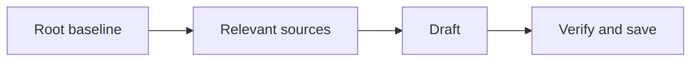
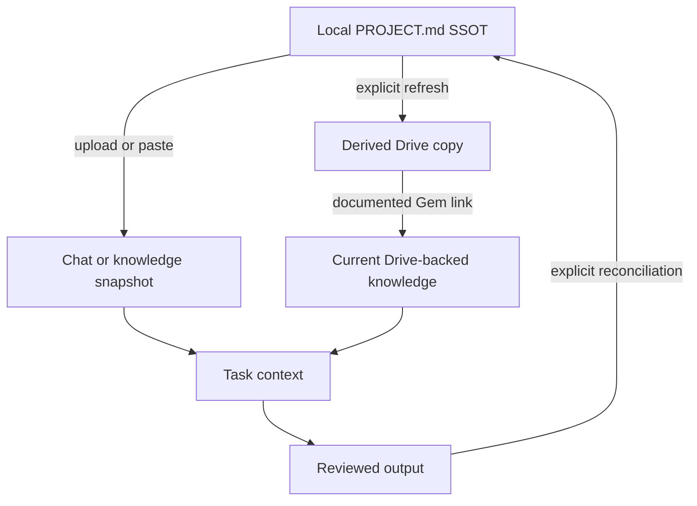

# Gemini Desktop: Cheat Sheet and Reference Guide

**Application:** Google’s official Gemini desktop app, with explicitly labeled Gemini web workflows where needed.  
**Platforms:** Windows first; native macOS and browser alternatives distinguished.  
**Documentation verified:** 27 October 2026. No installed Gemini build, account entitlement, connection, or native rendering was runtime-tested.  
**Root baseline:** `PROJECT.md`, supplied explicitly through accepted files, pasted text, or a documented connected source.  
**Series:** Master-list position 5; this file covers Gemini only.  
**Audience:** Beginners through advanced users maintaining durable project context.

The root file remains the project’s authoring source. Chats, uploaded files, Gem knowledge, Skills, notebooks, Canvas documents, and Drive copies provide context or outputs with different loading and refresh behavior. This guide explains those differences without treating Gemini CLI or Antigravity as the consumer desktop app.

## Contents

1. [Purpose and Capability Overview](#1-purpose-and-capability-overview)
2. [Universal Foundations and Root Markdown SSOT](#2-universal-foundations-and-root-markdown-ssot)
3. [Markdown Essentials and Application Markup](#3-markdown-essentials-and-application-markup)
4. [Workspace Architecture and Directory Hierarchy](#4-workspace-architecture-and-directory-hierarchy)
5. [Instruction Discovery, Loading, Scope, and Precedence](#5-instruction-discovery-loading-scope-and-precedence)
6. [References and Progressive Context Expansion](#6-references-and-progressive-context-expansion)
7. [Configuration, Tools, Skills, and Integrations](#7-configuration-tools-skills-and-integrations)
8. [Practical Workflows](#8-practical-workflows)
9. [Complete Templates and Worked Project](#9-complete-templates-and-worked-project)
10. [Troubleshooting and Limitations](#10-troubleshooting-and-limitations)
11. [Quick-Reference Tables and Checklists](#11-quick-reference-tables-and-checklists)
12. [Sources and Verification Notes](#12-sources-and-verification-notes)

## 1. Purpose and Capability Overview

### 1.1 Universal orientation

A project baseline answers five questions: what are we building, which constraints apply, where is supporting knowledge, what counts as success, and what remains to be done? A useful guide teaches both how to write those answers and how to supply them to the application.

Use three separate checks:

| Check | Question | Observable evidence |
| --- | --- | --- |
| Authoring | Is the authoritative instruction file current? | Its text, revision, and change history |
| Availability | Can this session access that revision? | Supplied text, accepted attachment, or successful file read |
| Application | Did the result follow the relevant instructions? | Output checked against the baseline and acceptance criteria |

Example request after supplying a baseline:

```text
Read the supplied project baseline. Report its revision, the task goal,
and the acceptance criteria you will use. Identify any missing source
before starting the task.
```

Expected result: a short context inventory and a task-specific interpretation. A confident answer alone is not proof that an unavailable file was read.

### 1.2 Identify the actual desktop product

Google now documents native Gemini apps for **Windows 10 or later** and **macOS 15 or later on Apple Silicon**. The Windows launch was announced on 10 September 2026. Use Google’s [desktop download page](https://gemini.google/desktop/) and [Windows help](https://support.google.com/gemini/answer/18263854?hl=en), not a third-party wrapper with a similar name.

| Surface | What it is | Practical baseline route |
| --- | --- | --- |
| Native Gemini for Windows | Google’s Windows desktop application | Available uploads/paste; browser fallback for unlisted features |
| Native Gemini for Mac | Google’s macOS application | Upload/paste; supported Mac features where available |
| Gemini web app | `gemini.google.com` in a supported browser | Documented setup for Gems, Skills, notebooks, and Canvas |
| Installed website | Browser-created app window | The website’s capabilities, not proof of native-app features |
| Gemini CLI | A separate terminal agent | Its `GEMINI.md` discovery is not a consumer-app contract |
| Antigravity | A separate developer application | Opening it does not turn Gemini chat into that agent |

No native Linux consumer download was established by the reviewed desktop sources; use the web app. A browser fallback is also the documented route for several features not listed for native Windows.

Windows users can open the running app with **Alt + Space**. Mac uses **Option + Space** for mini chat and **Option + Shift + Space** for full chat. Shortcuts can be customized. Feature parity is not guaranteed by sharing an account. See [desktop features](https://gemini.google/desktop/) and [Mac help](https://support.google.com/gemini/answer/17011627?hl=en).

### 1.3 Capability snapshot and current transition

| Capability | Documented purpose | Loading or scope distinction |
| --- | --- | --- |
| Ordinary chat | Writing, analysis, summarization, coding help | Supply the relevant source explicitly |
| File uploads | Analyze supplied documents and other supported files | Uploaded context is not a mounted local directory |
| Gems | Saved specialized instructions and knowledge | Use the selected Gem; current migration notice applies |
| Skills | Reusable procedures, references, and selective activation | Currently documented for web/Mac/mobile; Windows parity unestablished |
| Notebooks | Persistent sources, instructions, and project discussion | Supported surfaces and connection requirements vary |
| Connected Apps | Retrieve or act through available authorized apps | Actual app selection and account access matter |
| Canvas | Edit documents, code, and other generated content | Its autosave does not update a local root file |
| Instructions / memory | Cross-chat personalization where supported | Not a substitute for current project files; Gem exclusions apply |

Skills already exist; the Gems migration is a separate dated change. For adult personal accounts, Google’s current notice sets **17 November 2026** for Gems becoming read-only and transitioning, and **17 December 2026** for their removal. Work/school transitions follow in 2027. These are future dates relative to this guide. See [the transition notice](https://support.google.com/gemini/answer/18560919?hl=en).

**Root choice:** Reviewed consumer-app documentation does not establish automatic root or nested `GEMINI.md` loading. Use `PROJECT.md` explicitly. Google’s [CLI context documentation](https://geminicli.com/docs/cli/gemini-md/) assigns `GEMINI.md`, imports, and memory commands to the separate CLI. If an existing project already designates a different root file, supply that authoritative file instead of creating competing policy.

### 1.4 First launch and project preparation

For a new Windows installation, use the official desktop download page, save `GeminiSetup.exe`, run it, open Gemini from Start, and sign in with an eligible Google account. Windows Help lists 8 GB RAM, 200 MB installation space, and internet access as requirements. If already installed, start the existing app. Expected result: a usable signed-in conversation; this guide has not installed or authenticated the app for you.

On Mac, the official `.dmg` workflow installs Gemini into Applications; use the Mac requirements in Section 1.2. For the browser alternative, open [Gemini](https://gemini.google.com/) and sign in. A matching account does not prove every feature is enabled on every surface.

Create your example `Atlas` folder with `context/`, `tasks/`, and `outputs/`, then save the complete templates from Section 9. The core workflow needs only a text editor and a working Gemini conversation.

## 2. Universal Foundations and Root Markdown SSOT

### 2.1 Universal foundation: authority, persistence, and context

The **Single Source of Truth (SSOT)** is the designated authoring location for project policy. Keep the baseline at the project root so people can find it before entering specialized directories. Store purpose, constraints, navigation, and verification requirements there; put detailed domain knowledge in supporting files.

Persistence has two meanings. A file persists because it remains on disk. An instruction persists in the application only when an applicable feature reloads or retains it. Creating a file does not, by itself, establish that any future conversation reads it.

Use one authoritative owner for each kind of information:

| Information | Authoritative location | Maintenance rule |
| --- | --- | --- |
| Project purpose and policy | Root baseline | Edit here before refreshing copies |
| Domain definitions | Relevant context document | Link from the baseline |
| Current task and acceptance criteria | Task brief | Update when the task changes |
| Session progress and next action | Handoff document | Refresh after meaningful work |
| Application instruction text | Supported instruction surface | Keep adapters small; mark copied policy with its source revision |
| Produced report or artifact | Reviewed output location | Reconcile policy changes into the baseline |

A compact baseline excerpt:

```markdown
# Atlas Project Baseline

Revision: atlas-r1

## Purpose
Produce a clear onboarding guide for a fictional documentation project.

## Constraints
- Write in English.
- Use relative Markdown links inside project documents.
- Preserve existing files unless the current task authorizes a change.

## Context map
- Domain: [Documentation rules](context/documentation.md)
- Task: [Onboarding brief](tasks/onboarding.md)
- Progress: [Handoff](HANDOFF.md)

## Verification
Check the requested output against the task acceptance checklist.
```

The links document relationships. Loading those targets requires the application’s actual reference, upload, retrieval, or file-access mechanism.

### 2.2 Universal foundation: progressive expansion

Expand context by relevance:

1. Read the root baseline to establish purpose and policy.
2. Read the domain document that defines the relevant terminology.
3. Read the current task brief and its acceptance criteria.
4. Read only the working files needed for that task.
5. Verify the output and record the next action in the handoff.

Example context request:

```text
Start with the project baseline, then the documentation rules and
onboarding task brief supplied here. List any additional files needed.
Do not assume that a Markdown link made its target available.
```

Treat uploaded copies, instruction-field copies, and generated summaries as **derived snapshots**. Label them with the source revision. After editing the SSOT, refresh affected snapshots and deliberately supply the revised content to the next session.

### 2.3 Application mapping: Gemini Desktop

Keep the full baseline on disk. Supply its current text in a chat, attach an accepted file, or add it to the chosen Gem/notebook where supported. Use a small instruction adapter to request the relevant baseline and task documents.

Gem knowledge from a device upload and Gem knowledge added from Drive differ: Google explicitly documents that a **Drive-linked Gem file uses its most recent Drive version**. That promise does not establish automatic refresh of a device-uploaded file or an unrelated local copy. See [Gems and knowledge](https://support.google.com/gemini/answer/15146780?hl=en).

If the authoring SSOT is local, a Drive copy remains derived unless you deliberately change the authoring arrangement. Record where the current revision lives and refresh the transfer path. Do not independently edit two copies while calling both authoritative.

## 3. Markdown Essentials and Application Markup

### 3.1 Universal Markdown essentials

Use ordinary Markdown as the portable source format. Headings, paragraphs, lists, links, images, block quotes, inline code, and fenced code belong to the CommonMark foundation. Tables, task lists, and strikethrough are GFM extensions; math and Mermaid require additional renderer support. These standards describe document syntax, not a promise about a particular application. See [CommonMark](https://spec.commonmark.org/0.31.2/) and [GFM](https://github.github.com/gfm/).

Copy this complete syntax sample into a Markdown document:

````markdown
# Document title

## Context

Use **bold** for emphasis, *italics* for a term, and `PROJECT.md` for a filename.

- First requirement
- Second requirement

1. Read the baseline.
2. Read the task brief.

> This quotation is reference material; label its source separately.

[Task brief](tasks/onboarding.md)


| Item | Meaning |
| --- | --- |
| Root | Project policy |
| Task | Current acceptance criteria |

- [ ] Read the current revision.
- [x] Identify the requested output.

~~Superseded wording~~

```python
print("Read the baseline before starting.")
```

---

Literal characters: \*asterisk\*, \[bracket\], and a table pipe: \|.
````

Expected result in a compatible viewer: structured text, a code block, and supported extensions. The sample image renders only if that asset exists and the viewer can access it; it is not a companion file supplied by this manual.

| Rule | Copyable example | Practical reason |
| --- | --- | --- |
| One document title | `# Atlas Baseline` | Establishes the document’s subject |
| Logical heading levels | `## Constraints`, then `### Writing` | Keeps navigation and accessibility predictable |
| Blank lines around blocks | Paragraph, blank line, list | Avoids ambiguous block boundaries |
| Language on code fences | Opening fence: three backticks followed by `json` | Helps readers recognize the format |
| Longer outer fence | Four backticks around a sample containing triple backticks | Preserves nested code examples |
| Relative project link | `[Rules](context/documentation.md)` | Keeps project navigation portable |
| URL containing a space | `[Draft](<drafts/first draft.md>)` | Makes the link destination unambiguous |
| Inline backticks inside code | Use two backticks around a span containing one backtick | Shows literal Markdown syntax |
| Standard newline | Write a separate paragraph for a separate idea | Avoids relying on invisible trailing spaces |
| Descriptive image text | `` | Preserves meaning when an image cannot be seen |

Use UTF-8, consistent filenames, and short paragraphs. Relative links resolve from the document containing the link, not automatically from the project root. Anchor generation varies across viewers; check the table of contents where the file will be read.

YAML frontmatter is a separate convention, not a universal instruction loader. This valid example can hold authoring metadata where a consumer supports it:

```yaml
---
title: Atlas Baseline
revision: atlas-r1
status: current
---
```

In a general project document, plain Markdown metadata is often clearer. Reserve required frontmatter schemas for features that document them, such as Skills.

### 3.2 Prompt structure and requested output

Use clear headings to separate source material, instructions, and the task:

```text
## Sources
Use the supplied PROJECT.md, documentation rules, and task brief.
Report each revision and identify missing sources.

## Task
Draft a three-step onboarding guide for a new contributor.

## Constraints
Use English, relative project links, and one H1 title.
Do not invent repository details or claim links automatically load files.

## Acceptance
Each step must have an observable result. Finish with a checklist.
Return portable Markdown source that I can save locally.
```

Expected result: a draft with source revisions and checks, or a specific missing-input report. Headings organize the prompt; they do not create a new platform instruction priority.

Google’s [model prompting guidance](https://ai.google.dev/gemini-api/docs/prompting-strategies) recommends clear structure and examples. It is model/API guidance, not proof of a consumer Desktop parser or executable tag mechanism.

XML-style delimiters are another organizational choice:

```xml
<context>
  <source>PROJECT.md, revision atlas-r1</source>
  <content>The project produces an English onboarding guide.</content>
</context>
<task>Draft three onboarding steps and a verification checklist.</task>
<constraints>Use only supplied facts and identify missing information.</constraints>
```

Here, the content is supplied in the prompt. Naming a file inside `<source>` does not retrieve it.

For literal Markdown, request:

```text
Return Markdown source in a fenced block labeled markdown. Preserve
relative links and code examples. If the content contains triple-backtick
fences, use four backticks for the enclosing source block.
```

### 3.3 Mathematics and LaTeX

The reviewed Desktop documentation does not establish a universal delimiter default, strict dollar-spacing rule, or renderer implementation. Test the actual view and destination:

```text
Show these notation samples and preserve their source:

Inline dollars: $E = mc^2$
Display dollars:
$$
E = mc^2
$$

Inline backslashes: \(E = mc^2\)
Display backslashes:
\[
E = mc^2
\]

Plain-text fallback: E = m * c^2.
I will check rendering in this conversation and in my Markdown editor.
```

Check appearance yourself; the model’s assertion that something rendered is not a UI test. Bare `[...]` is ordinary bracketed text, not `\[...\]`. Protect literal shell variables and currency examples with code formatting when needed.

Canvas has a separately documented LaTeX feature: in a Canvas document use **Create > LaTeX** where offered. Google documents PDF preview/export for documents containing LaTeX and copying unrendered LaTeX source from responses. That does not establish identical clipboard behavior in every editor. See [Canvas help](https://support.google.com/gemini/answer/16047321?hl=en).

### 3.4 Mermaid, SVG, HTML, and Canvas previews

Preserve diagrams as portable source even if the chat does not render them:



The arrows describe deliberate steps, not automatic imports. Plain-text equivalent: `baseline -> relevant sources -> draft -> verify and save`.

Copyable visualization request:

```text
Illustrate baseline -> domain rules -> task brief -> verified output.
Return Mermaid source and a text explanation. If this view cannot render
Mermaid, keep the source and create a separate supported visual if available.
Do not claim a particular rendering engine.
```

Complete optional SVG source:

```svg
<svg xmlns="http://www.w3.org/2000/svg" viewBox="0 0 360 80" role="img" aria-labelledby="title desc">
  <title id="title">Baseline to task</title>
  <desc id="desc">The root baseline supplies project policy to a task.</desc>
  <rect x="10" y="20" width="125" height="40" fill="#e8eef7" stroke="#243b53"/>
  <text x="72" y="45" text-anchor="middle" fill="#102a43">Baseline</text>
  <path d="M135 40 H215 M205 32 L215 40 L205 48" fill="none" stroke="#243b53"/>
  <rect x="215" y="20" width="125" height="40" fill="#e8eef7" stroke="#243b53"/>
  <text x="277" y="45" text-anchor="middle" fill="#102a43">Task</text>
</svg>
```

For a minimal HTML example to request in Canvas:

```html
<!doctype html>
<html lang="en">
<meta charset="utf-8">
<title>Atlas context</title>
<main><h1>Atlas context</h1><p>Read the baseline before starting the task.</p></main>
</html>
```

Pasted HTML/SVG source is not a promise of execution in ordinary chat. Use the actual Canvas document/code controls; view source and any available preview separately. Section 7.5 covers that workflow.

### 3.5 Citations and structured inventories

Use ordinary Markdown links for portable attribution:

```markdown
See [Gemini file uploads](https://support.google.com/gemini/answer/14903178?hl=en)
for the documented upload workflow.
```

For source-based work:

```text
For each project requirement, name its source file and heading.
For web claims, include a direct supporting URL. Separate source facts
from your interpretation. Do not invent citation tokens or file contents.
```

A requested JSON inventory can clarify status. This example represents a task where all three sources were supplied:

```json
{
  "baseline": {"file": "PROJECT.md", "revision": "atlas-r1"},
  "sources_received": [
    "PROJECT.md",
    "context/documentation.md",
    "tasks/onboarding.md"
  ],
  "missing_sources": [],
  "local_file_written": false
}
```

This is an output-format example, not Gemini application configuration. Check its claims against the actual attachments, retrieved content, and saved files. Native citation chips, API `functionCall` objects, thought metadata, and imagined Canvas event payloads are not user-authored commands for the desktop app.

## 4. Workspace Architecture and Directory Hierarchy

### 4.1 Universal architecture

Keep the root baseline small enough to review. Expand detailed context through ordinary files with explicit responsibilities. Directory layout is an authoring design; it becomes an instruction hierarchy only if the application documents that behavior.

```text
Atlas/
|-- PROJECT.md                  # Authoritative project baseline
|-- HANDOFF.md                  # Reviewed progress and next action
|-- context/
|   `-- documentation.md        # Domain definitions and writing rules
|-- tasks/
|   `-- onboarding.md           # Current task and acceptance criteria
`-- outputs/
    `-- onboarding-guide.md    # Reviewed task output
```

Example relationship: `PROJECT.md` links to `context/documentation.md`; the task brief links back with `../PROJECT.md`. File responsibility is explicit, and duplicate policy is minimized.

### 4.2 Gemini: authoring source and supplied context



Only the Gem’s Drive-link behavior has the specific latest-version promise described in Section 2.3. Neither arrow from the local root represents an automatic sync established by this guide.

Use `C:\AI-Workspaces\Atlas` for Windows examples. On macOS, substitute `/Users/yourname/AI-Workspaces/Atlas`; on Linux, use an intended location such as `/home/yourname/AI-Workspaces/Atlas` with the web app. Replace `yourname`. These are example folders, not installation requirements.

An upload preserves source content for the selected feature. It does not mount this directory, grant standing access to sibling folders, or make relative Markdown links readable by themselves.

## 5. Instruction Discovery, Loading, Scope, and Precedence

### 5.1 Universal loading contract

For every instruction source, record: its owner, scope, loading trigger, revision, and refresh method. Distinguish normative instructions from evidence or quoted source material.

```text
Context inventory:
- Baseline: PROJECT.md, revision atlas-r1, supplied in this conversation.
- Domain: context/documentation.md, revision docs-r1, supplied.
- Task: tasks/onboarding.md, revision task-r1, supplied.
- Handoff: not supplied; do not infer its contents.
```

Project policy operates within platform rules, account/workspace controls, and applicable user instructions. When supplied project documents disagree, identify the competing requirements and request a decision where needed. A filename does not create a new instruction priority.

### 5.2 Gemini instruction and context surfaces

| Surface | Role | Maintenance |
| --- | --- | --- |
| Current prompt | Task instructions and supplied context | Identify sources and acceptance criteria |
| Instructions for Gemini | Personalization where documented and available | Keep general preferences separate from project policy |
| Gem instructions | Specialized behavior for the selected Gem | Store a small loading adapter; verify the selected Gem |
| Gem Knowledge | Supplied reference material | Distinguish device uploads from Drive-linked sources |
| Skill | Reusable procedure selected explicitly or automatically | Upload its complete references and refresh the installed package |
| Notebook instructions/sources | Persistent project context on supported surfaces | Reconcile changes with the root authoring files |
| Memory | Selected recalled context where supported | Check against current project revisions |
| Connected App result | Retrieved evidence or an app action | Confirm the actual source and access result |

These are documented scopes, not a total priority ranking. File names, headings, and code fences do not create a new instruction authority.

The [personal-instructions help](https://support.google.com/gemini/answer/16598625?hl=en) documents **Settings & help > Personal Intelligence > Instructions for Gemini** on the web. The reviewed instructions/memory pages do not establish complete native Desktop parity and explicitly exclude Gems from relevant personalization behavior. Use Gem instructions for a Gem rather than assuming global preferences apply there.

### 5.3 A complete project-loading adapter

Use this in Gem instructions, notebook instructions, or an opening chat message:

```text
Use the current PROJECT.md supplied here as this project's authoring source.
Report its revision and the supporting files actually received or retrieved.
Read the relevant domain document and current task brief explicitly.
Do not assume Markdown links, local paths, or file names load their contents.
If a required source is unavailable, name it before drafting.
Flag conflicts with older uploads or remembered context.
Propose project-policy changes separately for review. Do not silently
rewrite the baseline or claim a local file was saved without evidence.
```

The adapter describes a workflow. It does not install a file watcher, request arbitrary disk permissions, or configure `GEMINI.md` discovery.

### 5.4 Load through files or pasted text

1. Open the native Windows app and start the intended conversation.
2. Use its available attachment controls, or paste complete source text.
3. For the documented browser workflow, open `gemini.google.com`, choose **Add files > Upload files**, select the sources, and submit your prompt.
4. If a picker rejects `.md`, paste the full text or use a clearly labeled TXT transfer copy. Keep the root Markdown file authoritative.
5. Supply the baseline, domain document, and task brief; ask for revisions and missing inputs before drafting.

Google documents support for most file types, with operation-specific limits. Large uploads can exceed useful context even when accepted. See [upload help](https://support.google.com/gemini/answer/14903178?hl=en).

Minimal paste-format demonstration, separate from the full Atlas project:

````text
The following is the complete demonstration PROJECT.md, revision paste-demo-r1.
Use it as the baseline for this demonstration only.

```markdown
# Paste-Format Demonstration
Revision: paste-demo-r1
Purpose: Write an English onboarding guide.
Constraints: Use relative links and preserve unrelated files.
Acceptance: Include three ordered steps and a verification checklist.
```

Report the revision and acceptance criteria, then draft the guide.
````

For the worked project, supply the full Section 9.1 baseline instead of this miniature.

### 5.5 Persistent project context with a Gem or notebook

For a Gem, use the web workflow in Section 7.2 and attach the relevant knowledge. For a notebook, Google documents persistent sources, instructions, and ongoing discussion; Windows-native support is not listed in the reviewed notebook page. Use the web app when needed.

Browser notebook setup:

1. In the sidebar, find **Notebooks > New notebook**, where available.
2. Name it `Atlas` and add the baseline, domain rules, and task brief through **Add sources**.
3. Open its **More > Notebook settings**, add the Section 5.3 adapter, and save.
4. Ask for current source revisions before drafting.

In the EEA, the Gemini Notebook connection requires a manual connection flow. If the notebook feature asks you to connect, complete it only if you choose to use that optional feature. The ordinary upload/paste workflow needs no notebook connection. Keep Activity controls also affect notebook persistence. See [notebook help](https://support.google.com/gemini/answer/16972047?co=GENIE.Platform%3DDesktop&hl=en).

### 5.6 Refresh and reconcile

For device-uploaded snapshots, edit the local baseline, increase its revision, replace obsolete supplied copies, and explicitly supply the changed text. For a Gem’s Drive-linked source, update the correct Drive document and verify its revision; that does not update a separate local copy automatically.

```text
Use the supplied atlas-r2 baseline and revised task brief. The previous
atlas-r1 snapshot is superseded. Confirm that the task's Baseline field
matches atlas-r2. Identify conflicts before revising the requested output.
```

For a Skill, reference-file changes require re-uploading the complete Skill package. For a notebook, check which source changed and whether it is a source copy, linked content, or notebook instruction. A synced notebook is not proof of synchronization with an arbitrary local `.md` file.

## 6. References and Progressive Context Expansion

### 6.1 Universal reference discipline

A useful reference records both location and purpose. Keep the context map specific:

```markdown
## Context map
- [Writing rules](context/documentation.md): terminology and link policy.
- [Task brief](tasks/onboarding.md): output and acceptance criteria.
- [Handoff](HANDOFF.md): verified progress and next action.
```

When context becomes large, supply the baseline and task first, then request relevant supporting files. If the assistant has tools, require successful reads; otherwise paste or attach the required text. Preserve meaningful section headings when supplying excerpts, and label omitted portions explicitly.

### 6.2 Reference mechanisms and their limits

| Mechanism | Copyable example | What it establishes |
| --- | --- | --- |
| Relative Markdown link | `[Rules](context/documentation.md)` | Navigation relationship; no automatic import |
| Pasted source | `Source: documentation.md; revision: docs-r1` followed by text | Supplied conversation content |
| Device upload | Select the actual file in the upload controls | A supplied copy for the chosen feature |
| Gem Drive knowledge | Add the intended Drive file under Knowledge | Documented latest Drive version for that Gem link |
| Skill reference | `references/checklist.md` inside its uploaded package | Packaged reference material, loaded when needed |
| Connected App selection | Enter `@` and select the actual app | Request an available connected capability |
| Notebook source | Add the source through notebook controls | Notebook context with its own persistence behavior |

`@context/documentation.md`, `[[note]]`, and local paths are not universal consumer-app import commands. Do not copy the CLI’s `@file` semantics into a Gemini Desktop chat.

Folder or repository import is also supplied context, not a standing directory mount. Google’s [GitHub import help](https://support.google.com/gemini/answer/16176929?hl=en) states that imported repository changes do not sync and that merely pasting a URL does not read a repository. A repository snapshot does not establish write access.

### 6.3 Expand context for a concrete task

After supplying the Section 9 documents:

```text
Read the current PROJECT.md, context/documentation.md, and
tasks/onboarding.md supplied here. Report their revisions and verify
that the task's baseline reference matches the supplied baseline.

Return a source inventory: file, revision, relevant headings, missing inputs.
If all required sources are available, draft the onboarding guide against
its acceptance criteria. Return Markdown source for me to save locally.
Do not assume the relative links loaded any additional file.
```

Expected result: a source inventory followed by the draft or a precise missing-input report. This fictional task needs no external research or connected service.

For a larger hierarchy:

```text
This task concerns onboarding prose. Use the root baseline, documentation
rules, and onboarding brief. Before requesting unrelated API documents,
explain what information is missing and which source would resolve it.
```

Directory depth helps organize specialized knowledge. It does not, by itself, define consumer-app instruction precedence.

### 6.4 Memory and handoff

Keep mandatory policy in the baseline rather than relying on recall. Google’s [memory guidance](https://support.google.com/gemini/answer/16598469?co=GENIE.Platform%3DDesktop&hl=en) documents account/surface conditions and exclusions, including Gems and Live for relevant memory behavior. Do not assume that a remembered preference, a Gem instruction, and a notebook discussion share one context store.

After a long conversation or a new session:

```text
Resume from the supplied PROJECT.md, HANDOFF.md, current task brief, and
relevant domain document. Report the baseline and task revisions,
verified progress, unresolved items, and the next action.
Identify remembered information that conflicts with these current sources.
```

Save durable policy changes to the baseline and temporary progress to the handoff. Upload or paste those current files deliberately when resuming. Conversation continuity does not replace source-version verification.

## 7. Configuration, Tools, Skills, and Integrations

### 7.1 Universal configuration principles

Instructions describe behavior; configuration enables capabilities; permissions control access. A Markdown sentence does not install a tool or make a write-capable tool read-only.

For each configuration example, identify the consuming feature, file location, prerequisites, substituted values, reload action, and a bounded verification step. Preserve unrelated settings. Keep credentials out of shared Markdown and use the integration’s supported authentication interface.

Example verification request after a tool is connected:

```text
Use the configured project file tool to read only PROJECT.md. Report its
title and revision. Do not modify files or search unrelated folders.
```

### 7.2 A complete Gem configuration workflow

Gems remain a documented feature on this guide’s verification date, subject to the transition in Section 1.3. For the web setup:

1. Open `gemini.google.com` and its sidebar.
2. Choose **Gems > New Gem**; some layouts place Gems under **Settings and help**.
3. Name the Gem `Atlas Documentation Assistant`.
4. Put the Section 5.3 adapter in its instructions.
5. Under **Knowledge > Add files**, add the current baseline, domain rules, and task brief.
6. Save and select that Gem for the task.

These controls and device/Drive choices are documented in [Use Gems](https://support.google.com/gemini/answer/15146780?hl=en). If the Gem is not available in your native Windows interface, use the documented web interface rather than assuming parity.

Test after supplying the sources:

```text
Before drafting, report the Atlas baseline and task revisions and list
which source documents you actually received. Name any missing source.
Then produce the requested onboarding Markdown and check its acceptance list.
```

Compare the reported revisions with the actual files. A plausible answer alone is not proof that the correct knowledge copy was loaded.

### 7.3 A complete reusable Skill

Skills are already available on supported accounts; their availability is not solely a future migration. Current Google Help lists web, Mac, and mobile, with adult sign-in and Keep Activity requirements. It does not establish native Windows availability. Use the web app for this workflow on a Windows computer.

Complete source layout:

```text
context-check/
|-- SKILL.md
`-- references/
    `-- checklist.md
```

`context-check/SKILL.md`:

```markdown
---
name: context-check
description: Audit supplied project sources and revision references. Use when checking missing context or conflicting project instructions.
---

# Context Check

1. Read the supplied project baseline and current task brief.
2. Read [the checklist](references/checklist.md) from this Skill package.
3. Report source revisions and whether the task matches the baseline.
4. Identify missing files, stale copies, and conflicting requirements.
5. Return a table with issue, evidence, and next action.
6. Do not invent linked-file contents or silently rewrite project policy.

## Expected output example
| Issue | Evidence | Next action |
| --- | --- | --- |
| Missing domain source | Task names a document not supplied | Request that document |
```

`context-check/references/checklist.md`:

```markdown
# Context Audit Checklist

- Identify the baseline filename and revision.
- Identify the task revision and its Baseline reference.
- Separate instructions from quoted reference data.
- Record sources actually supplied or successfully retrieved.
- Flag obsolete uploads and conflicting remembered information.
- State one next action for each missing source or unresolved conflict.
```

Upload through **Customize > Skills > Create > Upload** in the supported web/Mac interface. Select the `context-check` folder, or an accepted ZIP containing its main-folder `SKILL.md` and references; review the imported metadata and finish creation/activation. Keep the lowercase-hyphen name and include every referenced file. Google documents a 100 MB total package limit and re-uploading the whole Skill to change reference files. See [Skills help](https://support.google.com/gemini/answer/17094296?hl=en).

If making the optional ZIP on Windows, start in the directory containing `context-check/`:

```powershell
Compress-Archive -LiteralPath '.\context-check' -DestinationPath '.\context-check.zip'
```

Inspect the archive’s folder structure before upload. A ZIP existing on disk is not proof that the Skill was imported or activated.

In a supported chat, enter `/` and select `context-check`, or use the updated `@` picker if your interface offers it. Then send:

```text
Audit the supplied PROJECT.md and task brief. Report their revisions,
missing sources, conflicts, and whether the task's baseline reference matches.
```

Check explicit Skill selection/activity where shown; a checklist-shaped answer alone does not prove loading. Google describes metadata-based relevance, full instructions, and extra files as separate stages in [effective Skill guidance](https://support.google.com/gemini/answer/17102773?hl=en).

Keep the Skill procedural and the project policy in `PROJECT.md`. Current transition guidance says Skills do not yet work with Canvas or Deep Research. Perform the audit in a supported ordinary chat, then supply its reviewed results and the source documents to a separate Canvas workflow. Do not assume the Skill accompanies that workflow.

### 7.4 Connected Apps and custom MCP boundaries

For the documented web controls, open **Customize > Connectors** to inspect available apps. Enter `@` in a chat and select the actual app when you want to choose a source. If connection is required, review and complete the presented connection flow yourself. Availability depends on the account, device, country, and feature. See [Connected Apps](https://support.google.com/gemini/answer/13695044?hl=en).

Example after selecting the intended Drive/Workspace app:

```text
Find the Atlas documentation policy in the selected connected source.
Return its document title, direct link, and relevant writing rules.
Compare them with the supplied PROJECT.md and identify conflicts.
Do not edit, share, send, or publish anything.
```

Expected result: retrieved evidence or an actual access/search failure. Connecting Google Drive does not connect arbitrary local folders.

Consumer custom MCP exists, but the reviewed [custom-app help](https://support.google.com/gemini/answer/17209137?hl=en) currently restricts it to eligible US personal accounts, English, and web/mobile. It is not the default path for a Berlin/Windows workflow and is not a documented native Desktop STDIO configuration route.

Do not put a server into `.gemini/settings.json` and assume the consumer desktop app will load it. That filename belongs to separate CLI configuration. This manual’s worked task needs no MCP server, API key, or account connection.

### 7.5 Canvas editing and Markdown delivery

For the documented browser route, start a new chat at `gemini.google.com`, choose **Add files > Canvas**, supply the needed sources, and request:

```text
Create an onboarding document from the supplied PROJECT.md, domain rules,
and task brief. Keep three ordered steps, an observable result per step,
and a final checklist. Preserve the intended relative-link destinations.
Also provide the complete Markdown source for local saving.
```

Edit directly or select text and request a targeted change. For example:

```text
In step 2, replace the claim that links automatically load files with an
explicit upload or paste instruction. Preserve the other requirements.
```

Canvas changes are saved within that feature, not automatically to your local project. Use **Share & export > Copy contents** or **Export to Docs** where offered. For code/apps, inspect **Code** and available preview/console controls. See [Canvas help](https://support.google.com/gemini/answer/16047321?hl=en).

To obtain portable Markdown:

1. Ask for complete Markdown source and save it in a UTF-8 text editor; or
2. Export the Canvas document to Docs, then use **File > Download > Markdown (.md)** in Google Docs.
3. Inspect the downloaded source: headings, lists, code fences, links, and equations can need adjustment after rich-text conversion.
4. Save the reviewed file as `outputs/onboarding-guide.md` in the local project.

Google documents Markdown import/copy/download in [Docs Markdown help](https://support.google.com/docs/answer/12014036?hl=en). It also documents editing uploaded `.md` while retaining that file type in [Docs Markdown-file mode](https://support.google.com/docs/answer/18289341?hl=en). Neither feature establishes synchronization with a separate local file.

### 7.6 What is not consumer Desktop configuration

| Item from the master source | Correct boundary |
| --- | --- |
| Root `GEMINI.md` and `/memory reload` | Gemini CLI guidance; not verified consumer-app discovery |
| `.gemini/settings.json` | CLI settings; not a consumer Desktop setup recipe |
| `.idx/airules.md` | Not established as a consumer Gemini chat instruction file |
| Antigravity rules/configuration | Separate developer product |
| API `functionCall`, thought flags, JSON streams | Developer/API mechanisms, not user-authored UI controls |

Likewise, screenshots/window sharing supply selected visual context; they do not establish recursive file access. Mac Tasks have a documented connected-folder workflow, but Tasks have separate platform, subscription, and regional requirements. Current [Tasks help](https://support.google.com/gemini/answer/17094507?hl=en) excludes the EEA and does not list native Windows. It is not a prerequisite or fallback for this guide’s Berlin/Windows baseline workflow.

## 8. Practical Workflows

### 8.1 Universal workflow: initialize, expand, verify, resume

Use this sequence for every substantive task:

1. Establish the root baseline and give it a revision.
2. Supply it through the application’s actual loading mechanism.
3. Supply the relevant domain document and current task brief.
4. Confirm the sources and acceptance criteria.
5. Produce the requested output within the authorized scope.
6. Check the result against the task’s observable requirements.
7. Update the handoff and reconcile durable decisions into their authoritative files.

Copyable task-start request:

```text
Read the baseline and task brief supplied here. Summarize the goal,
constraints, required sources, output location, and acceptance criteria.
If everything needed is available, complete the task and report which
checks were actually performed. Record unresolved items separately.
```

### 8.2 Workflow A: Windows-safe upload or paste

**Prerequisites:** The Section 9 documents are available locally or as text.

1. Open Gemini on Windows, or its web app if needed.
2. Supply the complete baseline, domain rules, and task brief by accepted upload or paste.
3. Send Section 6.3’s context-expansion request.
4. Compare the draft with the task acceptance criteria.
5. Request the complete Markdown source and save it locally as `outputs/onboarding-guide.md`.
6. Review/save a handoff and refresh any source copies you intend to reuse.

Expected result: a reviewed local output and explicit next action. A response containing a local path does not mean Gemini wrote to that path. This workflow needs no Gem, Skill, notebook, connected account, or agentic Task.

### 8.3 Workflow B: persistent context with a Gem or notebook

**Prerequisites:** The chosen feature is available in the supported interface.

1. Configure the Section 5.3 adapter and explicitly supply the relevant sources.
2. Start the task within the selected Gem or notebook.
3. Confirm source revisions and missing inputs.
4. Draft, verify, and save the result using Workflow A’s source-preserving steps.
5. Refresh the applicable device-upload, linked-source, or notebook copy after source changes.

```text
Use this project's supplied baseline and task sources. Report their
revisions before drafting. Produce the onboarding guide, check every
acceptance item, and return source text I can save locally.
```

A Gem knowledge link and a notebook source are different mechanisms. Verify the actual source rather than inferring it from a sidebar name.

### 8.4 Workflow C: update a requirement and refresh copies

1. Change the root policy to require direct instructions addressed to the reader as “you,” and increase its revision to `atlas-r2`.
2. Update the task to `task-r2`, set its `Baseline` to `atlas-r2`, and add the wording requirement to acceptance criteria.
3. Update the handoff to `handoff-r2` and update its baseline/task references. Set the output’s metadata to `Baseline: atlas-r2` and `Task: task-r2`; retain `Domain: docs-r1` unless its domain rules changed.
4. Replace obsolete uploaded copies, update the intended Drive source where used, and resupply the current documents.
5. Request:

```text
Use atlas-r2 and task-r2. Confirm their revision references agree.
Compare the onboarding guide with the revised acceptance criteria.
Apply the required output changes and check revision references inside
the saved output as well as the handoff. Report actual checks performed.
```

Expected result: revised content traceable to the current baseline. If a Skill’s reference files changed, replace the entire uploaded Skill package before testing it again.

### 8.5 Workflow D: hand off and resume

Before finishing:

```text
Draft HANDOFF.md with the baseline/task revisions, sources actually
received or retrieved, completed output, checks actually performed,
unresolved issues, and one next action. Separate completed work from proposals.
```

Review and save that text locally. In the next conversation, explicitly supply the current baseline, handoff, task brief, and relevant domain document, then use Section 6.4’s resume request. Keep one active writer when assistants share the same files; app history or notebook continuity does not coordinate independent local edits.

## 9. Complete Templates and Worked Project

### 9.1 Root baseline: `PROJECT.md`

Save the following complete content at `C:\AI-Workspaces\Atlas\PROJECT.md` when following this example. It is a project convention, not a special Gemini configuration filename.

```markdown
# Atlas Project Baseline

Revision: atlas-r1
Owner: Project maintainer
Status: Current

## Purpose
Create a short onboarding guide for a fictional documentation project.

## Audience
A new contributor with basic Markdown knowledge.

## Constraints
- Write in English with direct, concrete instructions.
- Use relative Markdown links within project documents.
- Preserve baseline and reference files during output-only tasks.
- Identify missing information instead of inventing repository details.
- Propose changes to project policy separately for maintainer review.

## Context map
- [Documentation rules](context/documentation.md): domain conventions.
- [Onboarding task](tasks/onboarding.md): output and acceptance criteria.
- [Handoff](HANDOFF.md): progress and next action.

## Context loading
Supply or read the relevant linked files explicitly.
Do not assume that Markdown links import their contents.

## Output policy
Place approved task outputs under outputs/.
For conversation-only work, return Markdown for the maintainer to save.

## Verification
Check the task acceptance criteria and relative-link destinations.
Report checks actually performed and any remaining uncertainty.

## Change policy
Increase this revision when project policy changes.
Refresh derived instruction and upload copies after review.
```

### 9.2 Domain context: `context/documentation.md`

```markdown
# Atlas Documentation Rules

Revision: docs-r1
Applies to: Documentation tasks for Atlas

## Terms
- Baseline: the root PROJECT.md authoring source.
- Task brief: the document defining one output and its acceptance criteria.
- Handoff: the reviewed record of progress and next action.

## Writing rules
- Start each document with one H1 title.
- Use an ordered list for sequential onboarding steps.
- Explain what the reader should observe after each action.
- Use a task checklist for verification.

## Link rules
Resolve relative links from the document containing the link.
An output under outputs/ links to the baseline as ../PROJECT.md.
Do not add links to files that do not exist in the example workspace.

## Boundaries
This fictional task needs no package installation or external service.
```

### 9.3 Task brief: `tasks/onboarding.md`

```markdown
# Atlas Onboarding Task

Revision: task-r1
Baseline: atlas-r1
Domain: docs-r1

## Goal
Write a short guide that teaches a contributor to load and verify context.

## Output
outputs/onboarding-guide.md

## Required sources
- [Project baseline](../PROJECT.md)
- [Documentation rules](../context/documentation.md)

## Required content
Exactly three ordered steps:
1. Read the project baseline.
2. Supply the domain rules and this task brief to the assistant.
3. Check the resulting draft against the acceptance checklist.

## Acceptance criteria
- [ ] The document has one H1 title.
- [ ] The document is written in English.
- [ ] There are exactly three ordered onboarding steps.
- [ ] Each step includes an observable result.
- [ ] The baseline link resolves from outputs/.
- [ ] A final verification checklist is present.
- [ ] The guide does not claim automatic Markdown-link loading.
- [ ] No package installation or external service is required.
```

### 9.4 Handoff: `HANDOFF.md`

This is the truthful initial state before the worked task has run:

```markdown
# Atlas Handoff

Revision: handoff-r1
Baseline: atlas-r1
Task: tasks/onboarding.md, task-r1

## Completed
- The baseline, domain document, and task brief are prepared.

## Verified
- No application-side file access or generated output has been tested yet.

## Remaining
- Supply or read the three source documents.
- Create and inspect outputs/onboarding-guide.md.
- Check each task acceptance item.

## Open issues
None recorded. Report access failures if they occur.

## Next action
Read the three source documents and draft the onboarding guide.
```

After actual completion, revise it with the specific output, performed checks, unresolved issues, and next action. Do not copy a “verified” claim from an example unless you performed the check.

### 9.5 Expected output: `outputs/onboarding-guide.md`

This complete example satisfies the fictional task’s content requirements. It is illustrative expected output, not a claim that Gemini Desktop generated it during this guide’s preparation.

```markdown
# Atlas Contributor Onboarding

Baseline: atlas-r1
Domain: docs-r1
Task: task-r1

1. Read the [project baseline](../PROJECT.md) and supply it to your assistant.
   Paste its full text or attach it. Use a file read only if a separately
   available file-access tool and its permissions have been verified.
   Confirm its revision is atlas-r1 and identify its constraints.
   Expected result: you can state the project purpose and output policy.

2. Supply the [documentation rules](../context/documentation.md) and
   [task brief](../tasks/onboarding.md) to your assistant.
   Attach accepted files or paste their text; use file tools only if their
   availability and access have been verified separately.
   Expected result: the assistant identifies docs-r1 and task-r1 and names
   any missing source. Markdown links alone do not load these files.

3. Check the draft against the task acceptance criteria.
   Inspect the three steps, expected results, links, and final checklist.
   Expected result: each criterion has a recorded pass or a specific issue.

## Verification checklist
- [ ] Baseline and source revisions match the supplied documents.
- [ ] There are exactly three ordered steps with expected results.
- [ ] Relative links point to the intended files.
- [ ] Every task acceptance criterion has been checked.
```

### 9.6 Walk through the complete example

1. Save Sections 9.1–9.4 into the illustrated directory layout; create `outputs/` as the output location.
2. Choose the ordinary-chat or persistent-context workflow from Section 8.
3. Supply/read the baseline, domain context, and task brief; check the revision inventory.
4. Generate the onboarding draft and compare it with the task criteria. Section 9.5 is a reference answer, not a required verbatim response.
5. Inspect the saved output’s links relative to `outputs/`.
6. Record the checks actually performed in `HANDOFF.md`.

Pass condition: one onboarding document with three actionable steps, observable results, correct links, and a final checklist, produced using explicitly supplied context.

## 10. Troubleshooting and Limitations

### 10.1 Universal troubleshooting method

Check failures in this order: source correctness, access, loading, interpretation, output, and verification. Record the failing step before changing settings.

```text
Diagnose this context problem. State which source was expected,
what access mechanism was used, what evidence confirms a read,
and the smallest correction needed. Do not invent missing content.
```

### 10.2 Gemini Desktop symptom table

| Symptom | Likely cause | Check and remedy |
| --- | --- | --- |
| Root instructions ignored | File exists only on disk | Supply/read the actual content and verify its revision |
| `GEMINI.md` has no automatic effect | CLI discovery assumed in consumer chat | Use explicit baseline loading |
| Linked file missing | Markdown link treated as an import | Upload, paste, or retrieve the target through an available source |
| Old revision used | Stale upload or remembered requirement | Refresh the actual source copy and resupply the current revision |
| Drive update not seen locally | Different authoring copies | Reconcile the intended Drive and local versions explicitly |
| Skill missing in Windows app | Native availability not documented | Use the supported web workflow; verify the actual picker |
| Skill cannot access its checklist | Reference omitted from upload | Replace the Skill with the complete package |
| Skill audit does not accompany Canvas | Current feature incompatibility | Run the audit separately, then supply sources/results to Canvas |
| Gem controls change or disappear | Scheduled account-specific migration | Check the dated transition notice and export/review knowledge |
| Notebook missing | Surface, rollout, or connector state | Use the documented web route or ordinary upload/paste |
| Global personalization ignored in a Gem | Feature scope differs | Use Gem instructions and explicit project sources |
| `@name` does not retrieve content | No recognized app selection or connection | Select the actual picker item and inspect access results |
| Repository changes absent | Imported snapshot does not sync | Import current source again through the supported workflow |
| Diagram remains source text | Viewer does not render the fence | Keep portable source; request a separate supported visual |
| Canvas output not saved locally | Feature autosave confused with disk write | Copy/export, inspect, and save the local `.md` explicitly |
| Tasks/custom MCP unavailable | Platform, account, or region restriction | Use the core upload/paste/manual-save workflow |

### 10.3 Limits to keep explicit

- No reviewed consumer-app documentation establishes automatic root/nested Markdown instruction discovery.
- A supplied file, a linked Drive source, a Skill reference, and a notebook are different context mechanisms.
- Native Windows, native Mac, mobile, and web support must be checked separately.
- Skills already exist, but Gems migration dates and compatibility limits still matter.
- Canvas autosave, a chat response, or an exported Doc does not update a separate local SSOT.
- Acceptance of a large source collection does not prove that every detail influenced the answer.
- Documentation-backed support is not installed-app runtime verification.

## 11. Quick-Reference Tables and Checklists

### 11.1 File and syntax reference

| Item | Location or syntax | Loading behavior |
| --- | --- | --- |
| Root baseline | `PROJECT.md` | Explicit supply/read in this guide |
| Domain context | `context/documentation.md` | Supply/retrieve for the relevant task |
| Task brief | `tasks/onboarding.md` | Check acceptance criteria and baseline reference |
| Handoff | `HANDOFF.md` | Supply when resuming |
| Gem adapter | Gem’s instruction field | Behavior within the selected Gem |
| Notebook adapter | Notebook settings | Context within the selected notebook |
| Skill entry point | `context-check/SKILL.md` | Supported import/activation; not arbitrary directory scanning |
| Skill reference | `references/checklist.md` in package | Must be included in the uploaded Skill |
| Skill selection | `/` or updated `@` picker | Select an available actual Skill |
| Connected App | `@` plus actual app selection | Authorized source/tool request |
| Project link | `[Rules](context/documentation.md)` | Navigation; not automatic ingestion |
| Mermaid | Fence labeled `mermaid` | Portable source; render separately if necessary |
| Math | `$...$`, `$$...$$`, `\(...\)`, `\[...\]` | Test the view and copied source |

For Gemini, the universal checklist’s “Project or folder” means your authoring project and the intended conversation, Gem, or notebook; it does not imply a native Windows folder-access feature. The generic prompt’s “authorized folder” alternative applies only if a separate file-access tool is actually available and verified. For the ordinary Desktop workflow, explicitly upload or paste the relevant sources.

### 11.2 Task-start checklist

- [ ] Select the intended Project or folder.
- [ ] Identify the current root baseline revision.
- [ ] Supply/read the baseline and required context explicitly.
- [ ] Confirm required sources and acceptance criteria.
- [ ] Resolve conflicts and missing inputs.
- [ ] State the output and authorized write scope.

### 11.3 Completion checklist

- [ ] Inspect the output against each acceptance criterion.
- [ ] Check relative links from the output’s actual directory.
- [ ] Separate performed tests from suggested tests.
- [ ] Review any proposed baseline changes.
- [ ] Save/reconcile approved outputs into the intended files.
- [ ] Refresh derived snapshots where needed.
- [ ] Update the handoff with one concrete next action.

### 11.4 Thirty-second reusable prompt

```text
Read the current PROJECT.md and relevant task/context documents supplied
here or accessible through the authorized folder. Report their revisions,
missing inputs, and conflicts. Complete the requested task using its
acceptance criteria. Distinguish actual file operations and tests from
proposals, then draft a truthful handoff. Do not assume links load files.
```

### 11.5 Gemini-specific task-start prompt

```text
In this conversation, Gem, or notebook, read the PROJECT.md, task brief,
domain document, and any handoff explicitly supplied here. Report their
revisions, missing inputs, and conflicts. Complete the task using its
acceptance criteria. Return Markdown source for local saving and a truthful
handoff. Do not assume local-folder access or automatic link loading.
```

## 12. Sources and Verification Notes

### 12.1 Master-source use and corrections

The supplied `Official First-Party Clients & Agent Apps.md` provides topic inventory and master-list position. Its Gemini column combines consumer, developer, and inferred implementation details that require separation.

| Master-source claim or implication | Treatment here |
| --- | --- |
| One uniform Gemini desktop architecture | Identify official Windows/Mac apps and distinguish browser/developer products |
| `GEMINI.md` or `.idx/airules.md` is consumer Desktop context | Keep CLI/development conventions separate; explicitly supply `PROJECT.md` |
| `.gemini/settings.json` configures a consumer MCP bridge | Do not transfer CLI configuration into consumer Desktop |
| Gems are the only persistent reusable feature | Cover current Skills and the dated Gems migration |
| Default math syntax/KaTeX implementation is established | Provide source-preserving tests; avoid renderer assertions |
| Canvas and Antigravity are one feature | Treat Canvas as consumer editing and Antigravity as a separate developer application |
| Fences/raw SVG guarantee native rendering | Preserve source and use supported feature controls |
| Clipboard output always preserves a specific syntax | Inspect copied/exported source in the destination |
| Native Windows has every Mac/local-task capability | Use surface-specific documentation and browser fallback |

### 12.2 Verification status

**Documentation:** Primary Google product/help pages were read on 27 October 2026. Current fetched text was preferred over older search snippets. A Google Help tab labeled “Computer” describes web steps unless the article explicitly names a native application.

**Document checks:** Passed the twelve-section sequence, twelve internal navigation targets, 48 code blocks, eight worked-project links, JSON/YAML/SVG/HTML/Python example checks, and PowerShell syntax checks. Both Mermaid diagrams parsed and rendered with Mermaid 11 in an isolated browser. Ten shared content blocks remain verbatim. A separate reader review checked the Windows workflow, source freshness, Skills/Canvas separation, revision metadata, resume sources, and file-access qualifications. These checks do not establish Gemini runtime behavior.

**Not runtime-tested:** Installation, account entitlements, upload acceptance, native Gem/Skill/notebook availability, Connected Apps, memory, local access, Canvas editing/export, clipboard behavior, or native Markdown/math/diagram rendering.

**Authoring conventions:** `PROJECT.md`, Atlas directories, revision labels, and the adapter/refresh workflow are guide choices. No native universal root-file loader, cross-feature priority order, or consumer local JSON configuration is inferred.

### 12.3 Compatibility and transition notes

- The native Windows app exists; older “no official Windows app” assumptions are outdated.
- Skills are already available on documented surfaces. Future Gems migration is not proof of native Windows Skill support.
- Adult personal Gems migration/removal dates are 17 November and 17 December 2026. Workspace schedules differ; inspect Google’s current transition notice before migrating retained knowledge.
- The transition can omit unsupported or oversized knowledge files. Review retained references instead of assuming automatic migration preserves every item.
- Gem Drive knowledge has documented current-version behavior; device uploads and arbitrary local files do not inherit that guarantee.
- The reviewed Tasks/custom-MCP restrictions make them unsuitable prerequisites for this Berlin/Windows guide.
- The core workflow remains upload/paste, source-aware drafting, explicit verification, and reviewed local Markdown saving.

### 12.4 Primary reference index

| Reference | What it supports |
| --- | --- |
| [Gemini desktop](https://gemini.google/desktop/) | Official Windows/Mac identity and platform differences |
| [Windows help](https://support.google.com/gemini/answer/18263854?hl=en) | Native Windows setup and basic features |
| [Windows launch](https://blog.google/innovation-and-ai/products/gemini-app/gemini-app-now-on-windows/) | 10 September 2026 release |
| [Mac help](https://support.google.com/gemini/answer/17011627?hl=en) | Native Mac requirements and selected-context features |
| [Upload files](https://support.google.com/gemini/answer/14903178?hl=en) | Browser uploads, imports, and context limits |
| [Use Gems](https://support.google.com/gemini/answer/15146780?hl=en) | Gem instructions/knowledge and latest Drive versions |
| [Gems transition](https://support.google.com/gemini/answer/18560919?hl=en) | Dates, migration, and current Skill compatibility |
| [Create/manage Skills](https://support.google.com/gemini/answer/17094296?hl=en) | Supported surfaces, SKILL.md import, references, replacement |
| [Write effective Skills](https://support.google.com/gemini/answer/17102773?hl=en) | Relevance, instructions, and reference loading |
| [Notebooks](https://support.google.com/gemini/answer/16972047?co=GENIE.Platform%3DDesktop&hl=en) | Persistent project sources/instructions and EEA connection |
| [Instructions for Gemini](https://support.google.com/gemini/answer/16598625?hl=en) | Personal instruction controls and scope |
| [Memory](https://support.google.com/gemini/answer/16598469?co=GENIE.Platform%3DDesktop&hl=en) | Recall controls, availability, and exclusions |
| [Connected Apps](https://support.google.com/gemini/answer/13695044?hl=en) | App selection and connection controls |
| [Custom Connected Apps](https://support.google.com/gemini/answer/17209137?hl=en) | Consumer MCP availability and platform restrictions |
| [GitHub import](https://support.google.com/gemini/answer/16176929?hl=en) | Repository snapshots and access limits |
| [Canvas](https://support.google.com/gemini/answer/16047321?hl=en) | Document/code editing, LaTeX, copy/export |
| [Docs Markdown](https://support.google.com/docs/answer/12014036?hl=en) | Markdown import, copy, and download |
| [Edit Markdown files in Docs](https://support.google.com/docs/answer/18289341?hl=en) | Retaining uploaded .md file type |
| [Tasks](https://support.google.com/gemini/answer/17094507?hl=en) | Conditional agentic feature and regional limits |
| [Google prompting strategies](https://ai.google.dev/gemini-api/docs/prompting-strategies) | Model-level prompt structure; not a Desktop parser specification |
| [Gemini CLI context](https://geminicli.com/docs/cli/gemini-md/) | Boundary evidence for CLI-specific GEMINI.md behavior |
| [CommonMark](https://spec.commonmark.org/0.31.2/) | Portable core Markdown syntax |
| [GFM](https://github.github.com/gfm/) | Tables, task lists, and strikethrough |
| [Mermaid flowcharts](https://mermaid.js.org/syntax/flowchart.html) | Portable diagram source syntax |
| [Mermaid accessibility](https://mermaid.js.org/config/accessibility.html) | Accessible titles and descriptions |
