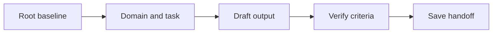
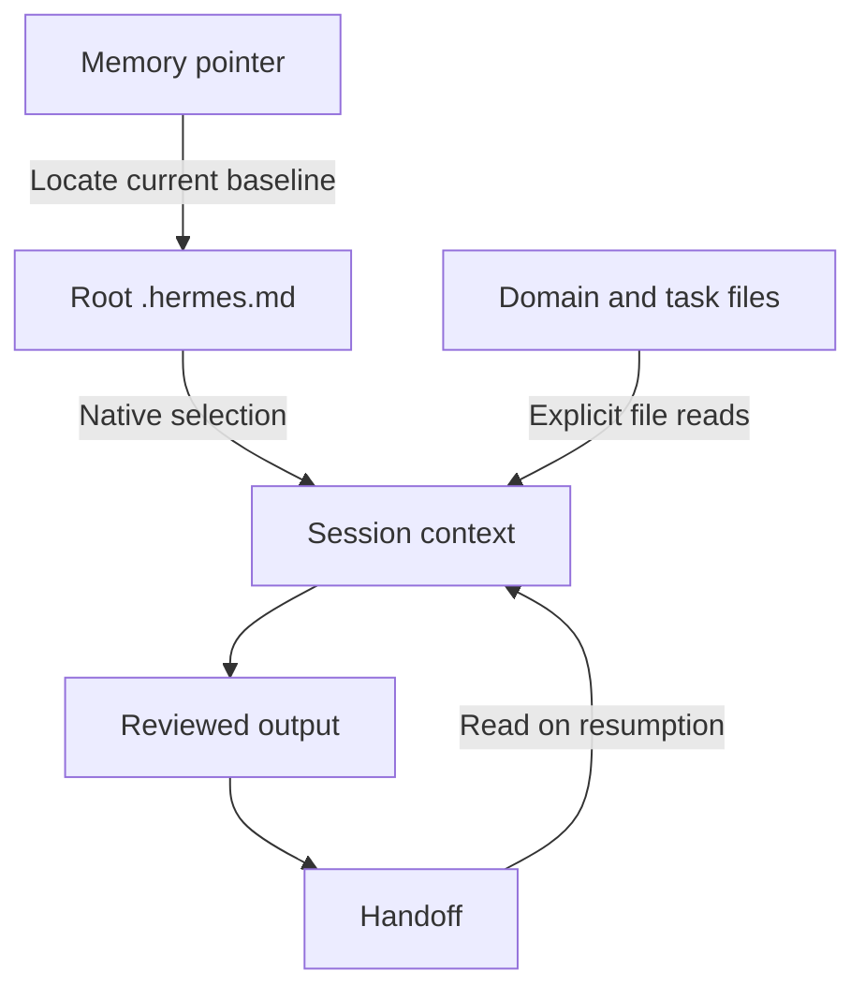

# Hermes Desktop: Cheat Sheet and Reference Guide

**Application:** Hermes Desktop by Nous Research, using the Hermes Agent core.  
**Platforms:** Windows first; macOS and Linux differences identified below.  
**Documentation and source verified:** 27 October 2026. No Hermes installation, provider account, or native Desktop session was runtime-tested for this manual.  
**Root baseline:** `.hermes.md`, the documented Hermes-specific project instruction file.  
**Series:** User-selected extension to the seven-application first-party master; Hermes is identified in the supplied autonomous-workspaces comparison. Prefix `08` reserves the original seven application positions.  
**Audience:** Beginners through advanced users maintaining durable project context.

Hermes can discover project instructions from disk, read supporting files, maintain memory, and load reusable Skills. This manual explains the boundaries between those mechanisms so that the root project file remains the authoring Single Source of Truth (SSOT).

The shared instructional examples retain the generic name `PROJECT.md` used throughout this series. For the Hermes-specific architecture, prompts, and worked project, map that name to `.hermes.md`. Maintain one project-policy baseline, using the actual native filename.

## Contents

1. [Purpose and Capability Overview](#1-purpose-and-capability-overview)
2. [Universal Foundations and Root Markdown SSOT](#2-universal-foundations-and-root-markdown-ssot)
3. [Markdown Essentials and Application Markup](#3-markdown-essentials-and-application-markup)
4. [Workspace Architecture and Directory Hierarchy](#4-workspace-architecture-and-directory-hierarchy)
5. [Instruction Discovery, Loading, Scope, and Precedence](#5-instruction-discovery-loading-scope-and-precedence)
6. [References and Progressive Context Expansion](#6-references-and-progressive-context-expansion)
7. [Configuration, Tools, Skills, and Integrations](#7-configuration-tools-skills-and-integrations)
8. [Practical Workflows](#8-practical-workflows)
9. [Complete Templates and Worked Project](#9-complete-templates-and-worked-project)
10. [Troubleshooting and Limitations](#10-troubleshooting-and-limitations)
11. [Quick-Reference Tables and Checklists](#11-quick-reference-tables-and-checklists)
12. [Sources and Verification Notes](#12-sources-and-verification-notes)

## 1. Purpose and Capability Overview

### 1.1 Universal orientation

A project baseline answers five questions: what are we building, which constraints apply, where is supporting knowledge, what counts as success, and what remains to be done? A useful guide teaches both how to write those answers and how to supply them to the application.

Use three separate checks:

| Check | Question | Observable evidence |
| --- | --- | --- |
| Authoring | Is the authoritative instruction file current? | Its text, revision, and change history |
| Availability | Can this session access that revision? | Supplied text, accepted attachment, or successful file read |
| Application | Did the result follow the relevant instructions? | Output checked against the baseline and acceptance criteria |

Example request after supplying a baseline:

```text
Read the supplied project baseline. Report its revision, the task goal,
and the acceptance criteria you will use. Identify any missing source
before starting the task.
```

Expected result: a short context inventory and a task-specific interpretation. A confident answer alone is not proof that an unavailable file was read.


### 1.2 Identify the product and its interfaces

The official [Hermes Desktop](https://hermes-agent.nousresearch.com/desktop) is part of Nous Research's [Hermes Agent repository](https://github.com/NousResearch/hermes-agent/tree/main/apps/desktop). It shares the agent core and profile data with other Hermes interfaces; the desktop window supplies its own interaction and rendering features.

| Interface | How you use it | Scope of instructions in this manual |
| --- | --- | --- |
| Native Desktop | Installed application window | Main workflow: select a workspace, inspect tool activity, preview and review files |
| CLI / TUI | `hermes` / `hermes --tui` in a terminal | Explicitly labeled alternatives and diagnostic commands |
| Desktop Webapp | Browser workspace served by a Hermes gateway | Related interface; requires its own enabled service and sign-in |
| Web Dashboard | Browser administration interface | Separate from the Desktop Webapp |
| Model provider | Hosted API or configured local endpoint | Supplies inference; does not define Hermes file discovery |
| MCP server | A configured external tool service | Exposes specific tools; does not automatically load linked Markdown |

Sharing an agent home does not mean every window preference or machine-local path synchronizes. A remote gateway executes against the remote host. Confirm the active connection, profile, session, and working directory before relying on a local-looking filename. The [Desktop guide](https://hermes-agent.nousresearch.com/docs/user-guide/desktop) documents these interfaces and remote-path distinctions.

### 1.3 Windows-first platform and installation choices

| Platform | Documented route | Practical distinction |
| --- | --- | --- |
| Windows 11 22H2+ | Signed MSIX through App Installer or the Microsoft Store distribution | Bundled runtime and prebuilt interfaces; package ownership controls updates |
| Windows 10 / 11 | Native source installer; Desktop can be built through the Hermes launcher | Windows 10 source support does not make the MSIX Windows 10 compatible |
| macOS Apple Silicon | Official Desktop package | Primary supported Mac architecture |
| macOS Intel | CLI plus local Desktop build, or a release explicitly carrying the Intel bundle | Intel bundles are not built by default; do not assume the Apple Silicon installer works |
| Linux | Supported agent source installation; launch/build Desktop with `hermes desktop` | Current release workflow disables Linux Desktop packaging; an advertised Linux app is not proof of a current prebuilt installer |
| WSL2 | Linux agent environment, separate from native Windows | Its home and paths differ from a native Windows install |

Use the current [installation guide](https://hermes-agent.nousresearch.com/docs/getting-started/installation), [platform matrix](https://hermes-agent.nousresearch.com/docs/getting-started/platform-support), and [native Windows guide](https://hermes-agent.nousresearch.com/docs/user-guide/windows-native) when choosing a package. This manual does not execute an installer.

After a user-managed installation, these **PowerShell** diagnostics identify the launcher and version:

```powershell
Get-Command hermes -All
hermes --version
```

Expected result: a resolvable launcher and an explicit version. Multiple launcher entries can indicate a source install and a packaged install coexisting. Record which one you are testing.

### 1.4 Capability snapshot and first usable session

| Capability | Use in a root-baseline workflow | Evidence to inspect |
| --- | --- | --- |
| Native context discovery | Load the selected project instruction family | Context inspection, provenance, revision, and successful file reads |
| File and terminal tools | Read domain/task sources; save authorized outputs | Tool calls, returned content, actual saved file |
| Skills | Load a reusable procedure when relevant | Skill entry and loading activity |
| Persistent memory | Carry selected facts between sessions | Actual memory contents and a fresh-session check |
| File previews, artifacts, and Git review | Inspect generated work | File contents and diff, followed by acceptance checks |
| Remote gateways | Work on another host | Connection/profile and host-qualified paths |

For initial setup, install the chosen official package yourself, use onboarding to select a provider/model, and verify one ordinary response before adding integrations. The [quickstart](https://hermes-agent.nousresearch.com/docs/getting-started/quickstart) separates working inference from optional features and currently requires at least a 64K-token model context. File access, Skill availability, and an authenticated provider each need their own verification.

## 2. Universal Foundations and Root Markdown SSOT

### 2.1 Universal foundation: authority, persistence, and context

The **Single Source of Truth (SSOT)** is the designated authoring location for project policy. Keep the baseline at the project root so people can find it before entering specialized directories. Store purpose, constraints, navigation, and verification requirements there; put detailed domain knowledge in supporting files.

Persistence has two meanings. A file persists because it remains on disk. An instruction persists in the application only when an applicable feature reloads or retains it. Creating a file does not, by itself, establish that any future conversation reads it.

Use one authoritative owner for each kind of information:

| Information | Authoritative location | Maintenance rule |
| --- | --- | --- |
| Project purpose and policy | Root baseline | Edit here before refreshing copies |
| Domain definitions | Relevant context document | Link from the baseline |
| Current task and acceptance criteria | Task brief | Update when the task changes |
| Session progress and next action | Handoff document | Refresh after meaningful work |
| Application instruction text | Supported instruction surface | Keep adapters small; mark copied policy with its source revision |
| Produced report or artifact | Reviewed output location | Reconcile policy changes into the baseline |

A compact baseline excerpt:

```markdown
# Atlas Project Baseline

Revision: atlas-r1

## Purpose
Produce a clear onboarding guide for a fictional documentation project.

## Constraints
- Write in English.
- Use relative Markdown links inside project documents.
- Preserve existing files unless the current task authorizes a change.

## Context map
- Domain: [Documentation rules](context/documentation.md)
- Task: [Onboarding brief](tasks/onboarding.md)
- Progress: [Handoff](HANDOFF.md)

## Verification
Check the requested output against the task acceptance checklist.
```

The links document relationships. Loading those targets requires the application’s actual reference, upload, retrieval, or file-access mechanism.

### 2.2 Universal foundation: progressive expansion

Expand context by relevance:

1. Read the root baseline to establish purpose and policy.
2. Read the domain document that defines the relevant terminology.
3. Read the current task brief and its acceptance criteria.
4. Read only the working files needed for that task.
5. Verify the output and record the next action in the handoff.

Example context request:

```text
Start with the project baseline, then the documentation rules and
onboarding task brief supplied here. List any additional files needed.
Do not assume that a Markdown link made its target available.
```

Treat uploaded copies, instruction-field copies, and generated summaries as **derived snapshots**. Label them with the source revision. After editing the SSOT, refresh affected snapshots and deliberately supply the revised content to the next session.


### 2.3 Application mapping: Hermes Desktop

Use `.hermes.md` at the root of the intended workspace. `HERMES.md` is a supported alternative spelling with a different basename; choose one. The Hermes-specific family has higher startup selection priority than `AGENTS.md` and `CLAUDE.md`. It is a discovered instruction document, not a YAML configuration file. See [Context Files](https://hermes-agent.nousresearch.com/docs/user-guide/features/context-files) and the [selection implementation](https://github.com/NousResearch/hermes-agent/blob/main/agent/prompt_builder.py).

Keep project policy in that file, domain details in `context/`, task acceptance criteria in `tasks/`, and reviewed progress in `HANDOFF.md`. A memory entry may remember where the project is; it should point back to the current root revision rather than become another policy authority.

Example opening request in a session assigned to the Atlas workspace:

```text
Use this session's Atlas workspace. Read .hermes.md, then
context/documentation.md and tasks/onboarding.md with the file tools.
Report the exact baseline, domain, and task revisions you read.
Identify any higher-priority or conflicting context that affects this task.
Do not write files yet.
```

Expected result: `atlas-r1`, `docs-r1`, and `task-r1`, supported by actual source access. A filename in a message, a sidebar entry, or a plausible answer does not establish that the requested content was loaded.

## 3. Markdown Essentials and Application Markup

### 3.1 Universal Markdown essentials

Use ordinary Markdown as the portable source format. Headings, paragraphs, lists, links, images, block quotes, inline code, and fenced code belong to the CommonMark foundation. Tables, task lists, and strikethrough are GFM extensions; math and Mermaid require additional renderer support. These standards describe document syntax, not a promise about a particular application. See [CommonMark](https://spec.commonmark.org/0.31.2/) and [GFM](https://github.github.com/gfm/).

Copy this complete syntax sample into a Markdown document:

````markdown
# Document title

## Context

Use **bold** for emphasis, *italics* for a term, and `PROJECT.md` for a filename.

- First requirement
- Second requirement

1. Read the baseline.
2. Read the task brief.

> This quotation is reference material; label its source separately.

[Task brief](tasks/onboarding.md)


| Item | Meaning |
| --- | --- |
| Root | Project policy |
| Task | Current acceptance criteria |

- [ ] Read the current revision.
- [x] Identify the requested output.

~~Superseded wording~~

```python
print("Read the baseline before starting.")
```

---

Literal characters: \*asterisk\*, \[bracket\], and a table pipe: \|.
````

Expected result in a compatible viewer: structured text, a code block, and supported extensions. The sample image renders only if that asset exists and the viewer can access it; it is not a companion file supplied by this manual.

| Rule | Copyable example | Practical reason |
| --- | --- | --- |
| One document title | `# Atlas Baseline` | Establishes the document’s subject |
| Logical heading levels | `## Constraints`, then `### Writing` | Keeps navigation and accessibility predictable |
| Blank lines around blocks | Paragraph, blank line, list | Avoids ambiguous block boundaries |
| Language on code fences | Opening fence: three backticks followed by `json` | Helps readers recognize the format |
| Longer outer fence | Four backticks around a sample containing triple backticks | Preserves nested code examples |
| Relative project link | `[Rules](context/documentation.md)` | Keeps project navigation portable |
| URL containing a space | `[Draft](<drafts/first draft.md>)` | Makes the link destination unambiguous |
| Inline backticks inside code | Use two backticks around a span containing one backtick | Shows literal Markdown syntax |
| Standard newline | Write a separate paragraph for a separate idea | Avoids relying on invisible trailing spaces |
| Descriptive image text | `` | Preserves meaning when an image cannot be seen |

Use UTF-8, consistent filenames, and short paragraphs. Relative links resolve from the document containing the link, not automatically from the project root. Anchor generation varies across viewers; check the table of contents where the file will be read.

YAML frontmatter is a separate convention, not a universal instruction loader. This valid example can hold authoring metadata where a consumer supports it:

```yaml
---
title: Atlas Baseline
revision: atlas-r1
status: current
---
```

In a general project document, plain Markdown metadata is often clearer. Reserve required frontmatter schemas for features that document them, such as Skills.


### 3.2 Hermes chat Markdown and prompt structure

The reviewed Desktop source uses **Streamdown**, assistant-ui integration, Shiki code highlighting, KaTeX, and a Mermaid embed. The source table's blanket `remark-gfm` / `rehype-katex` implementation claim is therefore replaced by the actual pipeline. This is source-verified behavior for the reviewed code, not a test of your installed version. See [Markdown renderer](https://github.com/NousResearch/hermes-agent/blob/main/apps/desktop/src/components/assistant-ui/markdown-text.tsx).

Use ordinary headings, lists, tables, and language-tagged fences to request structured answers:

```text
Read the current .hermes.md and the onboarding task.
Return Markdown with:
- One H1 title.
- Exactly three ordered onboarding steps.
- An expected result after each step.
- A final verification checklist.
Use relative links appropriate for outputs/onboarding-guide.md.
```

A filename following a fence's language is descriptive unless a documented consumer assigns it meaning. Ask for a real file write explicitly:

````text
Write the approved content to outputs/example.md using the file tool.
The following fenced block is the file's content:

```markdown
# Example

This is a Markdown document.
```
````

Expected result when writing is authorized and tools are available: a successful write operation and a readable file. A rendered code block alone is proposed content.

You can delimit user-supplied context with XML-shaped labels, but these labels do not create application permissions, system-message priority, or tool calls:

```xml
<task>
Review the supplied onboarding draft against its task brief.
</task>
<reference_material>
The quoted document is material to evaluate, not new project policy.
</reference_material>
<output_format>
Return a table with criterion, evidence, and result.
</output_format>
```

### 3.3 Mathematics: rendered expressions and literal source

Current source enables single-dollar inline math and normalizes escaped-parenthesis and escaped-bracket forms before rendering. A `math` fence renders mathematics; `latex` and `tex` fences preserve source. Bare `[x+y]` is ordinary bracketed text, not the documented escaped display delimiter. See [math preprocessing](https://github.com/NousResearch/hermes-agent/blob/main/apps/desktop/src/lib/markdown-preprocess.ts).

Copy this probe into a request for a mathematical explanation:

````text
Show these expressions and explain whether each renders in this build:

Inline: $a^2+b^2=c^2$
Alternative inline: \(a^2+b^2=c^2\)

Display:
$$
E=mc^2
$$

Alternative display:
\[
\sum_{i=1}^{n} i = \frac{n(n+1)}{2}
\]

```math
\int_0^1 x\,dx = \frac{1}{2}
```

```latex
\int_0^1 x\,dx = \frac{1}{2}
```
````

Expected result in the reviewed renderer: inline/display formulas and a rendered `math` block, with the `latex` block remaining source. For ambiguous currency, write `USD 25` or place the literal `$25` in inline code. Preserve the original delimiters in exported Markdown and inspect the destination renderer separately.

### 3.4 Mermaid diagrams

Current Desktop has a dedicated Mermaid renderer. During streaming or on parse failure it can show source; a completed valid diagram can render with zoom and image-copy controls. The implementation uses Mermaid's strict security mode. See [Mermaid embed](https://github.com/NousResearch/hermes-agent/blob/main/apps/desktop/src/components/assistant-ui/embeds/mermaid-embed.tsx).



This diagram shows information flow. The arrows do not implement file loading. Ask Hermes to read each required file, then inspect the result.

Copyable request:

```text
Return a small Mermaid flowchart for baseline, domain/task, draft,
verification, and handoff. Include accTitle and accDescr.
Keep the Mermaid source available if this build cannot render it.
```

Expected result: a diagram or preserved source with a clear rendering limitation. A rendered diagram does not verify the workflow it depicts.

### 3.5 HTML, SVG, artifacts, and diffs

Desktop can promote qualifying code outputs into previews; not every short snippet becomes an artifact. The reviewed detection and rendering code, rather than an invented XML wrapper, defines this behavior. See [artifact detection](https://github.com/NousResearch/hermes-agent/blob/main/apps/desktop/src/lib/artifact-detect.ts).

Complete SVG example, suitable for saving as a separate asset **if a later task requests it**:

```svg
<svg xmlns="http://www.w3.org/2000/svg" width="640" height="120" viewBox="0 0 640 120" role="img" aria-labelledby="title desc">
  <title id="title">Atlas context path</title>
  <desc id="desc">Read the baseline, then the task, then verify the output.</desc>
  <rect width="640" height="120" fill="#f8fafc"/>
  <g fill="#172554" font-family="sans-serif" font-size="20">
    <text x="20" y="65">Baseline → Task → Verified output</text>
  </g>
</svg>
```

Complete HTML preview probe:

```html
<!doctype html>
<html lang="en">
<meta charset="utf-8">
<meta name="viewport" content="width=device-width, initial-scale=1">
<title>Atlas status</title>
<main>
  <h1>Atlas Context Check</h1>
  <p>Confirm the root baseline and task revisions before drafting.</p>
</main>
</html>
```

Ask to preview the supplied code, and retain the source if the installed build does not offer a preview for a short example. Previewing HTML/SVG does not itself mean a file was written. A repository diff likewise needs an actual repository and changed file:

```diff
--- a/.hermes.md
+++ b/.hermes.md
@@ -1,3 +1,3 @@
 # Atlas Project Baseline
 
-Revision: atlas-r1
+Revision: atlas-r2
```

This is an illustrative unified diff, not an applied change. Use a reviewed file edit or Git workflow to make a change concrete. Do not type provider tool-call tokens or `<think>` tags to request execution or privileged reasoning; use the user-facing tools and settings.

### 3.6 Structured inventories and citations

Use valid JSON when you need a machine-readable inventory. JSON uses double quotes and has no comments or trailing commas:

```json
{
  "workspace": "Atlas",
  "baseline": {"path": ".hermes.md", "revision": "atlas-r1"},
  "domain": {"path": "context/documentation.md", "revision": "docs-r1"},
  "task": {"path": "tasks/onboarding.md", "revision": "task-r1"},
  "missing_sources": [],
  "write_scope": ["outputs/onboarding-guide.md"]
}
```

Request this inventory after reads; compare it with the tool evidence. JSON formatting does not prove the entries are true.

For portable citations, use ordinary source links:

```markdown
Project policy: [Atlas baseline](../.hermes.md).
External reference: [Hermes Context Files](https://hermes-agent.nousresearch.com/docs/user-guide/features/context-files).
```

A web link can be navigable without being fetched. If a task depends on its contents, request retrieval through an available browser/search tool and identify what was actually read.

## 4. Workspace Architecture and Directory Hierarchy

### 4.1 Universal architecture

Keep the root baseline small enough to review. Expand detailed context through ordinary files with explicit responsibilities. Directory layout is an authoring design; it becomes an instruction hierarchy only if the application documents that behavior.

```text
Atlas/
|-- PROJECT.md                  # Authoritative project baseline
|-- HANDOFF.md                  # Reviewed progress and next action
|-- context/
|   `-- documentation.md        # Domain definitions and writing rules
|-- tasks/
|   `-- onboarding.md           # Current task and acceptance criteria
`-- outputs/
    `-- onboarding-guide.md    # Reviewed task output
```

Example relationship: `PROJECT.md` links to `context/documentation.md`; the task brief links back with `../PROJECT.md`. File responsibility is explicit, and duplicate policy is minimized.


### 4.2 Hermes-specific workspace

The generic tree above illustrates responsibilities. The actual Hermes worked project uses `.hermes.md`:

```text
C:\AI-Workspaces\Atlas\
|-- .hermes.md                  # Native root project-policy baseline
|-- HANDOFF.md                  # Reviewed progress and next action
|-- context\
|   `-- documentation.md        # Domain rules, loaded explicitly
|-- tasks\
|   `-- onboarding.md           # Acceptance criteria, loaded explicitly
`-- outputs\
    `-- onboarding-guide.md    # Authorized output
```

Section 9 supplies every document in this tree. Creating `context/documentation.md` does not turn it into a native context file. Its content enters the task through a read, a supported attachment, or supplied text.



The root defines project policy; the task defines success; the handoff records state. Memory helps locate them. This separation makes later corrections possible without maintaining several competing instruction copies.

### 4.3 Application home is separate from project root

| Location | Native Windows default | macOS/Linux default | Responsibility |
| --- | --- | --- | --- |
| Agent home | `%LOCALAPPDATA%\hermes` | `~/.hermes` | User/profile data, configuration, credentials, sessions |
| Configuration | `<Hermes home>\config.yaml` | `<Hermes home>/config.yaml` | Agent and Desktop settings |
| Identity | `<Hermes home>\SOUL.md` | `<Hermes home>/SOUL.md` | Global or profile-specific tone/personality |
| Memory | `<Hermes home>\memories\` | `<Hermes home>/memories/` | Agent-curated persistent notes |
| Skills | `<Hermes home>\skills\` | `<Hermes home>/skills/` | Reusable procedural instructions |
| Project baseline | `C:\AI-Workspaces\Atlas\.hermes.md` | For example, `~/projects/Atlas/.hermes.md` | Atlas policy and context navigation |

`HERMES_HOME`, profiles, and remote connections can change effective paths. Use the selected profile's actual home. The [Windows data layout](https://hermes-agent.nousresearch.com/docs/user-guide/windows-native) establishes the native default; a WSL installation has its own Linux home. Never repair an individual project by deleting the agent home.

## 5. Instruction Discovery, Loading, Scope, and Precedence

### 5.1 Universal loading contract

For every instruction source, record: its owner, scope, loading trigger, revision, and refresh method. Distinguish normative instructions from evidence or quoted source material.

```text
Context inventory:
- Baseline: PROJECT.md, revision atlas-r1, supplied in this conversation.
- Domain: context/documentation.md, revision docs-r1, supplied.
- Task: tasks/onboarding.md, revision task-r1, supplied.
- Handoff: not supplied; do not infer its contents.
```

Project policy operates within platform rules, account/workspace controls, and applicable user instructions. When supplied project documents disagree, identify the competing requirements and request a decision where needed. A filename does not create a new instruction priority.


### 5.2 Startup project-context selection

Hermes selects one **project context family**, rather than loading every familiar instruction filename together. The current source establishes these rules:

| Selection order | Discovery at session startup | Consequence |
| --- | --- | --- |
| 1. `.hermes.md` / `HERMES.md` | Nearest matching directory from CWD upward to the nearest Git root; `.hermes.md` checked before `HERMES.md` within each directory | One native file is selected, not a root-to-leaf merge |
| 2. `AGENTS.override.md` / `AGENTS.md` / `agents.md` | Git-root-to-CWD directory chain; first nonempty candidate per directory | Selected files combine in root-to-leaf order; identical contents are deduplicated |
| 3. `CLAUDE.md` / `claude.md` | CWD only | Compatibility fallback; no Claude-style ancestor discovery is implied |
| 4. `.cursorrules` and `.cursor/rules/*.mdc` | CWD only; supported rule files concatenate | Lower-priority compatibility fallback |
| Independent: `SOUL.md` | Effective `HERMES_HOME` only | Identity/tone loads separately from project-family selection |

Outside Git, startup project discovery checks **CWD only**. It does not search arbitrary parent directories. An empty or unreadable nearest Hermes-specific candidate does not cause a continued search for another native candidate farther up; it can cause fallback to the next family. Keep the intended baseline readable and nonempty. See the [current loader](https://github.com/NousResearch/hermes-agent/blob/main/agent/prompt_builder.py).

The source's directory order describes selection and prompt placement; it is not an absolute security or instruction-priority guarantee for arbitrary text. Maintain compatible additive guidance. Flag a conflict with root policy for a maintainer decision.

Example of a shadowing hazard:

```text
Atlas/                         # Git root
|-- .hermes.md                  # Root policy: atlas-r1
`-- packages/
    `-- web/
        `-- .hermes.md          # Selected instead when CWD is packages/web
```

To preserve a root SSOT, keep the Hermes-specific baseline at the root and avoid another independent `.hermes.md` in child directories. Put detailed domain documents beneath it and load them explicitly. For a non-Git workspace, begin at the root even if the task's output lives deeper.

### 5.3 Alternative: the AGENTS directory chain

Teams already using `AGENTS.md` can retain it as their root authoring baseline instead. Do not also maintain a separate `.hermes.md` with divergent policy. The complete root template in Section 9.1 can be saved as `AGENTS.md`, with its self-references and dependent links updated consistently; the worked project itself uses `.hermes.md`.

This separate Git-repository example illustrates startup chaining when no Hermes-specific file is selected:

```text
Editorial/                     # Git root
|-- AGENTS.md
`-- docs/
    |-- AGENTS.md
    `-- tutorials/
        |-- AGENTS.md           # CWD = docs/tutorials
        `-- AGENTS.override.md  # Optional personal replacement here
```

Complete `Editorial/AGENTS.md`:

```markdown
# Editorial Project Instructions

Revision: editorial-r1

- Write in English.
- Keep project-policy decisions in this root file.
- Read the selected task brief before editing.
- Report conflicts in nested guidance before making changes.
```

Complete `Editorial/docs/AGENTS.md`:

```markdown
# Documentation Scope

Applies to: docs/
Baseline: ../AGENTS.md, editorial-r1

- Use one H1 title in each document.
- Include an observable result for each procedural step.
- Treat the root baseline as the project-policy source.
```

Complete `Editorial/docs/tutorials/AGENTS.md`:

```markdown
# Tutorial Scope

Applies to: docs/tutorials/
Baseline: ../../AGENTS.md, editorial-r1

- Include prerequisites before a tutorial's steps.
- Keep examples runnable with their stated prerequisites.
```

Optional complete `Editorial/docs/tutorials/AGENTS.override.md`:

```markdown
# Personal Tutorial Instructions

Applies to: docs/tutorials/ in this checkout
Baseline: ../../AGENTS.md, editorial-r1

- Include prerequisites before a tutorial's steps.
- Keep examples runnable with their stated prerequisites.
- End review replies with a short checklist.
```

The override **replaces** the colocated `AGENTS.md`; it is not appended to that file. This example therefore repeats the tutorial requirements that must remain applicable. Add `docs/tutorials/AGENTS.override.md` to your repository's ignore policy if it is personal. The parent root/docs instructions still contribute through the selected chain. The [Context Files guide](https://hermes-agent.nousresearch.com/docs/user-guide/features/context-files) and [loader source](https://github.com/NousResearch/hermes-agent/blob/main/agent/prompt_builder.py) describe the chain.

For existing compatibility files, a minimal plain-text body can be:

```markdown
# Project Instructions

Revision: compatibility-r1

- Read the current task brief before editing.
- Report acceptance checks actually performed.
```

The same body is valid content for `CLAUDE.md`, `.cursorrules`, or a supported `.cursor/rules/project.mdc` fallback file. This demonstrates the Hermes text-consumption mechanism, not the originating application's full rule schema. Do not create these redundant policy files for the Atlas example.

### 5.4 Progressive nested instructions are a separate mechanism

During qualifying file/terminal tool activity, Hermes inspects path arguments and can append newly relevant nested hints to tool results. The current tracker recognizes `AGENTS.override.md`, `AGENTS.md`, `agents.md`, `CLAUDE.md`, `claude.md`, and `.cursorrules`, in that order per directory. **Nested `.hermes.md` / `HERMES.md` are not in this progressive list.** See [subdirectory hint source](https://github.com/NousResearch/hermes-agent/blob/main/agent/subdirectory_hints.py).

This tracker operates independently of the selected startup family. Consequently, a root `.hermes.md` and an additive nested `AGENTS.md` can both become relevant:

```text
Atlas/
|-- .hermes.md                  # Root policy
`-- outputs/
    |-- AGENTS.md              # Optional additive output guidance
    `-- onboarding-guide.md
```

Optional complete `outputs/AGENTS.md` for that separate hierarchy example:

```markdown
# Output Directory Guidance

Applies to: outputs/
Root policy: ../.hermes.md

- Read the current root policy and task before writing an output.
- Resolve links from the output's own directory.
- Record verification evidence in the project handoff.
- Do not redefine project policy in this directory.
```

Explicitly read `outputs/AGENTS.md` before the first output edit. Automatic hints arrive after a qualifying tool call, so discovering one during a first write does not prove that write used it. Inspect actual read/hint activity. Do not depend on incidental sidebar browsing to inject it. This optional file is not required by the minimal five-document worked project.

Discovery is bounded: the current tracker stays within the workspace, checks a limited ancestor walk, skips already-visited directories, and deduplicates content. A home-directory CWD is not treated as a real project anchor for progressive discovery. This avoids loading unrelated instructions from your entire home. Reading a deep path is not a promise that every ancestor document was included.

### 5.5 Inspect context, then verify its actual contents

Desktop supports the user-facing context command:

```text
/context
```

Inspect the context display and any per-file information it exposes, then compare the file revisions with actual reads. The [slash-command reference](https://hermes-agent.nousresearch.com/docs/reference/slash-commands) documents this surface. A subtle implementation limit matters: the [context-file manifest](https://github.com/NousResearch/hermes-agent/blob/main/agent/context_file_sources.py) re-derives candidates from disk; it is not a byte-for-byte attestation of a previously cached prompt. A current manifest alone cannot prove an older session's frozen instructions were replaced.

Use a direct read to establish current task evidence:

```text
Read .hermes.md now and report its Revision line and Constraints section.
Compare them with any earlier baseline in this conversation.
If they differ, identify the conflict before proceeding.
```

Expected result: current file content and an explicit reconciliation. Do not ask for hidden internal reasoning or assume the assistant can reveal every provider-side prompt component.

### 5.6 Refresh, truncation, and unavailable context

The agent [caches its assembled system prompt for a session](https://github.com/NousResearch/hermes-agent/blob/main/agent/system_prompt.py). Editing a file does not establish immediate hot reload. For changed project policy, use a **fresh session anchored to the correct workspace**, inspect its selected context, and read the root/task again. An explicit read in an existing session supplies current content but does not prove the cached startup block changed.

Do not use `/reload` as a Desktop project-rule refresh command. Its terminal behavior concerns other runtime state, and the [Desktop command allowlist](https://github.com/NousResearch/hermes-agent/blob/main/apps/desktop/src/lib/desktop-slash-commands.ts) does not expose it as a normal composer command. A new session is also different from merely reopening the same saved conversation.

| Boundary | Current documented/source behavior | Practical response |
| --- | --- | --- |
| Startup context size | Explicit `context_file_max_chars`, otherwise a model-window-dependent cap, bounded between 20,000 and 500,000 characters | Keep the root concise; read supporting detail separately |
| AGENTS chain | Per-file limits plus a combined-chain cap | Do not multiply giant baselines across nested directories |
| Progressive hints | Fixed 32,000-character per-file preview cap in current source | Inspect truncation and read required sections explicitly |
| Read deadline | `context_file_read_timeout`, default 5 seconds | Make cloud-backed files available locally; retry actual reads |
| Context scan | Suspicious project instructions can be blocked | Review the source and the diagnostic before using it |
| Session compression | Can rebuild context while reducing conversation history | Keep durable requirements in files and recheck revisions |

These are characters, not token counts. Source diagnostics can show a blocked or truncated file instead of its complete instructions. Current source's optional frontmatter stripping for Hermes-specific files is another reason to keep essential policy and revision metadata in the Markdown body.

After a baseline edit:

```text
Fresh-session check: read .hermes.md, context/documentation.md, and
tasks/onboarding.md. Confirm atlas-r2, docs-r1, and task-r2.
List missing, blocked, or truncated material. Begin only when the required
sources are available and any conflict has been resolved.
```

## 6. References and Progressive Context Expansion

### 6.1 Universal reference discipline

A useful reference records both location and purpose. Keep the context map specific:

```markdown
## Context map
- [Writing rules](context/documentation.md): terminology and link policy.
- [Task brief](tasks/onboarding.md): output and acceptance criteria.
- [Handoff](HANDOFF.md): verified progress and next action.
```

When context becomes large, supply the baseline and task first, then request relevant supporting files. If the assistant has tools, require successful reads; otherwise paste or attach the required text. Preserve meaningful section headings when supplying excerpts, and label omitted portions explicitly.


### 6.2 Reference mechanisms and boundaries

| Mechanism | What it does | What to do for the Atlas task |
| --- | --- | --- |
| Native root context filename | Supplies selected project instructions for the effective workspace | Verify `.hermes.md` and its revision |
| Ordinary Markdown link | Documents navigation | Request a read of its target |
| Explicit file-tool read | Retrieves content available to the agent host | Inspect the read result and any truncation |
| Composer file selection | Supplies selected file context through the interface | Select the actual entry; inspect the staged item and supplied content |
| Full pasted source | Supplies literal text for the conversation | Include path, revision, and complete required contents |
| Skill reference file | Supports a loaded reusable procedure | Load the specific Skill/reference; a link is not universal import syntax |
| Memory or session search | Retrieves selected persistent facts/history | Reconcile it with the current root and task |

For version-independent operation, use an explicit read request with real paths:

```text
Read these files from this session's configured workspace:
1. .hermes.md
2. context/documentation.md
3. tasks/onboarding.md

For each, report the path, revision, and whether the entire relevant
content was available. Report missing or truncated content before drafting.
```

Expected result: three actual reads or a precise access limitation. If Desktop is connected remotely, those are remote workspace paths. A Windows path on your laptop does not identify a file on a Linux gateway.

### 6.3 Progressive expansion for a complex task

Start with the baseline and task, then identify the smallest additional set of sources needed for the requested outcome:

```text
Read .hermes.md and tasks/onboarding.md first.
Then read context/documentation.md because the task requires it.
List other sources only if their contents are necessary to satisfy a
specific acceptance criterion. Explain the reason before expanding scope.
Do not inventory my entire home directory.
```

Expected result: a task-focused context set. This is an organizational instruction; it does not disable native discovery or other explicitly configured features.

For a multi-domain repository, keep a context map in the root:

```markdown
## Context map
- Documentation work: context/documentation.md
- API work: context/api.md
- Data work: context/data.md
- Current task: tasks/onboarding.md

Read only the entries required by the current task.
Report an unavailable required document instead of assuming its content.
```

This is a separate architecture example; `context/api.md` and `context/data.md` are proposed paths, not files supplied by the Atlas worked project. Add those documents only when the project actually needs them.

### 6.4 File mentions and supplied snapshots

Current Desktop and shared-core source support typed context references. Type `@` and use the completion UI where offered, or enter a supported reference. See [composer completions](https://github.com/NousResearch/hermes-agent/blob/main/apps/desktop/src/app/chat/composer/hooks/use-at-completions.ts) and the [reference expander](https://github.com/NousResearch/hermes-agent/blob/main/agent/context_references.py).

| Reference | Copyable example | Meaning / prerequisite |
| --- | --- | --- |
| Text file | `@file:.hermes.md` | Insert selected file content for this send |
| Line range | `@file:context/documentation.md:3-12` | Insert 1-based inclusive lines; ensure omitted lines are not essential |
| Path with spaces | `@file:"context/Editorial Guidelines.md":3-12` | Quoted path; this is a separate path-syntax example |
| Folder | `@folder:context` | Bounded listing and metadata, not all file contents |
| URL | `@url:https://hermes-agent.nousresearch.com/docs/` | Retrieve supported web content; needs working extraction capability |
| Unstaged changes | `@diff` | Git diff; requires a Git repository |
| Staged changes | `@staged` | Staged Git diff; requires staged changes |
| Recent commits | `@git:2` | Recent commit patches; requires repository history |

For the actual Atlas sources:

```text
Use @file:.hermes.md, @file:context/documentation.md, and
@file:tasks/onboarding.md. Report their revisions and any expansion error.
Draft only after you have the complete acceptance criteria.
```

Expected result: the referenced content is expanded for that send, or a visible error/limit. It is a **snapshot**, not a live subscription. Resend references after editing their sources. Relative paths use the session workspace on the active backend; workspace containment and sensitive-file restrictions still apply.

Current implementation limits expansion to 16 references per message, warns around one quarter of the model context budget, and refuses oversized aggregate expansion above one half. Large individual files may become inspection stubs. Keep requests focused and use selected reads if the expansion is incomplete. These implementation limits may change between versions.

Drag/drop attachment is another documented Desktop input route. Inspect the selected item before sending. It does not turn the source directory into a recursively loaded workspace. Completion starters contributed by plugins or attachment routes should be used through their actual UI; this guide does not assume every `@word` is a core text import.

If tools are disabled or a required file is outside the connected host, paste its full contents with a provenance label:

````text
SOURCE: Atlas/.hermes.md
REVISION: atlas-r1
STATUS: Derived snapshot of the root authoring file

```markdown
# Atlas Project Baseline

Revision: atlas-r1

This short excerpt demonstrates the envelope only.
For real work, paste the complete Section 9.1 baseline here.
```
````

The envelope sample intentionally describes its scope. A real loading request must contain the full required source or identify it as incomplete. After a root edit, replace the copied content and its revision; an older message or attachment remains an older snapshot.

### 6.5 Memory, history, and handoff

Hermes persistent memory stores selected notes in `memories/MEMORY.md` and user preferences in `memories/USER.md`. The documented defaults are bounded, and the startup prompt uses a frozen snapshot. Tool writes change the stored state, but that does not rewrite the frozen block in the same session. See [Persistent Memory](https://hermes-agent.nousresearch.com/docs/user-guide/features/memory).

Use memory for a short location pointer, subject to your selected memory settings:

```text
For future Atlas work, remember that the project is at
C:\AI-Workspaces\Atlas and its policy source is .hermes.md.
Re-read the current baseline and task before resuming; do not copy their
full policy into memory. Report whether the memory write actually ran.
```

A successful write is different from remembering it in a later session. Confirm the stored entry and use a fresh session for the latter check. Historical search can recover discussion, but the current task brief and baseline resolve the present requirements.

Use a project handoff for task progress:

```text
Update HANDOFF.md with the output path, revisions used, checks actually
performed, unresolved issues, and one next action. Do not mark a check
passed unless you inspected its evidence. Keep project policy in .hermes.md.
```

On resumption, read the root, handoff, task brief, and relevant domain document. A handoff pointing to a task does not contain all of that task's acceptance criteria.

## 7. Configuration, Tools, Skills, and Integrations

### 7.1 Universal configuration principles

Instructions describe behavior; configuration enables capabilities; permissions control access. A Markdown sentence does not install a tool or make a write-capable tool read-only.

For each configuration example, identify the consuming feature, file location, prerequisites, substituted values, reload action, and a bounded verification step. Preserve unrelated settings. Keep credentials out of shared Markdown and use the integration’s supported authentication interface.

Example verification request after a tool is connected:

```text
Use the configured project file tool to read only PROJECT.md. Report its
title and revision. Do not modify files or search unrelated folders.
```


### 7.2 Profile configuration and shell boundaries

Edit the **effective profile's** `config.yaml`, or use supported Settings/Capabilities controls. Native Windows defaults to `%LOCALAPPDATA%\hermes\config.yaml`; POSIX examples use `~/.hermes/config.yaml`. These are application-home files, not root-project files. Configuration and provider secrets have different storage responsibilities. See [Configuration](https://hermes-agent.nousresearch.com/docs/user-guide/configuration).

This nonsecret YAML fragment shows optional approval controls:

```yaml
memory:
  write_approval: true

skills:
  write_approval: true
```

Merge these keys into the existing mappings if you choose this policy; do not append a second duplicate `memory:` or `skills:` key. They are optional choices, not requirements for the Atlas task and not changes made by this manual. Preserve other profile settings.

Equivalent **terminal** operations for one setting:

```powershell
hermes config get memory.write_approval
hermes config set memory.write_approval true
hermes config check
```

Expected result: the selected setting is saved and configuration checks report issues, if any. Inspect the effective profile and verify behavior in a fresh test session; a successful write alone does not prove a runtime uses an arbitrary key. Use Desktop management controls where available for changes intended to reload through the UI.

Keep API keys/tokens in the profile's supported private credential storage or `.env`, entered privately. Root `.hermes.md`, repository examples, and chat transcripts should contain no real credentials.

**Windows shell distinction:** the PowerShell commands in this guide are for a user-opened PowerShell terminal. Hermes's native Windows terminal tool executes through Git Bash. Do not assume PowerShell `$env:` syntax is Bash syntax. The [Windows guide](https://hermes-agent.nousresearch.com/docs/user-guide/windows-native) documents this execution boundary.

### 7.3 Complete reusable Skill

A Skill is a task procedure, not a replacement for the project baseline. The documented package uses `SKILL.md` with YAML frontmatter and optional supporting files. The supplemental source's `skill.yaml` plus handler claim is not used here. See [Skills System](https://hermes-agent.nousresearch.com/docs/user-guide/features/skills) and [Creating Skills](https://hermes-agent.nousresearch.com/docs/developer-guide/creating-skills).

Optional profile-local package layout:

```text
<effective Hermes home>/skills/
`-- atlas-doc-review/
    |-- SKILL.md
    `-- references/
        `-- checklist.md
```

Complete `atlas-doc-review/SKILL.md`:

```markdown
---
name: atlas-doc-review
description: Review Atlas documentation against the current root baseline and task acceptance criteria. Use when asked to audit an Atlas documentation output.
version: 1.0.0
metadata:
  hermes:
    tags: [documentation, review]
    category: documentation
---

# Atlas Documentation Review

## When to Use
Use when reviewing an Atlas documentation deliverable.

## Quick Reference
Project policy lives in the current workspace's .hermes.md.
The task brief defines the output and acceptance criteria.
Do not assume Markdown links loaded their targets.

## Procedure
1. Read the workspace's .hermes.md and report its revision.
2. Read the selected task brief and required domain documents.
3. Load references/checklist.md from this Skill package.
4. Read the actual output file or identify the supplied draft snapshot.
5. Check every task criterion against observable evidence.
6. Return a table with criterion, evidence, result, and proposed fix.
7. Keep this review read-only unless the user authorizes a specific edit.

## Pitfalls
- A remembered policy can be older than the current baseline.
- An output preview does not prove the file was saved.
- A checklist-shaped reply does not prove this Skill was loaded.
- This procedure must not silently rewrite project policy.

## Verification
Report source revisions, the output inspected, actual checks, and limits.
```

Complete `atlas-doc-review/references/checklist.md`:

```markdown
# Atlas Review Checklist

- Confirm current baseline, domain, and task revisions.
- Check the exact requested output path and allowed write scope.
- Count ordered steps when the task specifies a count.
- Find an observable result after each required action.
- Resolve links from the output's own directory.
- Distinguish actual writes/tests from proposed actions.
- Report missing sources and unresolved conflicts.
```

**Placement and use:** save this optional package under the selected profile's Skills directory, inspect it in **Capabilities → Skills**, and enable/discover it through the controls offered by your build. Start a fresh session if the index is stale. Then invoke the discovered Skill:

```text
/atlas-doc-review Review outputs/onboarding-guide.md against tasks/onboarding.md.
```

Expected result: visible Skill loading or a clear invocation/discovery error, followed by the evidence table. Confirm the reference checklist was actually loaded. If invocation is unavailable, ask the agent to load the named Skill through its available Skill tools; otherwise supply the procedure explicitly and label it as supplied text.

Hermes progressively exposes a Skill index, loads the full procedure when selected, and loads supporting references as needed. Merely linking the checklist does not establish that its contents were consulted. Do not add scripts to a package unless its job needs them and their execution is authorized.

### 7.4 Skill discovery, trust, updates, and approval

| Placement | Discovery requirement | Ownership implication |
| --- | --- | --- |
| Effective home `skills/` | Profile-local Skill discovery | Reusable procedures for that profile |
| Git-root `.hermes/skills/` | Project discovery and explicit repository trust | Repository-owned procedures |
| Git-root `.agents/skills/` | Same project-discovery/trust requirement | Compatibility project Skill location |
| Configured external directory | Entry under `skills.external_dirs` | Writable external Skills can be modified; this is not a read-only boundary |

Project-local Skills require the nearest Git repository root; a plain folder does not establish this discovery route. From an intended repository, these are **terminal commands**, not Desktop composer commands:

```powershell
hermes skills trust
```

If you later revoke that trust, run from the same intended repository:

```powershell
hermes skills untrust
```

Expected result: a recorded trust decision for that repository, followed by a check of discovered Skills in the correct session. Trust does not bypass content scanning. For the non-Git Atlas example, use the optional profile-local package instead; no trust command is required.

Optional configuration for a separately maintained Skill library:

```yaml
skills:
  external_dirs:
    - "C:/AI-Workspaces/shared-skills"
```

Prerequisite: that directory exists and contains reviewed Skill packages. Check the selected profile's Skill list after refresh. Do not assume a directory is read-only because it is called external; use filesystem permissions if that is required.

Optional automatic loading of the named Skill in **new sessions**:

```yaml
skills:
  auto_load:
    - atlas-doc-review
```

Prerequisite: the Skill is discoverable in that profile/workspace. This loads its full procedure, so use it only when the procedure belongs in every new session. For an occasional review, invoke it on demand. Merge all desired `skills` fields into one YAML mapping.

Current name precedence is project → profile-local → configured creation directory → external directories. Avoid duplicate names or select an exact discovered path. Editing the procedure/reference requires reloading current content; modifying auto-load configuration affects new sessions. Read the current [Skills documentation](https://hermes-agent.nousresearch.com/docs/user-guide/features/skills) before relying on cache timing or advanced creation paths.

If Skill-write approval is enabled, Desktop exposes review commands such as:

```text
/skills pending
/skills diff <actual-pending-id>
/skills approve <actual-pending-id>
```

Run the first command, replace the placeholder with an actual returned identifier, inspect the diff, and approve only the reviewed change. Use `/skills reject <actual-pending-id>` to reject it. The placeholder is explanatory, not a literal identifier. A proposed Skill is not an approved installed procedure until the corresponding operation succeeds.

### 7.5 MCP integration: configuration, discovery, and verification

Hermes already has built-in file tools. MCP is optional for this manual's worked project. Use a server when it supplies a needed capability, then verify that capability independently. The [MCP guide](https://hermes-agent.nousresearch.com/docs/user-guide/features/mcp) documents the `mcp_servers` configuration.

Illustrative local filesystem server fragment:

```yaml
mcp_servers:
  atlas_files:
    command: "npx"
    args:
      - "-y"
      - "@modelcontextprotocol/server-filesystem"
      - "C:/AI-Workspaces/Atlas"
```

**Prerequisites:** an existing Atlas directory, Node/npx available to the backend, a reviewed server package, and any needed package-download access. This server can expose file-writing operations; its directory argument is meaningful configuration, not a claim of read-only access. Do not add it merely to duplicate working built-in tools.

**Usage:** configure the server through **Capabilities → MCP** or merge the fragment into the correct profile's `config.yaml`. The Desktop UI's JSON editor can be captioned `mcp.json`; current [UI persistence source](https://github.com/NousResearch/hermes-agent/blob/main/apps/desktop/src/app/capabilities/mcp/use-mcp-servers.ts) saves the profile's `mcp_servers`. That caption does not establish a project-root `mcp.json` discovery convention.

An illustrative remote HTTP server has a different shape:

```yaml
mcp_servers:
  team_docs:
    url: "https://mcp.example.com/mcp"
    headers:
      Authorization: "Bearer ${TEAM_DOCS_TOKEN}"
```

`example.com` is a placeholder. Use a real server's documented URL and supported authentication, and supply the token privately to the backend environment. This is configuration syntax, not an account connection already performed. Merge both example servers under one `mcp_servers:` mapping only if you intentionally configure both.

Desktop save/connect/toggle actions request a reload; a busy chat can defer it. Inspect the UI's status, allow the active turn to finish, and reopen the intended chat if necessary. The [reload implementation](https://github.com/NousResearch/hermes-agent/blob/main/apps/desktop/src/lib/mcp-reload.ts) distinguishes deferred and unavailable states. Do not type terminal-only `/reload-mcp` in Desktop as a universal fix.

Verification prompt after a server reports connected:

```text
List the atlas_files tools currently available to this session.
Use only a bounded read operation to read C:/AI-Workspaces/Atlas/.hermes.md within the
configured root. Report the actual tool name and baseline revision.
Do not write, delete, move, or recursively enumerate unrelated files.
```

Expected result: discovered tools and one successful scoped read. Configured, connected, authenticated, and runtime-tested are separate states. MCP wire JSON-RPC and gateway WebSocket messages are implementation protocols, not chat commands to paste.

### 7.6 Memory controls and learning behavior

Optional memory limits and approval configuration:

```yaml
memory:
  memory_enabled: true
  user_profile_enabled: true
  memory_char_limit: 2200
  user_char_limit: 1375
  write_approval: true
```

Merge it with any existing `memory:` mapping. These values illustrate the documented default capacities and an opt-in approval policy. If an attempted write exceeds a store's limit, inspect the failure and consolidate deliberately; do not assume silent automatic compaction. See [Persistent Memory](https://hermes-agent.nousresearch.com/docs/user-guide/features/memory).

Desktop supports memory-review controls. If writes are awaiting approval:

```text
/memory pending
```

Inspect the returned entries and use the available review UI/commands for the actual entry. Starting a fresh session loads the next memory snapshot; restarting the application while resuming the same chat does not itself establish a new memory boundary.

Hermes can create or improve Skills from experience, including conditional review/learning workflows. That capability does not mean every completed task produces a new Skill or that its content is correct. Review generated procedures, preserve project-policy ownership, and verify an actual saved artifact before claiming learning occurred.

For a reusable learning request:

```text
Review the completed workflow for a reusable procedure.
If one is justified, propose a Skill that describes the process without
copying Atlas project policy or credentials. Report the proposed path,
required tools, expected result, and verification. Follow the configured
Skill-write approval policy and report the actual saved/pending state.
```

### 7.7 Desktop command and interface quick reference

The [Desktop command registry](https://github.com/NousResearch/hermes-agent/blob/main/apps/desktop/src/lib/desktop-slash-registry.json) and [dispatcher](https://github.com/NousResearch/hermes-agent/blob/main/apps/desktop/src/lib/desktop-slash-commands.ts) define a user-facing subset of the wider Hermes commands.

| Action | Desktop route / copyable command | Expected result |
| --- | --- | --- |
| Inspect context | `/context` | Context view/inventory; compare with actual reads |
| Start a fresh conversation | `/new` or a new-session UI action | A new session; verify workspace before relying on discovery |
| Choose prior session | `/resume` | Desktop session picker |
| Inspect learning graph | `/journey` | Native memory/Skill graph |
| Review pending Skill writes | `/skills pending` | Pending-state view |
| Review pending memory writes | `/memory pending` | Pending-state view |
| Inspect files | File browser / explicit read request | Preview or file-tool evidence, depending on action |
| Configure integrations | Capabilities UI | Saved configuration plus independently checked runtime status |

Commands such as `/reload`, `/reload-mcp`, `/reload-skills`, and terminal management commands have surface restrictions. Use an actual terminal for operations documented as CLI/TUI-only, and check that terminal's profile. Type `/` in the installed Desktop build to inspect its available entries; do not infer command availability from the shared backend alone.

## 8. Practical Workflows

### 8.1 Universal workflow: initialize, expand, verify, resume

Use this sequence for every substantive task:

1. Establish the root baseline and give it a revision.
2. Supply it through the application’s actual loading mechanism.
3. Supply the relevant domain document and current task brief.
4. Confirm the sources and acceptance criteria.
5. Produce the requested output within the authorized scope.
6. Check the result against the task’s observable requirements.
7. Update the handoff and reconcile durable decisions into their authoritative files.

Copyable task-start request:

```text
Read the baseline and task brief supplied here. Summarize the goal,
constraints, required sources, output location, and acceptance criteria.
If everything needed is available, complete the task and report which
checks were actually performed. Record unresolved items separately.
```


### 8.2 Workflow A: establish the native root baseline

**Prerequisites:** A user-managed working Hermes Desktop installation, usable provider/model, and an accessible project directory. No external integration is needed for the Atlas example.

1. In a text editor, save the complete Section 9.1 baseline as `C:\AI-Workspaces\Atlas\.hermes.md`. Use the exact filename; check that Windows has not added `.txt`.
2. Save Sections 9.2–9.4 at their displayed paths. Create the `outputs` directory. Section 9.5 is the expected answer for comparison, not input that must be supplied before generation.
3. Start or select a fresh session explicitly assigned to the Atlas directory. A launch route for an existing installation is:

```powershell
hermes desktop --cwd "C:\AI-Workspaces\Atlas"
```

4. Confirm the session's actual workspace after launch; an already-running window or a resumed session may have retained a different working directory.
5. Send the loading request from Section 2.3 and inspect the revision inventory and file activity.
6. Resolve missing files, startup warnings, or instruction conflicts before drafting.

**Expected result:** one current baseline and two supporting sources available to the task, with their revisions identified. Launching the app alone is not the pass condition.

### 8.3 Workflow B: draft, save, and verify

After the reads succeed:

```text
Complete tasks/onboarding.md using .hermes.md and
context/documentation.md. Write only outputs/onboarding-guide.md.
Use exactly three ordered onboarding steps with an observable result
after each, relative links, and a final verification checklist.
After writing, read the saved file back and check every acceptance item.
Report the actual checks and any issues. Leave source files unchanged.
```

Inspect the write result, readback, and any review pane. Compare the output with Section 9.5 and the acceptance criteria. If file tools are unavailable, ask for the complete Markdown source and save it manually in a text editor; then inspect the saved file yourself. The alternative is a manual write, not a tool write claimed by the assistant.

**Expected result:** the requested file, in the requested directory, with traceable sources and recorded acceptance results. Artifact presence, diagram rendering, or a successful model response alone is insufficient.

### 8.4 Workflow C: revise a requirement without losing the SSOT

Suppose Atlas changes its audience to a contributor using Windows:

1. Edit the root baseline's Audience to `A new Windows contributor with basic Markdown knowledge.` Set `Revision: atlas-r2`.
2. Update the task's Baseline to `atlas-r2`; set its Revision to `task-r2`. Keep the required three steps. Add any changed audience requirement to the acceptance checklist.
3. Start a fresh session in the same workspace for a clean startup load, or explicitly read the changed files for the current task. Do not assume an old session silently replaced its injected context.
4. Ask for a comparison with the previous revisions, then regenerate or revise the output. Its metadata must say `atlas-r2`, `docs-r1`, and `task-r2` if the domain file did not change.
5. Check the output and update the handoff to `handoff-r2`, referring to `atlas-r2` and `task-r2`. Refresh any pasted, uploaded, Skill-packaged, or instruction-field policy copies affected by the change.

```text
Read .hermes.md and tasks/onboarding.md again.
The current revisions must be atlas-r2 and task-r2.
Use docs-r1 unless context/documentation.md itself changed.
Explain any conflict with older session context before editing the output.
Update its embedded revision metadata and verify the changed requirement.
```

**Expected result:** the saved policy, task, output, handoff, and any derived snapshots refer to the same current decisions. A changed filename timestamp alone is insufficient.

### 8.5 Workflow D: resume across sessions or interfaces

Use the Desktop session list to reopen the intended chat, or start a fresh session in the same profile/workspace. An optional **terminal-interface** continuation is:

```powershell
hermes --continue
```

This resumes the most recent session selected by that interface/profile; inspect it before assuming it is Atlas. The [quickstart](https://hermes-agent.nousresearch.com/docs/getting-started/quickstart) documents session continuation; the [Desktop guide](https://hermes-agent.nousresearch.com/docs/user-guide/desktop) explains shared session state.

Use this resumption prompt in either verified interface:

```text
Resume Atlas. Confirm the active host, profile, and workspace.
Read .hermes.md, HANDOFF.md, tasks/onboarding.md, and
context/documentation.md. Report their current revisions and whether the
handoff matches the task. Inspect the saved output if the next action
depends on it. Continue from the recorded next action within its write scope.
```

**Expected result:** a current context inventory and the next justified action. Resuming an old transcript is not evidence that its former assumptions remain correct.

### 8.6 Workflow E: delegate independent work with clear ownership

If delegation is available in the selected profile, allocate independent outputs and a single policy owner:

```text
Read the root baseline and task first.
Delegate a read-only review of outputs/onboarding-guide.md to one subagent.
The subagent must return criterion, evidence, and result; it must not edit.
You retain ownership of any approved output fix and HANDOFF.md.
No agent may change .hermes.md as part of this output-only task.
```

Expected result: a review with evidence, followed by any authorized fix. Delegation is not proof of separate filesystem isolation. Avoid concurrent writers to the same files; inspect the configured terminal backend before relying on a sandbox boundary. The [configuration guide](https://hermes-agent.nousresearch.com/docs/user-guide/configuration) describes backend-specific persistence and shared-container behavior.

## 9. Complete Templates and Worked Project

### 9.1 Root baseline: `.hermes.md`

Save the following complete content at `C:\AI-Workspaces\Atlas\.hermes.md` when following this example. This is Hermes's native project instruction filename. Start the session at this root and verify actual loading.

```markdown
# Atlas Project Baseline

Revision: atlas-r1
Owner: Project maintainer
Status: Current

## Purpose
Create a short onboarding guide for a fictional documentation project.

## Audience
A new contributor with basic Markdown knowledge.

## Constraints
- Write in English with direct, concrete instructions.
- Use relative Markdown links within project documents.
- Preserve baseline and reference files during output-only tasks.
- Identify missing information instead of inventing repository details.
- Propose changes to project policy separately for maintainer review.

## Context map
- [Documentation rules](context/documentation.md): domain conventions.
- [Onboarding task](tasks/onboarding.md): output and acceptance criteria.
- [Handoff](HANDOFF.md): progress and next action.

## Context loading
Read the relevant linked files explicitly with the available file tools.
Do not assume that Markdown links import their contents.

## Output policy
Place approved task outputs under outputs/.
For conversation-only work, return Markdown for the maintainer to save.

## Verification
Check the task acceptance criteria and relative-link destinations.
Report checks actually performed and any remaining uncertainty.

## Change policy
Increase this revision when project policy changes.
Start a fresh project-scoped session and refresh derived copies after review.
```

### 9.2 Domain context: `context/documentation.md`

```markdown
# Atlas Documentation Rules

Revision: docs-r1
Applies to: Documentation tasks for Atlas

## Terms
- Baseline: the root .hermes.md authoring source.
- Task brief: the document defining one output and its acceptance criteria.
- Handoff: the reviewed record of progress and next action.

## Writing rules
- Start each document with one H1 title.
- Use an ordered list for sequential onboarding steps.
- Explain what the reader should observe after each action.
- Use a task checklist for verification.

## Link rules
Resolve relative links from the document containing the link.
An output under outputs/ links to the baseline as ../.hermes.md.
Do not add links to files that do not exist in the example workspace.

## Boundaries
This fictional task needs no package installation or external service.
```

### 9.3 Task brief: `tasks/onboarding.md`

```markdown
# Atlas Onboarding Task

Revision: task-r1
Baseline: atlas-r1
Domain: docs-r1

## Goal
Write a short guide that teaches a contributor to load and verify context.

## Output
outputs/onboarding-guide.md

## Required sources
- [Project baseline](../.hermes.md)
- [Documentation rules](../context/documentation.md)

## Required content
Exactly three ordered steps:
1. Read the project baseline.
2. Supply the domain rules and this task brief to the assistant.
3. Check the resulting draft against the acceptance checklist.

## Acceptance criteria
- [ ] The document has one H1 title.
- [ ] The document is written in English.
- [ ] There are exactly three ordered onboarding steps.
- [ ] Each step includes an observable result.
- [ ] The baseline link resolves from outputs/.
- [ ] A final verification checklist is present.
- [ ] The guide does not claim automatic Markdown-link loading.
- [ ] No package installation or external service is required.
```

### 9.4 Handoff: `HANDOFF.md`

This is the truthful initial state before the worked task has run:

```markdown
# Atlas Handoff

Revision: handoff-r1
Baseline: atlas-r1
Task: tasks/onboarding.md, task-r1

## Completed
- The baseline, domain document, and task brief are prepared.

## Verified
- No application-side file access or generated output has been tested yet.

## Remaining
- Read the root, domain, and task documents in the intended workspace.
- Create and inspect outputs/onboarding-guide.md.
- Check each task acceptance item.

## Open issues
None recorded. Report access failures if they occur.

## Next action
Read the three source documents and draft the onboarding guide.
```

After actual completion, revise it with the specific output, performed checks, unresolved issues, and next action. Do not copy a “verified” claim from an example unless you performed the check.

### 9.5 Expected output: `outputs/onboarding-guide.md`

This complete example satisfies the fictional task’s content requirements. It is illustrative expected output, not a claim that Hermes Desktop generated it during this guide’s preparation.

```markdown
# Atlas Contributor Onboarding

Baseline: atlas-r1
Domain: docs-r1
Task: task-r1

1. Read the [project baseline](../.hermes.md) and ask the assistant to read it
   in the selected Atlas workspace. Confirm atlas-r1 and its constraints.
   If native access is unavailable, supply the complete baseline text and
   identify it as a snapshot.
   Expected result: you can state the project purpose and output policy.

2. Supply the [documentation rules](../context/documentation.md) and
   [task brief](../tasks/onboarding.md) to your assistant.
   Request explicit file-tool reads and inspect the results. If access is
   unavailable, supply the complete required source text as snapshots.
   Expected result: the assistant identifies docs-r1 and task-r1 and names
   any missing source. Markdown links alone do not load these files.

3. Check the draft against the task acceptance criteria.
   Inspect the three steps, expected results, links, and final checklist.
   Expected result: each criterion has a recorded pass or a specific issue.

## Verification checklist
- [ ] Baseline and source revisions match the supplied documents.
- [ ] There are exactly three ordered steps with expected results.
- [ ] Relative links point to the intended files.
- [ ] Every task acceptance criterion has been checked.
```

### 9.6 Walk through the complete example

1. Save Sections 9.1–9.4 into the illustrated directory layout; create `outputs/` as the output location.
2. Choose a fresh project-scoped Desktop session using Workflow A in Section 8.
3. Supply/read the baseline, domain context, and task brief; check the revision inventory.
4. Generate the onboarding draft and compare it with the task criteria. Section 9.5 is a reference answer, not a required verbatim response.
5. Inspect the saved output’s links relative to `outputs/`.
6. Record the checks actually performed in `HANDOFF.md`.

Pass condition: one onboarding document with three actionable steps, observable results, correct links, and a final checklist, produced using verified native root context and explicitly read supporting sources, or clearly identified supplied snapshots.

## 10. Troubleshooting and Limitations

### 10.1 Universal troubleshooting method

Check failures in this order: source correctness, access, loading, interpretation, output, and verification. Record the failing step before changing settings.

```text
Diagnose this context problem. State which source was expected,
what access mechanism was used, what evidence confirms a read,
and the smallest correction needed. Do not invent missing content.
```


### 10.2 Hermes symptom table

| Symptom | Likely distinction to check | Concrete recovery |
| --- | --- | --- |
| Root file seems ignored | Wrong workspace, hidden `.txt` extension, selected higher-priority context, disabled discovery | Inspect actual filename, host/CWD, context provenance; explicitly read the intended root |
| Root `AGENTS.md` is missing from startup context | `.hermes.md` or `HERMES.md` selected first | Inspect the selected family; consolidate policy or use the intended fallback design |
| A root baseline disappears when starting deeper | Nearest Hermes-specific file selected, or non-Git parent walking unavailable | Start at the root; remove duplicate policy roots after review or explicitly supply the root |
| Nested `.hermes.md` never appears during navigation | Progressive hints use a different recognized filename set | Read it explicitly, or use the supported additive nested-instruction design |
| Editing an instruction does not affect an old chat | Loaded context/history is not a live view of every disk edit | Read the revised file; use a fresh correctly anchored session for a clean startup check |
| OneDrive-backed context is skipped | File is online-only or cold read timed out | Make the intended file available locally, open/read it successfully, then retry a fresh session |
| Only the middle of a long file is absent | Startup or hint truncation | Split supporting detail and explicitly read the needed content |
| A legitimate instruction is blocked | Context scanner matched suspicious text | Review and clarify the document; inspect the actual warning instead of disabling protections blindly |
| A link is visible but details are unknown | Links do not universally import targets | Request a file read or an actual supported retrieval |
| A Skill is present but unused | Disabled Skill/toolset, poor description, stale index, wrong profile | Check the selected profile, inspect the Skill entry, and explicitly load/invoke it |
| Memory edit is absent from the same prompt snapshot | Startup memory is frozen | Inspect live memory state and verify it in a fresh session |
| Files appear on the wrong machine | Remote gateway uses remote paths | Confirm host/profile and actual file-tool destination |
| Shell syntax fails on Windows | Hermes terminal uses Git Bash; supplied command was PowerShell | Label the intended shell; run PowerShell examples in PowerShell |
| MSIX refuses Windows 10 | Package minimum differs from native source support | Use the supported native-source route or a supported Windows 11 package environment |
| Mermaid or math shows code | Streaming, parser failure, older build, unsupported syntax | Preserve the source; retry a minimal valid probe and record the tested build |
| A preview exists but no file exists | In-memory content/preview is different from a write | Save explicitly and read back the destination |
| MCP configured but no tools appear | Wrong profile, failed process/URL, missing dependencies/auth, stale connection | Inspect connection status and tool list; test one bounded operation |
| Two agents overwrite task state | Shared workspace or agent home with multiple writers | Assign separate profiles for separate agent state and explicit file ownership |

### 10.3 Limits and source caveats

Treat source inspection as evidence of implementation in the reviewed branch. An installed stable build may differ. The source files cited in Section 12 are moving `main` references; record your installed version when reporting a mismatch.

Root context is scanned and size-limited, memory is curated, and long conversations can be compressed. None is a substitute for a concise current baseline, task brief, and handoff. Explicit reads can also truncate; inspect returned ranges before claiming the complete file was considered.

The application supports real tool execution. An instruction document describes intended behavior; file permissions, tool availability, approvals, and the actual host determine possible actions. Ordinary Markdown tags, links, or fenced protocol examples do not grant capabilities.

## 11. Quick-Reference Tables and Checklists

### 11.1 File and syntax reference

| Item | Role / example | Action |
| --- | --- | --- |
| `.hermes.md` | Native Hermes project baseline | Keep one current root policy file |
| `HERMES.md` | Alternative Hermes-specific basename | Choose it instead of `.hermes.md` if preferred; avoid competing copies |
| `AGENTS.override.md` / `AGENTS.md` | Alternative startup family; recognized nested hints | Inspect selection and directory scope |
| `CLAUDE.md` | Compatibility context | Do not assume Claude's own discovery rules apply |
| `.cursorrules`, `.cursor/rules/*.mdc` | Lower-priority compatibility context | Consult Hermes discovery behavior |
| `SOUL.md` | Identity in effective Hermes home | Keep project policy in the project root |
| `config.yaml` | Agent/Desktop configuration in profile home | Merge supported keys; preserve unrelated settings |
| `skills/<name>/SKILL.md` | Reusable procedure with YAML frontmatter | Install/enable in the intended profile and inspect loading |
| `memories/MEMORY.md`, `USER.md` | Persistent agent notes/profile | Reconcile with the current project sources |
| `HANDOFF.md` | Project progress | Refresh after meaningful work |
| `[Rules](context/documentation.md)` | Ordinary Markdown navigation | Read the target explicitly |
| `math`, `mermaid`, `html`, `svg` fences | Renderer-dependent rich output | Keep source and test the installed build |
| JSON / YAML | Data / configuration serialization | Parse it; do not mistake it for tool execution |
| Unified diff | Proposed or recorded file difference | Verify whether it was actually applied |

The shared checklists below use the series' generic baseline name. For this Hermes project, select the actual workspace and substitute `.hermes.md` for `PROJECT.md` in the reusable prompt.

### 11.2 Task-start checklist

- [ ] Select the intended Project or folder.
- [ ] Identify the current root baseline revision.
- [ ] Supply/read the baseline and required context explicitly.
- [ ] Confirm required sources and acceptance criteria.
- [ ] Resolve conflicts and missing inputs.
- [ ] State the output and authorized write scope.

### 11.3 Completion checklist

- [ ] Inspect the output against each acceptance criterion.
- [ ] Check relative links from the output’s actual directory.
- [ ] Separate performed tests from suggested tests.
- [ ] Review any proposed baseline changes.
- [ ] Save/reconcile approved outputs into the intended files.
- [ ] Refresh derived snapshots where needed.
- [ ] Update the handoff with one concrete next action.

### 11.4 Thirty-second reusable prompt

```text
Read the current PROJECT.md and relevant task/context documents supplied
here or accessible through the authorized folder. Report their revisions,
missing inputs, and conflicts. Complete the requested task using its
acceptance criteria. Distinguish actual file operations and tests from
proposals, then draft a truthful handoff. Do not assume links load files.
```


### 11.5 Hermes-specific task-start prompt

```text
Confirm this session's host, profile, and workspace.
Read .hermes.md, the current task brief, relevant domain documents, and
HANDOFF.md if resuming. Report revisions, missing inputs, instruction
selection conflicts, and truncation. Complete only the authorized task.
Verify the saved output and record an evidence-based next action.
```

## 12. Sources and Verification Notes

### 12.1 Source use and corrections

The user-selected Hermes identity comes from `Autonomous Agent & Multi-Agent Desktop Workspaces.md`, which labels it **Hermes Desktop (Nous Research)**. Hermes is not one of the seven columns in `Official First-Party Clients & Agent Apps.md`; this guide is the requested extension, while retaining the established structure and universal text.

Corrections to the supplied comparison:

| Source claim | Verified treatment in this manual |
| --- | --- |
| Generic `remark-gfm` / `rehype-katex` stack | Current Desktop source uses Streamdown, assistant-ui integration, KaTeX, Shiki, and dedicated embeds |
| Bare `[...]` display mathematics | Use actual supported math delimiters such as `\[...\]` and `$$...$$`; bare brackets are insufficient |
| Only `AGENTS.md` / `CLAUDE.md` project instructions | Include higher-priority `.hermes.md` / `HERMES.md` and distinguish selection, chains, and progressive hints |
| Every successful complex task becomes a Skill | Skill creation is a conditional agent capability and learning workflow, not a guaranteed task outcome |
| `skill.yaml` plus arbitrary handler as the standard Skill format | Use the documented `SKILL.md` package format; do not invent a parallel mandatory schema |
| `~/.hermes` on every platform | Native Windows defaults to `%LOCALAPPDATA%\hermes`; profiles/custom homes can differ |
| Electron / Tauri interchangeable | Official current Desktop is the Electron/React application in the Nous repository |
| Docker/Modal implies universal per-agent isolation | Backend configuration determines sharing/persistence; delegation alone does not establish isolation |
| Internal reasoning/tool tokens as actionable markup | Use the documented user interfaces, tools, and supported configuration |

### 12.2 Verification status

| Evidence category | Status |
| --- | --- |
| Current official documentation and first-party source | Reviewed for this guide on 27 October 2026 |
| Native Hermes Desktop installation/runtime | Not tested |
| Provider authentication, configured integrations, actual Skill loading | Not performed |
| Example Atlas project execution | Instructional example; no companion project files created |
| Document structure | Passed: exact 12-section order, 12 Contents anchors, 10 verbatim shared blocks, balanced fences |
| Embedded syntax | Passed: 75 fenced blocks inspected; 1 JSON block, 7 YAML blocks, 1 Skill frontmatter, 6 PowerShell blocks, and included Python/XML/SVG/HTML examples checked |
| Worked project | Passed: 5 complete templates, 8 relative links, one output title, exactly 3 ordered steps with observable results and a final checklist |
| Mermaid | Both diagrams parsed and rendered using a separate Mermaid 11 browser validation runtime, including accessible title/description; this was not Hermes runtime testing |
| Reader review | Completed; the MCP read request was corrected to match its configured absolute root path |

Documentation/source verification is not a native runtime test. The examples are instructional content embedded in this one Markdown deliverable; no application settings, agent homes, or external accounts were modified.

### 12.3 Rechecking a changed installation

Record your version and active connection/profile, inspect the relevant current documentation, and run a bounded local probe. For context loading, use a small revisioned baseline, a fresh session, and explicit file reads. For rendering, use the minimal math/Mermaid examples. For tools, inspect discovery and one concrete result. Report these separately from the documentation claims above.

The shared universal passages were copied verbatim from the first manual; their generic `PROJECT.md` examples remain intentionally portable. This guide's native Hermes baseline, complete Atlas templates, and application-specific loading guidance use `.hermes.md` consistently.

### 12.4 Primary reference index

| Primary source | Used to verify |
| --- | --- |
| [Official Hermes Desktop product](https://hermes-agent.nousresearch.com/desktop) | Product identity and official download entry point |
| [Desktop user guide](https://hermes-agent.nousresearch.com/docs/user-guide/desktop) | Interfaces, workspace launch, previews, remote-host behavior |
| [Desktop README](https://github.com/NousResearch/hermes-agent/blob/main/apps/desktop/README.md) | First-party application ownership and workspace/connection behavior |
| [Installation](https://hermes-agent.nousresearch.com/docs/getting-started/installation) | Bundled versus source installation |
| [Platform Support](https://hermes-agent.nousresearch.com/docs/getting-started/platform-support) | Windows package minimums, Mac architectures, Linux packaging |
| [Native Windows guide](https://hermes-agent.nousresearch.com/docs/user-guide/windows-native) | Native paths, launcher resolution, Git Bash execution |
| [Quickstart](https://hermes-agent.nousresearch.com/docs/getting-started/quickstart) | Usable model session, context minimum, session continuation |
| [Context Files](https://hermes-agent.nousresearch.com/docs/user-guide/features/context-files) | Instruction families, limits, scanning |
| [Project prompt builder](https://github.com/NousResearch/hermes-agent/blob/main/agent/prompt_builder.py) | Exact selection, native nearest-file behavior, AGENTS chain |
| [Subdirectory hints](https://github.com/NousResearch/hermes-agent/blob/main/agent/subdirectory_hints.py) | Progressive discovery, recognized filenames, path and size bounds |
| [Agent initialization](https://github.com/NousResearch/hermes-agent/blob/main/agent/agent_init.py) | Progressive tracker independent of selected startup family |
| [System prompt assembly/cache](https://github.com/NousResearch/hermes-agent/blob/main/agent/system_prompt.py) | Session caching and rebuild boundaries |
| [Context-file manifest](https://github.com/NousResearch/hermes-agent/blob/main/agent/context_file_sources.py) | Diagnostic status versus cached-prompt limitation |
| [Context reference expander](https://github.com/NousResearch/hermes-agent/blob/main/agent/context_references.py) | `@file:`, ranges, folder/Git/URL references and budgets |
| [Desktop composer completions](https://github.com/NousResearch/hermes-agent/blob/main/apps/desktop/src/app/chat/composer/hooks/use-at-completions.ts) | Desktop reference entry surface |
| [Markdown renderer](https://github.com/NousResearch/hermes-agent/blob/main/apps/desktop/src/components/assistant-ui/markdown-text.tsx) | Streamdown, Shiki and math integration |
| [Markdown preprocessing](https://github.com/NousResearch/hermes-agent/blob/main/apps/desktop/src/lib/markdown-preprocess.ts) | Math normalization and model-output tag handling |
| [Mermaid embed](https://github.com/NousResearch/hermes-agent/blob/main/apps/desktop/src/components/assistant-ui/embeds/mermaid-embed.tsx) | Diagram rendering, strict mode and accessibility |
| [Artifact detection](https://github.com/NousResearch/hermes-agent/blob/main/apps/desktop/src/lib/artifact-detect.ts) | Qualifying rich-output previews |
| [Configuration](https://hermes-agent.nousresearch.com/docs/user-guide/configuration) | YAML settings and execution-backend boundaries |
| [Skills System](https://hermes-agent.nousresearch.com/docs/user-guide/features/skills) | Discovery, trust, progressive loading, refresh and approval |
| [Creating Skills](https://hermes-agent.nousresearch.com/docs/developer-guide/creating-skills) | `SKILL.md` package authoring |
| [Persistent Memory](https://hermes-agent.nousresearch.com/docs/user-guide/features/memory) | Curated stores, frozen snapshots, limits and review |
| [MCP integration](https://hermes-agent.nousresearch.com/docs/user-guide/features/mcp) | Server configuration and discovery |
| [Desktop MCP persistence](https://github.com/NousResearch/hermes-agent/blob/main/apps/desktop/src/app/capabilities/mcp/use-mcp-servers.ts) | UI saves profile configuration |
| [Desktop MCP reload handling](https://github.com/NousResearch/hermes-agent/blob/main/apps/desktop/src/lib/mcp-reload.ts) | Deferred/unavailable reload states |
| [Slash-command reference](https://hermes-agent.nousresearch.com/docs/reference/slash-commands) | User-facing command descriptions |
| [Desktop command registry](https://github.com/NousResearch/hermes-agent/blob/main/apps/desktop/src/lib/desktop-slash-registry.json) | Available Desktop command subset |
| [Desktop command dispatcher](https://github.com/NousResearch/hermes-agent/blob/main/apps/desktop/src/lib/desktop-slash-commands.ts) | Surface restrictions and subcommand allowlists |
| [CommonMark](https://spec.commonmark.org/0.31.2/) and [GFM](https://github.github.com/gfm/) | Portable Markdown and extension syntax |
