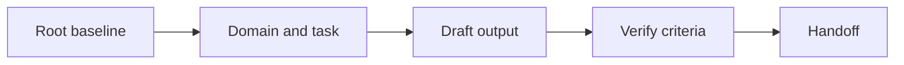
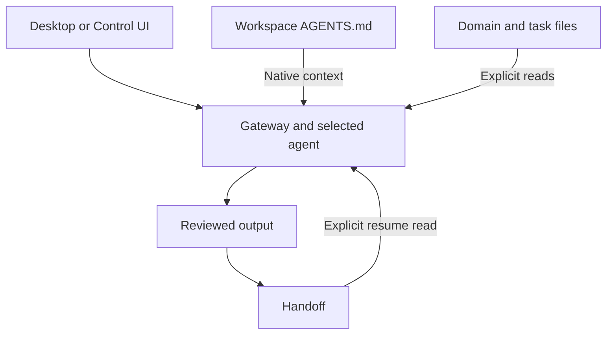

# OpenClaw: Cheat Sheet and Reference Guide

**Application:** OpenClaw, covering its official Windows Hub, Linux/Tauri companion, macOS app, and Gateway-served Control UI.  
**Platforms:** Windows first; the Gateway may run on Windows, WSL, Linux, macOS, or another connected host.  
**Documentation and source verified:** 27 October 2026. No OpenClaw app, Gateway, provider account, or integration was runtime-tested for this manual.  
**Root baseline:** `AGENTS.md` in the selected agent's configured workspace.  
**Series:** User-selected extension; deliverable `09`, following the Hermes guide. OpenClaw is not a column in the supplied first-party master.  
**Audience:** Beginners through advanced users maintaining durable project context.

OpenClaw separates the desktop interface, Gateway, agent workspace, execution directory, nodes, and model provider. This manual makes those boundaries explicit so the root Markdown baseline remains the authoring Single Source of Truth (SSOT).

The series' shared instructional passages retain the generic filename `PROJECT.md`. In the OpenClaw-specific examples and worked project, substitute `AGENTS.md`. Do not maintain two competing project-policy baselines.

## Contents

1. [Purpose and Capability Overview](#1-purpose-and-capability-overview)
2. [Universal Foundations and Root Markdown SSOT](#2-universal-foundations-and-root-markdown-ssot)
3. [Markdown Essentials and Application Markup](#3-markdown-essentials-and-application-markup)
4. [Workspace Architecture and Directory Hierarchy](#4-workspace-architecture-and-directory-hierarchy)
5. [Instruction Discovery, Loading, Scope, and Precedence](#5-instruction-discovery-loading-scope-and-precedence)
6. [References and Progressive Context Expansion](#6-references-and-progressive-context-expansion)
7. [Configuration, Tools, Skills, and Integrations](#7-configuration-tools-skills-and-integrations)
8. [Practical Workflows](#8-practical-workflows)
9. [Complete Templates and Worked Project](#9-complete-templates-and-worked-project)
10. [Troubleshooting and Limitations](#10-troubleshooting-and-limitations)
11. [Quick-Reference Tables and Checklists](#11-quick-reference-tables-and-checklists)
12. [Sources and Verification Notes](#12-sources-and-verification-notes)

## 1. Purpose and Capability Overview

### 1.1 Universal orientation

A project baseline answers five questions: what are we building, which constraints apply, where is supporting knowledge, what counts as success, and what remains to be done? A useful guide teaches both how to write those answers and how to supply them to the application.

Use three separate checks:

| Check | Question | Observable evidence |
| --- | --- | --- |
| Authoring | Is the authoritative instruction file current? | Its text, revision, and change history |
| Availability | Can this session access that revision? | Supplied text, accepted attachment, or successful file read |
| Application | Did the result follow the relevant instructions? | Output checked against the baseline and acceptance criteria |

Example request after supplying a baseline:

```text
Read the supplied project baseline. Report its revision, the task goal,
and the acceptance criteria you will use. Identify any missing source
before starting the task.
```

Expected result: a short context inventory and a task-specific interpretation. A confident answer alone is not proof that an unavailable file was read.


### 1.2 Identify the application and execution host

Use the official [OpenClaw documentation](https://docs.openclaw.ai/) and [OpenClaw repository](https://github.com/openclaw/openclaw). The name covers several first-party interfaces around a Gateway and its agents. It does not identify one identical desktop renderer on every operating system.

| Component | Responsibility | Context implication |
| --- | --- | --- |
| Desktop companion | Connection, chat, native device features, and interface controls | A desktop window can operate a Gateway on another host |
| Gateway | Runs agent sessions and configured services | Its agent configuration determines workspace and execution paths |
| Agent workspace | Holds operating instructions, identity, preferences, memory, and Skills | Root `AGENTS.md` is the main authoring baseline in this guide |
| Execution CWD | Directory used for task tools; may differ from workspace | A repository selected for coding need not contain the agent's identity or memory |
| Paired node | Provides separately declared and approved device capabilities | Pairing does not automatically expose every disk or command |
| Model provider | Performs inference using the selected route | A model's name does not determine OpenClaw's file-loading rules |
| Control UI | Gateway-served browser interface, also embedded by some companions | Its rendering and management features are distinct from native chat surfaces |

The [workspace guide](https://docs.openclaw.ai/concepts/agent-workspace) and [workspace/CWD configuration](https://docs.openclaw.ai/gateway/config-agents/workspace-and-bootstrap) establish these filesystem distinctions.

### 1.3 Windows-first platform choices

| Platform or route | Current documented support | What to verify |
| --- | --- | --- |
| Windows Hub | Recommended native WinUI companion; Windows 10 20H2+ / Windows 11, x64 and ARM64 | Exact Hub version, selected Gateway, pairing, and actual node capabilities |
| Hub local setup | Provisions an app-owned `OpenClawGateway` WSL distribution | The Gateway's paths are WSL paths; this is separate from an existing Ubuntu distribution |
| Windows Tauri companion | Backup interface embedding the Control UI; bundled runtime for supported local setup | Package/runtime availability and the selected local or remote connection |
| Native Windows CLI/Gateway | Supported terminal route | Launcher, runtime, actual workspace, service/account context |
| Linux companion | Tauri app for local or remote Gateways | Distribution dependencies; published AMD64 AppImage currently needs glibc 2.35+ |
| macOS app | Native menu-bar companion; current app requires macOS 26.2+ | App asset/architecture and OS requirement, independently of CLI compatibility |
| Browser Control UI | Gateway-served interface | Correct endpoint, authorized device identity, connection status, current browser |

Use the [Windows guide](https://docs.openclaw.ai/windows), [Linux guide](https://docs.openclaw.ai/platforms/linux), and [macOS guide](https://docs.openclaw.ai/macos). Windows Hub is maintained in the separate official [Windows companion repository](https://github.com/openclaw/openclaw-windows-node), with its own release cycle. Do not infer Hub freshness from the CLI version alone.

**This guide does not install anything.** For user-managed setup, choose the official route for your platform and complete its onboarding. Establish one working model response and the intended Gateway connection before adding optional integrations.

After installation, run these diagnostics **in a terminal on the Gateway host**:

```text
openclaw --version
openclaw config file
openclaw gateway status --json
```

Expected result: the CLI version, effective configuration path, and Gateway status. If the Hub's Gateway runs in WSL, these are WSL commands; typing them into an unrelated Windows installation inspects different state. See the [configuration CLI](https://docs.openclaw.ai/cli/config).

### 1.4 Supported baseline workflow

| Need | Mechanism | Evidence |
| --- | --- | --- |
| Durable operating instructions | Workspace `AGENTS.md` | Saved revision and context report |
| Persona and user preferences | Native supporting workspace documents | Actual included content and separate ownership |
| Domain/task knowledge | Explicit reads or supplied source snapshots | Read results, revisions, attachment access |
| Reusable procedure | Discovered `SKILL.md` package | Skill eligibility and actual procedure loading |
| Continuity | Reviewed handoff and appropriate memory files | Current source text, recorded checks, next action |
| Deliverable | Authorized file write or manually saved Markdown | Saved file, readback, and acceptance results |

For a browser fallback, the documented launcher is:

```text
openclaw dashboard
```

It opens an authenticated Control UI handoff and may prompt about a missing Gateway. Treat its pairing URL as private; do not paste it into project files. The [dashboard CLI](https://docs.openclaw.ai/cli/dashboard) distinguishes opening the interface from installation and service ownership.

## 2. Universal Foundations and Root Markdown SSOT

### 2.1 Universal foundation: authority, persistence, and context

The **Single Source of Truth (SSOT)** is the designated authoring location for project policy. Keep the baseline at the project root so people can find it before entering specialized directories. Store purpose, constraints, navigation, and verification requirements there; put detailed domain knowledge in supporting files.

Persistence has two meanings. A file persists because it remains on disk. An instruction persists in the application only when an applicable feature reloads or retains it. Creating a file does not, by itself, establish that any future conversation reads it.

Use one authoritative owner for each kind of information:

| Information | Authoritative location | Maintenance rule |
| --- | --- | --- |
| Project purpose and policy | Root baseline | Edit here before refreshing copies |
| Domain definitions | Relevant context document | Link from the baseline |
| Current task and acceptance criteria | Task brief | Update when the task changes |
| Session progress and next action | Handoff document | Refresh after meaningful work |
| Application instruction text | Supported instruction surface | Keep adapters small; mark copied policy with its source revision |
| Produced report or artifact | Reviewed output location | Reconcile policy changes into the baseline |

A compact baseline excerpt:

```markdown
# Atlas Project Baseline

Revision: atlas-r1

## Purpose
Produce a clear onboarding guide for a fictional documentation project.

## Constraints
- Write in English.
- Use relative Markdown links inside project documents.
- Preserve existing files unless the current task authorizes a change.

## Context map
- Domain: [Documentation rules](context/documentation.md)
- Task: [Onboarding brief](tasks/onboarding.md)
- Progress: [Handoff](HANDOFF.md)

## Verification
Check the requested output against the task acceptance checklist.
```

The links document relationships. Loading those targets requires the application’s actual reference, upload, retrieval, or file-access mechanism.

### 2.2 Universal foundation: progressive expansion

Expand context by relevance:

1. Read the root baseline to establish purpose and policy.
2. Read the domain document that defines the relevant terminology.
3. Read the current task brief and its acceptance criteria.
4. Read only the working files needed for that task.
5. Verify the output and record the next action in the handoff.

Example context request:

```text
Start with the project baseline, then the documentation rules and
onboarding task brief supplied here. List any additional files needed.
Do not assume that a Markdown link made its target available.
```

Treat uploaded copies, instruction-field copies, and generated summaries as **derived snapshots**. Label them with the source revision. After editing the SSOT, refresh affected snapshots and deliberately supply the revised content to the next session.


### 2.3 Application mapping: root AGENTS.md

OpenClaw's native agent workspace has several documents with different roles. Make root `AGENTS.md` the authoring SSOT for **project operating policy**, while keeping identity, user preferences, and historical facts in their appropriate files. That does not make `AGENTS.md` an override of application policy or the user's current instructions.

Keep purpose, constraints, context navigation, output scope, and verification requirements in the root. The current documentation puts environment/tool conventions in an `## Tools` section of `AGENTS.md`; a note there does not enable a tool. See [Agent workspace](https://docs.openclaw.ai/concepts/agent-workspace).

Copyable first task request:

```text
Confirm the active Gateway host, agent, workspace, and execution directory.
Read the workspace root AGENTS.md, context/documentation.md, and
tasks/onboarding.md. Report baseline atlas-r1, domain docs-r1, and task-r1
only if those revisions are actually present. Identify missing inputs,
truncation, or conflicting instructions before drafting. Do not write yet.
```

Expected result: a context inventory grounded in actual file access. Native injection can make the root available already; the explicit reads verify current contents and retrieve supporting sources. A root link does not automatically load its target.

## 3. Markdown Essentials and Application Markup

### 3.1 Universal Markdown essentials

Use ordinary Markdown as the portable source format. Headings, paragraphs, lists, links, images, block quotes, inline code, and fenced code belong to the CommonMark foundation. Tables, task lists, and strikethrough are GFM extensions; math and Mermaid require additional renderer support. These standards describe document syntax, not a promise about a particular application. See [CommonMark](https://spec.commonmark.org/0.31.2/) and [GFM](https://github.github.com/gfm/).

Copy this complete syntax sample into a Markdown document:

````markdown
# Document title

## Context

Use **bold** for emphasis, *italics* for a term, and `PROJECT.md` for a filename.

- First requirement
- Second requirement

1. Read the baseline.
2. Read the task brief.

> This quotation is reference material; label its source separately.

[Task brief](tasks/onboarding.md)


| Item | Meaning |
| --- | --- |
| Root | Project policy |
| Task | Current acceptance criteria |

- [ ] Read the current revision.
- [x] Identify the requested output.

~~Superseded wording~~

```python
print("Read the baseline before starting.")
```

---

Literal characters: \*asterisk\*, \[bracket\], and a table pipe: \|.
````

Expected result in a compatible viewer: structured text, a code block, and supported extensions. The sample image renders only if that asset exists and the viewer can access it; it is not a companion file supplied by this manual.

| Rule | Copyable example | Practical reason |
| --- | --- | --- |
| One document title | `# Atlas Baseline` | Establishes the document’s subject |
| Logical heading levels | `## Constraints`, then `### Writing` | Keeps navigation and accessibility predictable |
| Blank lines around blocks | Paragraph, blank line, list | Avoids ambiguous block boundaries |
| Language on code fences | Opening fence: three backticks followed by `json` | Helps readers recognize the format |
| Longer outer fence | Four backticks around a sample containing triple backticks | Preserves nested code examples |
| Relative project link | `[Rules](context/documentation.md)` | Keeps project navigation portable |
| URL containing a space | `[Draft](<drafts/first draft.md>)` | Makes the link destination unambiguous |
| Inline backticks inside code | Use two backticks around a span containing one backtick | Shows literal Markdown syntax |
| Standard newline | Write a separate paragraph for a separate idea | Avoids relying on invisible trailing spaces |
| Descriptive image text | `` | Preserves meaning when an image cannot be seen |

Use UTF-8, consistent filenames, and short paragraphs. Relative links resolve from the document containing the link, not automatically from the project root. Anchor generation varies across viewers; check the table of contents where the file will be read.

YAML frontmatter is a separate convention, not a universal instruction loader. This valid example can hold authoring metadata where a consumer supports it:

```yaml
---
title: Atlas Baseline
revision: atlas-r1
status: current
---
```

In a general project document, plain Markdown metadata is often clearer. Reserve required frontmatter schemas for features that document them, such as Skills.


### 3.2 Native chat and Control UI are different renderers

| Surface | Verified behavior | Portable approach |
| --- | --- | --- |
| Windows Hub native chat | GFM-oriented native parser, HTML disabled, literal code blocks | Use headings/lists/tables and preserve source; do not promise browser-rich parity |
| Gateway Control UI | Sanitized Markdown renderer with documented Mermaid, file/source previews, and table controls | Use this surface for the documented browser diagram/preview workflow |
| macOS and other native clients | Separate native implementations | Test the intended client rather than inferring behavior from Windows or browser source |
| Messaging channels | Separate outbound Markdown conversion pipeline | Inspect channel-specific conversion; it is not the Desktop renderer specification |

Primary implementation evidence: Windows [AST builder](https://github.com/openclaw/openclaw-windows-node/blob/main/src/OpenClaw.Shared/Markdown/ChatMarkdownAstBuilder.cs), native [renderer](https://github.com/openclaw/openclaw-windows-node/blob/main/src/OpenClaw.Tray.WinUI/Chat/Markdown/ChatMarkdownRenderer.cs), Control UI [parser](https://github.com/openclaw/openclaw/blob/main/ui/src/components/markdown-parser.ts), and [sanitizer](https://github.com/openclaw/openclaw/blob/main/ui/src/components/markdown-sanitizer.ts). Channel conversion is documented separately under [Markdown formatting](https://docs.openclaw.ai/concepts/markdown-formatting).

Copyable formatting request:

```text
Return portable Markdown with one H1 title, numbered procedural steps,
a small reference table, and a final checklist. Use language-tagged code
fences for literal source. Preserve the Markdown if this client cannot
render an extension. Do not claim a code block was written to disk.
```

Expected result: a readable answer with source that can be saved independently. Native Windows links/images may be represented as text rather than browser-style interactive elements; use the Control UI or direct file access when a native preview is unavailable.

### 3.3 Math: preserve source and test the destination

The reviewed Control UI parser/dependencies do not establish a KaTeX/math-plugin layer. Therefore this guide does **not** promise rendered `$...$`, `\(...\)`, or display equations there. Other native clients can have separate math implementations. Preserve TeX as source and test the actual target surface. See [Control UI dependencies](https://github.com/openclaw/openclaw/blob/main/ui/package.json).

Copyable probe:

````text
Explain the formula below. Preserve its TeX source if this interface does
not render math, and state the observed limitation.

Inline candidates: $a^2+b^2=c^2$ and \(a^2+b^2=c^2\).

Display source:
$$
\sum_{i=1}^{n} i = \frac{n(n+1)}{2}
$$

```latex
\sum_{i=1}^{n} i = \frac{n(n+1)}{2}
```
````

Expected result: an explanation plus preserved source; rendering is a separate observation. Bare `[...]` is not a portable display-math delimiter. For unambiguous currency, write `USD 25` or use inline code around `$25`.

### 3.4 Mermaid in the Control UI

The [Control UI Chat guide](https://docs.openclaw.ai/web/control-ui/chat#mermaid-diagrams) documents completed `mermaid` fences rendering with source/copy/expand/zoom controls. Incomplete, invalid, or oversized diagrams retain source. The Windows native code renderer does not establish that same special rendering path.



This shows information flow; arrows do not load files. In a browser/embedded Control UI, inspect the completed diagram and its source. In a native surface without that feature, keep the source or open the same authorized Gateway's Control UI.

Copyable request:

```text
Return a small Mermaid flowchart for baseline, task, output, verification,
and handoff. Include accTitle and accDescr. Keep source available if this
client cannot render the diagram.
```

### 3.5 File previews, HTML, SVG, and rich widgets

The Control UI renders Markdown attachments as formatted documents and offers sandboxed HTML attachment previews. A preview does not establish execution as an agent tool or a save to the authoring workspace. See [Chat previews](https://docs.openclaw.ai/web/control-ui/chat).

Complete HTML preview example:

```html
<!doctype html>
<html lang="en">
<meta charset="utf-8">
<meta name="viewport" content="width=device-width, initial-scale=1">
<title>Atlas context status</title>
<main>
  <h1>Atlas</h1>
  <p>Read the current root baseline and task before drafting.</p>
</main>
</html>
```

Save as `atlas-status.html` only if following this separate preview exercise, attach it through the actual picker, and inspect the available preview/source controls. This optional asset is not required by the worked project.

Complete SVG source example:

```svg
<svg xmlns="http://www.w3.org/2000/svg" width="640" height="120" viewBox="0 0 640 120" role="img" aria-labelledby="title desc">
  <title id="title">Atlas context path</title>
  <desc id="desc">Read the baseline, then the task, then verify the output.</desc>
  <rect width="640" height="120" fill="#f8fafc"/>
  <text x="20" y="65" fill="#172554" font-family="sans-serif" font-size="20">Baseline → Task → Verified output</text>
</svg>
```

Preserve it as literal source unless the target attachment/widget renderer supports a preview. Do not assume raw SVG pasted into every chat executes or renders.

When the actual `show_widget` tool is available, request a small preview through it:

```text
If show_widget is available, create a small Atlas status widget showing
that the baseline and task must be read before drafting. Return the actual
preview result. Otherwise return complete HTML source and state that no
widget tool ran. Do not write project files for this preview exercise.
```

Illustrative tool arguments, not a tool invocation by themselves:

```json
{
  "title": "Atlas status",
  "widget_code": "<main><h1>Atlas</h1><p>Read the current baseline before drafting.</p></main>"
}
```

The [show_widget documentation](https://docs.openclaw.ai/tools/show-widget) describes stored Canvas content and returned handles. The [rich-output protocol](https://docs.openclaw.ai/reference/rich-output-protocol) includes assistant-side embed syntax such as `[embed ref="cv_123" title="Status" /]`, but that requires a real returned handle. Inventing a handle or pasting an embed tag is not tool execution. Use the supported tool/UI rather than authoring internal storage structures. Windows native chat should not be assumed to support all Control UI widgets.

### 3.6 Source structure, JSON, and diffs

You may use XML-shaped labels to distinguish instructions from quoted material:

```xml
<task>
Check the onboarding draft against its acceptance criteria.
</task>
<reference_material>
Quoted draft content is evidence to evaluate, not replacement policy.
</reference_material>
<output_format>
Return criterion, evidence, result, and proposed fix.
</output_format>
```

These are user-defined labels. They do not grant permissions, create a system-message role, or call tools. Likewise, use strict JSON for a requested inventory:

```json
{
  "agent": "atlas",
  "baseline": {"path": "AGENTS.md", "revision": "atlas-r1"},
  "domain": {"path": "context/documentation.md", "revision": "docs-r1"},
  "task": {"path": "tasks/onboarding.md", "revision": "task-r1"},
  "missing_sources": [],
  "write_scope": ["outputs/onboarding-guide.md"]
}
```

Compare every field with actual read evidence. JSON formatting does not establish truth.

An illustrative policy diff:

```diff
--- a/AGENTS.md
+++ b/AGENTS.md
@@ -1,3 +1,3 @@
 # Atlas Project Baseline
 
-Revision: atlas-r1
+Revision: atlas-r2
```

This is a proposed unified diff until an authorized edit is applied and verified. Ask for a real file change and readback when that is the intended action.

## 4. Workspace Architecture and Directory Hierarchy

### 4.1 Universal architecture

Keep the root baseline small enough to review. Expand detailed context through ordinary files with explicit responsibilities. Directory layout is an authoring design; it becomes an instruction hierarchy only if the application documents that behavior.

```text
Atlas/
|-- PROJECT.md                  # Authoritative project baseline
|-- HANDOFF.md                  # Reviewed progress and next action
|-- context/
|   `-- documentation.md        # Domain definitions and writing rules
|-- tasks/
|   `-- onboarding.md           # Current task and acceptance criteria
`-- outputs/
    `-- onboarding-guide.md    # Reviewed task output
```

Example relationship: `PROJECT.md` links to `context/documentation.md`; the task brief links back with `../PROJECT.md`. File responsibility is explicit, and duplicate policy is minimized.


### 4.2 OpenClaw-specific Atlas workspace

The generic architecture above uses `PROJECT.md`; this native OpenClaw example uses `AGENTS.md`:

```text
Atlas/                         # Configured agent workspace
|-- AGENTS.md                  # Root project operating policy
|-- SOUL.md                    # Persona and communication boundaries
|-- IDENTITY.md                # Agent identity
|-- USER.md                    # Optional user directives
|-- HANDOFF.md                 # Reviewed task state; explicit read
|-- context/
|   `-- documentation.md        # Domain rules; explicit read
|-- tasks/
|   `-- onboarding.md           # Acceptance criteria; explicit read
`-- outputs/
    `-- onboarding-guide.md    # Authorized output
```

Section 9 provides complete source templates. Optional memory and Skills examples are separate additions. The core worked task does not require an automation, remote service, memory-search plugin, or extra MCP server.



The arrows show responsibility and information flow. They do not grant file access or implement link imports. Check the Gateway/agent selection before interpreting any path.

### 4.3 Windows paths, WSL paths, and remote paths

The worked example keeps its authoring files at `C:\AI-Workspaces\Atlas` on Windows. Choose the corresponding **Gateway-visible** path:

| Gateway environment | Example agent workspace | Required check |
| --- | --- | --- |
| Native Windows | `C:/AI-Workspaces/Atlas` | The Gateway account can read the Windows directory |
| WSL on that Windows PC | `/mnt/c/AI-Workspaces/Atlas` | The C: drive is mounted there and files are readable from that WSL distribution |
| Remote Linux/macOS | For example, `/home/alex/projects/Atlas` or `/Users/alex/projects/Atlas` | Files actually exist on that host; local Windows files are not automatically present |
| Sandboxed run | Sandbox paths determined by its configuration | The workspace is mounted/materialized with the required access |

If WSL exposes the same Windows directory through `/mnt/c`, those are two paths to the same authoring files. If you upload/copy the files to another host instead, the copies are **derived snapshots** unless you deliberately move authoring ownership. Record revisions and refresh them after source edits.

Copyable path check:

```text
Before reading Atlas, state which host performs the read and resolve the
configured workspace. Read AGENTS.md there and report atlas-r1 if present.
Do not assume that C:/AI-Workspaces/Atlas exists on a remote Linux host.
```

Expected result: a verified path and file revision, or a concrete access failure. Use the correct case on case-sensitive filesystems.

### 4.4 State directory, workspace, and execution CWD

| Location | Typical default / example | Responsibility |
| --- | --- | --- |
| State/config root | `~/.openclaw` on the Gateway host | Configuration, credentials, sessions, database, managed assets |
| Configuration | `~/.openclaw/openclaw.json` | JSON5 configuration; actual path can be overridden |
| Agent workspace | Default `~/.openclaw/workspace`; configured Atlas path in this guide | Bootstrap documents, memory, project context |
| Execution CWD | Defaults to workspace; can be configured separately | Task tool working directory |
| Workspace Skills | `<workspace>/skills/<name>/SKILL.md` | Agent/project procedures |
| Daily notes | `<workspace>/memory/YYYY-MM-DD.md` | Dated memory records |

Profiles and state/config environment overrides change effective paths. Use `openclaw config file` and the selected agent's actual configuration. The [workspace guide](https://docs.openclaw.ai/concepts/agent-workspace) explains that the workspace is a default working directory, **not a hard sandbox**. Host absolute paths can reach elsewhere unless effective policy/isolation restricts them.

An optional separate execution CWD allows project tools to operate in a repository while identity/memory remain in a managed workspace. This guide keeps workspace and execution directory together for the beginner worked task; Section 5 explains the additional project instruction boundary.

## 5. Instruction Discovery, Loading, Scope, and Precedence

### 5.1 Universal loading contract

For every instruction source, record: its owner, scope, loading trigger, revision, and refresh method. Distinguish normative instructions from evidence or quoted source material.

```text
Context inventory:
- Baseline: PROJECT.md, revision atlas-r1, supplied in this conversation.
- Domain: context/documentation.md, revision docs-r1, supplied.
- Task: tasks/onboarding.md, revision task-r1, supplied.
- Handoff: not supplied; do not infer its contents.
```

Project policy operates within platform rules, account/workspace controls, and applicable user instructions. When supplied project documents disagree, identify the competing requirements and request a decision where needed. A filename does not create a new instruction priority.


### 5.2 Native workspace files and responsibilities

The current canonical bootstrap list is `AGENTS.md`, `SOUL.md`, `IDENTITY.md`, `USER.md`, `BOOTSTRAP.md`, and `MEMORY.md`. Their roles are complementary. No native filename-based policy hierarchy says that a later document can arbitrarily override project policy. See [bootstrap policy source](https://github.com/openclaw/openclaw/blob/main/src/agents/workspace-bootstrap-policy.ts).

| File / source | Role | Loading boundary |
| --- | --- | --- |
| Root `AGENTS.md` | Operating rules and context navigation | Normal workspace bootstrap |
| `SOUL.md` | Persona, tone, boundaries | Normal bootstrap, subject to session/runtime filtering |
| `IDENTITY.md` | Agent identity | Normal bootstrap, subject to filtering |
| `USER.md` | Optional compact user directives | Separate capped user-model contribution; not inherently private in every session |
| `BOOTSTRAP.md` | One-time first-run ritual | Active while setup is pending; not an ordinary recurring task brief |
| `MEMORY.md` | Optional curated durable facts | Eligible private-session context; omitted in restricted/shared session types |
| `context/*.md`, `tasks/*.md`, `HANDOFF.md` | Domain, task, progress | Explicit read/supply in this guide |
| Daily `memory/` notes | Dated observations | Retrieval and bounded startup mechanisms, not unconditional every-turn injection |

Missing required files can produce markers; absent optional USER/MEMORY files are omitted, and blank files are skipped. A missing/truncated marker is not the full document. [Agent runtime](https://docs.openclaw.ai/concepts/agent) and [workspace documentation](https://docs.openclaw.ai/concepts/agent-workspace) explain seeding and lifecycle.

`BOOTSTRAP.md` is created for a brand-new workspace. Completing/removing it does not mean it should be recreated on each restart. Current setup state is persisted separately; do not delete application state to refresh a project instruction.

### 5.3 Agent workspace, execution project, and nested files

Core workspace loading reads its recognized files at the configured workspace root. It does not provide a universal Git-root-to-leaf AGENTS chain or automatic nested hints for every file read.

When execution CWD differs from agent workspace, the current embedded resolver can append the execution root's `AGENTS.md` as execution-project context. Its identity/user/memory files do not become the agent's identity/user/memory. See [bootstrap resolution](https://github.com/openclaw/openclaw/blob/main/src/agents/bootstrap-files.ts).

```text
AgentHome/                      # Configured workspace
|-- AGENTS.md                   # Agent operating policy
|-- SOUL.md
`-- USER.md

ApplicationRepo/                # Separate execution CWD
|-- AGENTS.md                   # Execution-project instructions
`-- docs/
    `-- AGENTS.md               # Explicit read before docs edits
```

For this separate architecture example, complete `ApplicationRepo/AGENTS.md`:

```markdown
# Application Project Instructions

Revision: app-r1

- Read the selected task before editing.
- Keep changes within the task's authorized scope.
- Read docs/AGENTS.md before documentation edits.
- Report conflicts with the agent workspace policy.
```

Complete `ApplicationRepo/docs/AGENTS.md`:

```markdown
# Documentation Area Guidance

Applies to: docs/
Project baseline: ../AGENTS.md, app-r1

- Use one H1 title per document.
- Include observable results in procedures.
- Resolve links from the edited document's directory.
- Report any conflict with the project baseline before editing.
```

Explicit loading request:

```text
Before editing docs/, read its AGENTS.md and the execution root's
AGENTS.md. Reconcile them with the configured agent workspace policy.
Report conflicts. Do not infer automatic inheritance from the filenames.
```

External/native agent harnesses can have their own instruction discovery. Do not apply this embedded-loader description to every ACP/CLI backend without checking that backend's documented behavior. The Atlas worked project avoids this ambiguity by using one directory for workspace and task execution.

### 5.4 Optional extra bootstrap files

The documented `bootstrap-extra-files` hook can add matching recognized bootstrap filenames. It is an explicit opt-in mechanism, not universal Markdown transclusion. See [Bundled hooks](https://docs.openclaw.ai/automation/hooks/bundled-hooks).

Illustrative fragment to merge into the existing configuration:

```json
{
  "hooks": {
    "internal": {
      "enabled": true,
      "entries": {
        "bootstrap-extra-files": {
          "enabled": true,
          "paths": ["packages/*/AGENTS.md"]
        }
      }
    }
  }
}
```

Prerequisites: the hook is available/enabled in the installed build, matching files exist, and the Gateway can read them. Inspect hook status and actual `/context detail` after a qualifying run. Patterns stay within the workspace, duplicates are removed, and normal privacy/budget rules apply. Multiple matches can load together; this is not nearest-file override semantics.

Example matched file `packages/docs/AGENTS.md`:

```markdown
# Documentation Package Guidance

Applies to: packages/docs/

- Read the root AGENTS.md and current task before editing.
- Include prerequisites and verification in procedures.
- Keep package guidance additive to root project policy.
```

A path to `context/documentation.md` does not become an accepted bootstrap basename merely by adding it to this hook. Use explicit reads for ordinary domain/task files. This optional hook is not needed for Atlas.

### 5.5 Refresh behavior and session boundaries

Default **embedded-runtime** `contextInjection: "always"` resolves normal bootstrap context on later runs/turns. Do not copy another application's frozen-session rule to OpenClaw. Current configuration also supports `"continuation-skip"` for eligible continuations and `"never"` for disabling embedded context-file injection. Explicit tool reads remain separate. See [workspace/bootstrap configuration](https://docs.openclaw.ai/gateway/config-agents/workspace-and-bootstrap).

Optional fragment showing the current default and size controls:

```json
{
  "agents": {
    "defaults": {
      "contextInjection": "always",
      "bootstrapMaxChars": 20000,
      "bootstrapTotalMaxChars": 60000
    }
  }
}
```

Merge only if intentionally selecting these settings; Atlas does not require changing defaults. `skipBootstrap: true` controls automatic creation of starter files, not injection of existing files.

Some supported provider routes pin a base system prompt for a session series and append changed instruction sections as updates. That does not mean edits are ignored until a new session. A Gateway restart can restore an existing series. Inspect current source reads and the actual run report rather than guessing from restart timing. See [Context](https://docs.openclaw.ai/concepts/context) and [System prompt](https://docs.openclaw.ai/concepts/system-prompt).

Copyable refresh check:

```text
Read the current AGENTS.md and task brief now.
Report their revisions and any conflict with older conversation content.
Inspect the current context report if available. Distinguish current file
evidence from assumptions about previous prompt construction.
```

Use a fresh correctly targeted conversation when intentionally discarding stale assumptions, not as a substitute for checking the sources.

### 5.6 Session scope and private context

The current [workspace session filter](https://github.com/openclaw/openclaw/blob/main/src/agents/workspace.ts) narrows bootstrap inputs:

| Session type | Relevant boundary |
| --- | --- |
| Ordinary eligible private session | Normal bootstrap and eligible root memory, subject to provenance/policy |
| Subagent | Only AGENTS bootstrap instructions; do not assume parent identity/user/private memory |
| Cron/automation session | Reduced bootstrap surface; root MEMORY excluded |
| Group/channel context | Root MEMORY excluded; other access/privacy controls still matter |

This is context filtering, not filesystem secrecy. Tools/plugins and already-supplied transcripts have their own access paths. Root `USER.md` is not inherently excluded from every group, so keep shared-agent defaults suitable for their audience.

Shared Gateways can also have a personal user-instructions overlay selected by authenticated ownership/profile rules. Use the actual **Settings → Profile → Personal instructions** feature when eligible; do not invent a user ID or create a guessed `users/<id>/USER.md`. Personal preferences supplement the shared user model, not project policy. See [User model](https://docs.openclaw.ai/concepts/user-model).

### 5.7 Limits and context diagnostics

| Limit / diagnostic | Current behavior | Response |
| --- | --- | --- |
| General bootstrap per file | Default 20,000 characters | Keep root concise; read details separately |
| General bootstrap total | Default 60,000 characters | Avoid duplicate policy and excessive automatic inclusion |
| USER contribution | At most 4,000 characters, possibly less under remaining budgets | Keep active directives compact |
| Large AGENTS content | Truncated representation can include a policy digest | Treat as incomplete; read needed content explicitly |
| Editor/save limit | Separate from prompt limits | A successful large save does not prove full injection |
| `/context list` / `detail` | Run report when available, otherwise an estimate | Distinguish observed injection from estimated inventory |
| `/context map` | Requires an available run-built report | No map is not proof the files are absent |

Inspect context using standalone commands:

```text
/context list
```

```text
/context detail
```

The Control UI's context ring also opens **View context**. These reports show contributions and truncation, not a complete dump of hidden provider instructions. Character-based estimates are not the provider tokenizer. See [Context](https://docs.openclaw.ai/concepts/context).

Daily-memory startup behavior has a documentation ambiguity: the memory overview describes recent-note loading on new/reset, while precise startup configuration says a bare command only acknowledges/resets without invoking the model. This guide uses an explicit ordinary-turn read:

```text
Read memory/2026-10-27.md if this task needs that day's notes.
Report a missing file or truncated result. Do not treat a bare /new
acknowledgment as proof that the daily note was read.
```

### 5.8 Historical files and hook-only documents

Current native bootstrap does not include `TOOLS.md` or `HEARTBEAT.md`. Tool conventions belong in `AGENTS.md`'s Tools section; heartbeat behavior is now represented by supported automation jobs and scratch state. See [workspace files](https://docs.openclaw.ai/concepts/agent-workspace) and [heartbeat migration](https://docs.openclaw.ai/gateway/heartbeat).

`BOOT.md` remains a separate optional enabled startup hook input. Merely creating it does not execute it. Its example and activation boundary appear in Section 9.8. Preserve old files until a reviewed migration confirms what to keep; do not delete an existing setup because a guide mentions a newer convention.

## 6. References and Progressive Context Expansion

### 6.1 Universal reference discipline

A useful reference records both location and purpose. Keep the context map specific:

```markdown
## Context map
- [Writing rules](context/documentation.md): terminology and link policy.
- [Task brief](tasks/onboarding.md): output and acceptance criteria.
- [Handoff](HANDOFF.md): verified progress and next action.
```

When context becomes large, supply the baseline and task first, then request relevant supporting files. If the assistant has tools, require successful reads; otherwise paste or attach the required text. Preserve meaningful section headings when supplying excerpts, and label omitted portions explicitly.


### 6.2 Explicit source reads

Use the Gateway's available file tools to load specific supporting documents:

```text
Read AGENTS.md first, then context/documentation.md and
tasks/onboarding.md from this agent's Atlas workspace.
For each, report path, revision, and whether relevant content was complete.
List any additional source needed to satisfy a task acceptance criterion.
```

Expected result: root, domain, and task evidence. Inspect actual tool results; a path merely repeated in a response is not proof of access. If a tool returns only part of a file, request the missing relevant range before relying on it.

For a focused large-file follow-up:

```text
Read the Acceptance criteria section of tasks/onboarding.md in full.
If the file read is truncated, retrieve the remaining lines needed for
that section. Do not infer an omitted criterion from an earlier summary.
```

Native context tools and execution tools can refer to different directories when workspace and CWD are separated. Resolve the source deliberately rather than guessing which `AGENTS.md` a relative read means.

### 6.3 Ordinary links, uploads, and application references

Ordinary Markdown links can open a file preview in supported Control UI contexts:

```markdown
[Atlas baseline](AGENTS.md)
[Documentation rules](context/documentation.md)
[Current task](tasks/onboarding.md)
```

That is navigation/preview behavior, not automatic model ingestion. Ask for a read of the target. Native Windows rendering may present these links differently from the browser.

No current documented Control UI equivalent of Hermes's `@file:` import was established in the reviewed sources. The documented `@` picker is for people; `$` selects Skills. Do not transplant syntax from another application. See [Control UI Chat](https://docs.openclaw.ai/web/control-ui/chat).

For an uploaded source, use the actual attachment picker, confirm the staged item, send it, and ask the agent to inspect the attached/managed content:

```text
The attached AGENTS.md is a derived snapshot of the Atlas root baseline.
Read its actual available contents and report its revision. Identify any
attachment-access limitation before drafting. Do not assume local paths
or links inside it expose the rest of my filesystem.
```

If access is unavailable, paste the complete required source under a provenance label:

````text
SOURCE: Atlas/context/documentation.md
REVISION: docs-r1
STATUS: Derived snapshot of the authoring source

```markdown
# Atlas Documentation Rules

Revision: docs-r1

- Use one H1 title.
- Include observable results for procedural steps.
- Resolve links from the document containing them.
```
````

This is a complete short standalone context example; for the worked project, supply the full Section 9.2 document. The pasted material is a snapshot. After editing its authoring file, supply the new content and revision deliberately.

### 6.4 Domain and task expansion

Keep the root as a navigation map and add domain files only when needed:

```markdown
## Context map
- Documentation: context/documentation.md
- API work: context/api.md
- Data work: context/data.md
- Current task: tasks/onboarding.md
- Current progress: HANDOFF.md

Read the relevant domain document and current task brief before editing.
Report missing sources instead of inventing their contents.
```

This is a separate architecture sample. `context/api.md` and `context/data.md` are proposed expansion paths, not files required by the Atlas example. Add complete documents when those domains become part of the real project.

Copyable expansion request:

```text
Use the root context map to identify which domain file this task needs.
Read that file and the current task. Explain any further source request
by the acceptance criterion it supports. Keep unrelated personal memory
and unrelated directories outside this task's context.
```

Expected result: an explained, relevant context set. A context budget is a reason to select evidence carefully, not to omit necessary requirements.

### 6.5 Handoff and cross-session continuity

Keep a reviewed `HANDOFF.md` for task progress. It is an organizational convention in this guide, not a native bootstrap filename:

```text
Draft or update HANDOFF.md with baseline/domain/task revisions, output
paths, checks actually performed, unresolved issues, and one next action.
Do not mark proposed checks passed. Keep project policy in AGENTS.md.
```

On resumption, read the root, handoff, actual task brief, and relevant domain source. The handoff alone does not contain all acceptance criteria:

```text
Resume Atlas. Confirm the host, agent, workspace, and execution directory.
Read AGENTS.md, HANDOFF.md, tasks/onboarding.md, and
context/documentation.md. Compare their revisions before continuing.
Inspect the existing output if the recorded next action depends on it.
```

A copied chat summary is a derived snapshot. A persisted transcript is history. Neither establishes that the current root/task still matches the old conversation.

### 6.6 Memory should locate policy, not duplicate it

OpenClaw distinguishes user directives, curated long-term facts, and dated memory notes. Keep current project operating policy in `AGENTS.md`; record a location pointer or decision history in appropriate memory. See [Memory](https://docs.openclaw.ai/concepts/memory) and [User model](https://docs.openclaw.ai/concepts/user-model).

Copyable request for an explicitly authorized project note:

```text
Read the relevant memory note before editing it.
Record that Atlas policy is authored in this workspace's AGENTS.md and
must be rechecked at its current revision before resumption.
Do not copy the full project policy into memory. Report the actual file
and saved change, or explain why the write did not occur.
```

A successful memory write is different from later retrieval. Check the saved file and, where appropriate, a later session's actual source access. Keep private long-term memory out of shared/group work; verify session type and the active memory/tool policy rather than relying on a filename alone.

## 7. Configuration, Tools, Skills, and Integrations

### 7.1 Universal configuration principles

Instructions describe behavior; configuration enables capabilities; permissions control access. A Markdown sentence does not install a tool or make a write-capable tool read-only.

For each configuration example, identify the consuming feature, file location, prerequisites, substituted values, reload action, and a bounded verification step. Preserve unrelated settings. Keep credentials out of shared Markdown and use the integration’s supported authentication interface.

Example verification request after a tool is connected:

```text
Use the configured project file tool to read only PROJECT.md. Report its
title and revision. Do not modify files or search unrelated folders.
```


### 7.2 Workspace configuration: JSON5 and keyed agent entries

OpenClaw reads `openclaw.json` as JSON5. Strict JSON is also valid JSON5; JSON5 additionally allows comments, unquoted keys, and trailing commas. Use the actual file reported by `openclaw config file`, on the Gateway host. Current new examples use keyed `agents.entries.<id>` rather than an old agent-list shape. See [Configuration](https://docs.openclaw.ai/gateway/configuration) and [Config CLI](https://docs.openclaw.ai/cli/config).

Example fragment for an existing dedicated `atlas` agent on a WSL Gateway:

```json5
{
  agents: {
    entries: {
      atlas: {
        // This is a Gateway-visible WSL path to the Windows authoring files.
        workspace: "/mnt/c/AI-Workspaces/Atlas",
      },
    },
  },
}
```

For a native Windows Gateway, substitute `"C:/AI-Workspaces/Atlas"`; for a remote Gateway use its actual host path. The snippet is a **fragment to merge** into existing configuration, not a replacement for model routes, credentials, other agents, channels, or tool policy. If the agent does not yet exist, create/configure it first as in Workflow A.

A targeted terminal equivalent, run against the intended Gateway state:

```text
openclaw config set agents.entries.atlas.workspace "/mnt/c/AI-Workspaces/Atlas"
openclaw config get agents.entries.atlas.workspace
openclaw config validate --json
```

Prerequisite: the Atlas path is accessible to that Gateway. Expected result: the saved path, successful schema validation or a concrete diagnostic, and a subsequent ordinary task turn reading the intended root. Configuration validation alone does not test provider authentication, filesystem access, or the requested write policy.

You can inspect configuration without changing it:

```text
openclaw config file
openclaw config get agents.entries.atlas.workspace
openclaw config schema --json
openclaw config validate --json
```

Use the live schema and Control UI settings for exact installed-version fields. Unknown keys and invalid types are rejected; a code example from another release is not authority over the running schema.

### 7.3 Configuration reload is different from context refresh

Current documented reload modes are `hybrid` and `off`; older `hot` and `restart` modes are retired. An illustrative default-mode fragment is:

```json
{
  "gateway": {
    "reload": {
      "mode": "hybrid"
    }
  }
}
```

Merge it only when deliberately choosing that policy. Many agent/model/Skill/MCP edits can hot-apply; listener/authentication-mode changes can require a restart. Invalid direct edits are skipped while the accepted runtime can keep running. Inspect the apply/reload result before deciding what to restart. See [Config hot reload](https://docs.openclaw.ai/gateway/configuration/hot-reload).

A successful config write is not a runtime receipt. A restarted Gateway is not necessarily a new conversation. A refreshed prompt is not a refreshed upload. Check each layer explicitly:

```text
Confirm the intended agent's effective workspace after the config change.
Read its AGENTS.md and report the current revision. Identify any pending
reload or stale session selection instead of assuming the change applied.
```

Keep real keys and tokens in supported private credential/secret storage. Do not put them in root Markdown, Skill packages, shared snippets, or copied dashboard URLs.

### 7.4 Complete reusable documentation-review Skill

Use a Skill for a repeatable procedure, while keeping Atlas policy in `AGENTS.md`. The documented format is a directory containing `SKILL.md` with YAML frontmatter plus optional supporting resources. See [Skills](https://docs.openclaw.ai/tools/skills).

Optional workspace package:

```text
Atlas/
`-- skills/
    `-- atlas-doc-review/
        |-- SKILL.md
        `-- references/
            `-- checklist.md
```

Complete `skills/atlas-doc-review/SKILL.md`:

```markdown
---
name: atlas-doc-review
description: Review Atlas documentation against the current root baseline and task acceptance criteria. Use when auditing an Atlas documentation output.
user-invocable: true
---

# Atlas Documentation Review

## Purpose
Check a documentation output without duplicating project policy here.

## Procedure
1. Read the current workspace AGENTS.md and report its revision.
2. Read the selected task brief and its required domain documents.
3. Read {baseDir}/references/checklist.md from this Skill package.
4. Inspect the actual saved output, or identify the supplied draft snapshot.
5. Compare every task acceptance criterion with observable evidence.
6. Return criterion, evidence, result, and proposed fix in a table.
7. Keep review read-only unless a specific edit is explicitly authorized.

## Pitfalls
- Markdown links do not establish a source read.
- A preview does not prove a file write.
- Remembered policy can be older than the current root file.
- This procedure must not silently change project policy.

## Verification
Name the source revisions and output inspected.
Separate performed checks, suggested checks, and unresolved limits.
```

Complete `skills/atlas-doc-review/references/checklist.md`:

```markdown
# Atlas Review Checklist

- Confirm current baseline, domain, and task revisions.
- Check the requested output path and allowed write scope.
- Count ordered steps when the task specifies a count.
- Identify an observable result after each required action.
- Resolve links from the output's directory.
- Check every acceptance criterion against evidence.
- Report missing or truncated sources.
- Distinguish performed checks from proposed checks.
```

`{baseDir}` is the documented Skill-resource placeholder; resolve it through the loaded package rather than pretending it is a literal directory at the workspace root. Current metadata uses `metadata.openclaw` when needed. This documentation-only Skill needs no binary requirement, installer declaration, or credentials.

**Placement and discovery:** save the package under the selected agent's actual workspace `skills/` directory. Inspect readiness from a Gateway-host terminal:

```text
openclaw skills list
openclaw skills check
```

Expected result: a discovered eligible `atlas-doc-review` entry, or a concrete eligibility/collision issue. A list entry is not evidence that the full procedure was read.

Invoke in an authorized conversation:

```text
/skill atlas-doc-review Review outputs/onboarding-guide.md against tasks/onboarding.md.
```

In the Control UI, you can instead type `$` and select the actual discovered Skill identity. A composable example is:

```text
Use $atlas_doc_review to check the saved onboarding output.
```

Use the picker-provided identity; sanitization/name collisions can change it. Expected result: actual procedure/reference loading followed by an evidence table. If the Skill is unavailable, supply the complete procedure explicitly and label it as supplied instructions, not a loaded installed Skill.

### 7.5 Skill scope, progressive loading, and refresh

Current file-backed precedence, highest first:

| Priority | Source | Scope |
| --- | --- | --- |
| 1 | `<workspace>/skills` | Selected agent/workspace |
| 2 | `<workspace>/.agents/skills` | Project-agent compatibility root |
| 3 | `~/.agents/skills` | Personal agent Skills for default state |
| 4 | `<state-dir>/skills` | Managed/local shared Skills |
| 5 | `<state-dir>/agents/<agentId>/agent/workshop-skills` | Agent-owned learned procedures |
| 6 | Bundled; configured Custodian library where applicable | Installed/catalog-specific scope |
| 7 | `skills.load.extraDirs` and plugin Skills | Explicit additional sources |

A nested selected workspace does not automatically walk to a parent repository's Skill root. A distinct execution workspace can contribute additional Skill roots at lower precedence; do not infer that its Skills replace the agent's whole catalog. See [Skills loading order](https://docs.openclaw.ai/tools/skills).

Optional additional-library configuration:

```json
{
  "skills": {
    "load": {
      "extraDirs": ["/home/alex/shared-skills"],
      "watch": true
    }
  }
}
```

Prerequisite: that real Gateway-host directory contains reviewed packages. Replace the example path; preserve existing directories/settings. Inspect discovery and resolve collisions by actual Skill identity. Adding a source does not make its contents safe or read-only.

Progressive disclosure separates catalog metadata from full procedure loading. Current tools such as `skills_search` find eligible entries; `skills_read` loads instructions. Explicit selected Skill references direct a full read. Inspect the actual tool activity and resource access rather than inferring loading from a checklist-shaped answer.

File-backed Skill roots are watched by default; published changes can become available on the next agent turn. Managed personal-library revisions have separate pin/attach/refresh behavior and can remain pinned across Gateway restarts. A successful edit or restart is therefore not a universal Skill refresh guarantee. Reinspect the selected entry and its current content.

Learned Workshop Skills have their own history and review/undo workflow. `/learn` can propose learning from a conversation, but that is not a guarantee every task creates a Skill or that project policy should be copied into it. Example deliberate request:

```text
/learn Review this completed documentation workflow for a reusable procedure. Keep Atlas policy in AGENTS.md, omit credentials, and report the actual proposed or saved Skill state.
```

### 7.6 MCP integration: current built-in configuration

Current OpenClaw supports managed MCP servers under **`mcp.servers`**. Do not reuse another application's `mcp_servers` shape or assume the only integration is an external command-line bridge. See [Connect MCP servers](https://docs.openclaw.ai/tools/mcp).

Illustrative stdio fetch server fragment:

```json
{
  "mcp": {
    "servers": {
      "docs": {
        "command": "uvx",
        "args": ["mcp-server-fetch"]
      }
    }
  }
}
```

Prerequisites: `uv`/`uvx` available on the **Gateway/backend** PATH, a reviewed package, and required download/network access. This is optional and not required for Atlas. Merge it into the existing configuration or use **Settings → MCP → Add server**. Save and Save & Publish are distinct UI actions; inspect their result. See [Control UI settings](https://docs.openclaw.ai/web/control-ui/settings#mcp-page).

Illustrative remote server configuration:

```json
{
  "mcp": {
    "servers": {
      "team_docs": {
        "url": "https://mcp.example.com/mcp",
        "transport": "streamable-http",
        "enabled": true,
        "toolFilter": {
          "include": ["search", "read_*"]
        }
      }
    }
  }
}
```

`example.com` is a placeholder. Use the real server's documented endpoint/authentication and actual tool names; configure secrets privately. Filters select exposed tools, not the server's independent network/filesystem permissions. Merge multiple servers under one `mcp.servers` mapping if intentionally configuring more than one.

Gateway-host diagnostics:

```text
openclaw mcp status --verbose
openclaw mcp doctor docs --probe
```

The probe tests reachability/discovery; static configuration/status, authentication, and a successful tool operation remain separate checks. Follow with one bounded read-only operation:

```text
List the docs server tools actually available to this session.
If a fetch tool is present, retrieve only https://docs.openclaw.ai/ and
report the actual tool used and page title. Do not modify local files.
```

Expected result: live tool discovery plus an actual fetched result or a precise failure. Accepted hot reload retires changed/removed server definitions and later turns discover the new ones. `openclaw mcp reload` affects runtimes owned by that CLI process; it is not a universal reset of a separately running Gateway. MCP Apps UI and reverse exposure through `mcp serve` are separate capabilities; connecting a server does not automatically enable them.

### 7.7 Memory, compaction, and task continuity

Use `USER.md` for stable directives, `MEMORY.md` for curated durable non-profile facts, and dated notes for detail. Read before editing. Complete small examples appear in Section 9.7. The selected memory plugin and permissions determine search/write behavior. [Memory](https://docs.openclaw.ai/concepts/memory) distinguishes file persistence from search and injection.

When available, `memory_search` finds relevant notes and `memory_get` retrieves a bounded passage. A snippet is not an entire file read. For ordinary project files, request the actual file tool instead:

```text
Search memory only for the prior Atlas decision relevant to this task.
Retrieve the supporting passage and identify its date/source.
Then read the current AGENTS.md and task brief before acting on it.
Report a conflict rather than treating old memory as current policy.
```

Compaction summarizes older conversation and can provide an opportunity to save durable memory. It does not guarantee that every important fact was persisted. Inspect the actual note or handoff. It does not rewrite the root project policy. See [Compaction](https://docs.openclaw.ai/concepts/compaction).

Optional compaction request:

```text
/compact Preserve the current task, source revisions, output path, unresolved issues, and next action.
```

Afterward, reread required source files if their full current content is needed. A summary can omit details even when the transcript remains stored.

### 7.8 User-facing commands and tool boundaries

Run commands as standalone messages unless their documented syntax says otherwise. Availability depends on surface, permissions, and enabled features. See [Slash commands](https://docs.openclaw.ai/tools/slash-commands).

| Command | Use | Observable result |
| --- | --- | --- |
| `/help` | Discover help | Available command/help response |
| `/commands` | Inspect available commands | Installed/authorized command inventory |
| `/status` | Inspect session/model/context state | Status rather than a file read |
| `/context detail` | Inspect contributions | Run report or labeled estimate |
| `/new` | Start a fresh session | Acknowledgment; send an ordinary loading task next |
| `/skill atlas-doc-review ...` | Invoke a named eligible Skill | Actual procedure loading or a discovery error |
| `/compact ...` | Summarize older context | Compaction result; source files still authoritative |
| `/stop` | Stop current work | Stop acknowledgment; prior file effects remain |

Owner-only configuration/MCP chat commands can be disabled by default. Do not assume `/config` or `/mcp` works merely because a CLI counterpart exists. Shell execution shortcuts require their own enablement and authorization; ordinary Markdown fences are not shell commands.

## 8. Practical Workflows

### 8.1 Universal workflow: initialize, expand, verify, resume

Use this sequence for every substantive task:

1. Establish the root baseline and give it a revision.
2. Supply it through the application’s actual loading mechanism.
3. Supply the relevant domain document and current task brief.
4. Confirm the sources and acceptance criteria.
5. Produce the requested output within the authorized scope.
6. Check the result against the task’s observable requirements.
7. Update the handoff and reconcile durable decisions into their authoritative files.

Copyable task-start request:

```text
Read the baseline and task brief supplied here. Summarize the goal,
constraints, required sources, output location, and acceptance criteria.
If everything needed is available, complete the task and report which
checks were actually performed. Record unresolved items separately.
```


### 8.2 Workflow A: prepare a dedicated Atlas workspace

**Prerequisites:** a user-managed OpenClaw installation, a reachable Gateway, a usable model/provider for the intended agent, and a directory readable by the Gateway host.

1. Create the Windows authoring directory `C:\AI-Workspaces\Atlas`, or choose an equivalent directory on the actual authoring host.
2. Save the complete templates in Sections 9.1–9.4 and 9.6 at the illustrated paths. Create `outputs/`. The expected answer in Section 9.5 is for comparison after generation.
3. Create or select a dedicated Atlas agent. The documented **Gateway-host terminal** agent-creation command is:

```text
openclaw agents add atlas
```

4. Follow the installed version's setup controls for the workspace and provider. Pin the agent's workspace using the appropriate path from Section 4.3 and the configuration example in Section 7.2. Preserve existing agents and their workspace assignments.
5. Open the correct Gateway's Control UI or connected desktop chat; select the `atlas` agent and a private task conversation.
6. Send the context inventory request from Section 2.3. Inspect actual reads and revisions before drafting.

Expected result: the intended agent uses the intended Atlas files. App connection, model authentication, root loading, and file-tool access are separate checks. The [multi-agent guide](https://docs.openclaw.ai/concepts/multi-agent) documents separate workspaces and agent creation.

### 8.3 Workflow B: draft, save, and verify

After source access succeeds:

```text
Complete tasks/onboarding.md using AGENTS.md and
context/documentation.md. Write only outputs/onboarding-guide.md.
Use exactly three ordered onboarding steps, an observable result after
each, correct relative links, and a final verification checklist.
Read the saved output back and check every task acceptance item.
Report the actual file operations, checks, and any unresolved issue.
```

Inspect the actual saved output and compare it with the task brief. If file writes are unavailable, request the complete Markdown source, save it manually in a text editor, and inspect that file. Describe the result as manually saved rather than claiming the agent wrote it.

Expected result: the requested document at the specified output path, with verified links and acceptance results. A preview or successful submission acknowledgment alone is not completion.

After verification, use this separate request to authorize the handoff write:

```text
Read HANDOFF.md, then update only that file with the revisions actually
used, output path, checks performed, unresolved issues, and one next action.
Advance its handoff revision to the next unused value; initial completion
can use handoff-r2 after handoff-r1. Read the saved handoff back and report
its revision. Do not alter the baseline, task, domain document, or output.
```

### 8.4 Workflow C: revise policy and refresh context

Suppose Atlas changes its audience to a new Windows contributor:

1. Change the Audience in `AGENTS.md` to `A new Windows contributor with basic Markdown knowledge.` Increase its revision to `atlas-r2`.
2. Set the task revision to `task-r2`, its Baseline to `atlas-r2`, and add the changed audience requirement to its acceptance checklist.
3. Send an ordinary task turn asking for current file reads. Default context reinjection and explicit reads are separate evidence; inspect both where available. If the profile uses a continuation-skipping mode or context remains unclear, begin a new private session with the same agent/workspace.
4. Revise the output and its embedded metadata to `atlas-r2`, `docs-r1`, and `task-r2` when the domain file is unchanged.
5. Verify the new requirement and advance the handoff to its next unused revision, referring to `atlas-r2` and `task-r2`. For example, use `handoff-r3` if initial completion already produced `handoff-r2`. Refresh affected uploaded, copied, or packaged snapshots.

```text
Read AGENTS.md and tasks/onboarding.md now.
Confirm atlas-r2 and task-r2; retain docs-r1 if its source is unchanged.
Identify any older policy in this conversation that conflicts.
Update the output's content and revision metadata, then verify the change.
```

Expected result: root, task, output, and handoff refer to the same decisions. Do not assume a Gateway restart creates a fresh session or that editing a config setting refreshes every attached file snapshot.

### 8.5 Workflow D: resume from evidence

Open the intended existing conversation, or use a new conversation on the same agent. If using a documented new/reset command, inspect its acknowledgment and send the actual loading request afterward; the command alone is not proof of a file read.

```text
Read AGENTS.md, HANDOFF.md, tasks/onboarding.md, and the required domain
document. Report their current revisions and any mismatch.
Read outputs/onboarding-guide.md if it exists. Continue only from the
verified next action, within the task's authorized write scope.
```

Expected result: a current source inventory and a justified next action. If no reliable handoff exists, reconstruct state from the actual files and clearly label uncertainty.

### 8.6 Workflow E: use an area document and a reviewer

For a larger project, read area guidance explicitly before an edit:

```text
Read the workspace AGENTS.md and the current task.
Before editing an output, also read outputs/AGENTS.md if it exists.
Treat its guidance as additive; report conflicts with root policy.
Do not assume that a nested filename is automatically injected.
```

If delegation is available and authorized for the task:

```text
Delegate a read-only review of outputs/onboarding-guide.md.
Supply the current baseline, task, and relevant domain guidance to the
reviewer, or require explicit reads. Ask for criterion, evidence, and result.
The reviewer must not edit. You own any authorized fix and HANDOFF.md.
```

Expected result: evidence-based review without concurrent edits to the same files. Subagents have a reduced bootstrap surface; do not assume they receive the parent's identity, user profile, private memory, or complete working context. Separate workspaces and actual sandbox policy determine isolation.

## 9. Complete Templates and Worked Project

### 9.1 Root baseline: `AGENTS.md`

Save the following complete content at `C:\AI-Workspaces\Atlas\AGENTS.md` when following this example. This is OpenClaw's native project instruction filename. Configure this directory as the selected agent's workspace and verify actual loading.

```markdown
# Atlas Project Baseline

Revision: atlas-r1
Owner: Project maintainer
Status: Current

## Purpose
Create a short onboarding guide for a fictional documentation project.

## Audience
A new contributor with basic Markdown knowledge.

## Constraints
- Write in English with direct, concrete instructions.
- Use relative Markdown links within project documents.
- Preserve baseline and reference files during output-only tasks.
- Identify missing information instead of inventing repository details.
- Propose changes to project policy separately for maintainer review.

## Context map
- [Documentation rules](context/documentation.md): domain conventions.
- [Onboarding task](tasks/onboarding.md): output and acceptance criteria.
- [Handoff](HANDOFF.md): progress and next action.

## Context loading
Read the relevant linked files explicitly with the available file tools.
Do not assume that Markdown links import their contents.

## Tools
Confirm the Gateway host, selected agent, workspace, and execution CWD.
Use file tools only within the current task's authorized scope.
This section describes conventions; configuration controls tool access.

## Output policy
Place approved task outputs under outputs/.
For conversation-only work, return Markdown for the maintainer to save.

## Verification
Check the task acceptance criteria and relative-link destinations.
Report checks actually performed and any remaining uncertainty.

## Change policy
Increase this revision when project policy changes.
Verify updated context and refresh derived copies after review.
```

### 9.2 Domain context: `context/documentation.md`

```markdown
# Atlas Documentation Rules

Revision: docs-r1
Applies to: Documentation tasks for Atlas

## Terms
- Baseline: the root AGENTS.md authoring source.
- Task brief: the document defining one output and its acceptance criteria.
- Handoff: the reviewed record of progress and next action.

## Writing rules
- Start each document with one H1 title.
- Use an ordered list for sequential onboarding steps.
- Explain what the reader should observe after each action.
- Use a task checklist for verification.

## Link rules
Resolve relative links from the document containing the link.
An output under outputs/ links to the baseline as ../AGENTS.md.
Do not add links to files that do not exist in the example workspace.

## Boundaries
This fictional task needs no package installation or external service.
```

### 9.3 Task brief: `tasks/onboarding.md`

```markdown
# Atlas Onboarding Task

Revision: task-r1
Baseline: atlas-r1
Domain: docs-r1

## Goal
Write a short guide that teaches a contributor to load and verify context.

## Output
outputs/onboarding-guide.md

## Required sources
- [Project baseline](../AGENTS.md)
- [Documentation rules](../context/documentation.md)

## Required content
Exactly three ordered steps:
1. Read the project baseline.
2. Supply the domain rules and this task brief to the assistant.
3. Check the resulting draft against the acceptance checklist.

## Acceptance criteria
- [ ] The document has one H1 title.
- [ ] The document is written in English.
- [ ] There are exactly three ordered onboarding steps.
- [ ] Each step includes an observable result.
- [ ] The baseline link resolves from outputs/.
- [ ] A final verification checklist is present.
- [ ] The guide does not claim automatic Markdown-link loading.
- [ ] No package installation or external service is required.
```

### 9.4 Handoff: `HANDOFF.md`

This is the truthful initial state before the worked task has run:

```markdown
# Atlas Handoff

Revision: handoff-r1
Baseline: atlas-r1
Domain: context/documentation.md, docs-r1
Task: tasks/onboarding.md, task-r1

## Completed
- The baseline, domain document, and task brief are prepared.

## Verified
- No application-side file access or generated output has been tested yet.

## Remaining
- Read the root, domain, and task documents in the intended workspace.
- Create and inspect outputs/onboarding-guide.md.
- Check each task acceptance item.

## Open issues
None recorded. Report access failures if they occur.

## Next action
Read the three source documents and draft the onboarding guide.
```

After actual completion, revise it with the specific output, performed checks, unresolved issues, and next action. Do not copy a “verified” claim from an example unless you performed the check.

### 9.5 Expected output: `outputs/onboarding-guide.md`

This complete example satisfies the fictional task’s content requirements. It is illustrative expected output, not a claim that OpenClaw generated it during this guide’s preparation.

```markdown
# Atlas Contributor Onboarding

Baseline: atlas-r1
Domain: docs-r1
Task: task-r1

1. Read the [project baseline](../AGENTS.md) and ask the assistant to read it
   in the selected Atlas workspace. Confirm atlas-r1 and its constraints.
   If native access is unavailable, supply the complete baseline text and
   identify it as a snapshot.
   Expected result: you can state the project purpose and output policy.

2. Supply the [documentation rules](../context/documentation.md) and
   [task brief](../tasks/onboarding.md) to your assistant.
   Request explicit file-tool reads and inspect the results. If access is
   unavailable, supply the complete required source text as snapshots.
   Expected result: the assistant identifies docs-r1 and task-r1 and names
   any missing source. Markdown links alone do not load these files.

3. Check the draft against the task acceptance criteria.
   Inspect the three steps, expected results, links, and final checklist.
   Expected result: each criterion has a recorded pass or a specific issue.

## Verification checklist
- [ ] Baseline and source revisions match the supplied documents.
- [ ] There are exactly three ordered steps with expected results.
- [ ] Relative links point to the intended files.
- [ ] Every task acceptance criterion has been checked.
```

### 9.6 Complete native supporting files

For this dedicated Atlas agent, these files keep identity/preferences separate from root project policy. Preserve an existing agent's deliberate settings instead of overwriting them with fictional examples. Save these beside `AGENTS.md` only when following the dedicated-workspace exercise.

Complete `SOUL.md`:

```markdown
# Atlas Assistant Persona

- Communicate calmly and directly in English.
- Explain actions with concrete expected results.
- Be candid about missing sources and unperformed checks.
- Keep project operating policy in AGENTS.md.
- Treat quoted external material as evidence to evaluate.
```

Complete `IDENTITY.md`:

```markdown
# Identity

- Name: Atlas
- Role: Documentation assistant
- Style: Clear, practical, and evidence-based
- Emoji: 📘
```

Complete optional `USER.md`:

```markdown
# User Preferences

<!-- observed: 2026-10-27 | status: active -->

- Prefer English documentation with concrete verification results.
- Prefer current root policy and task sources over remembered summaries.
- Ask for a decision when material requirements conflict.
```

The dated directive convention follows the [User model](https://docs.openclaw.ai/concepts/user-model). When a preference changes, supersede the old directive and retain one active instruction for that preference. Shared-agent USER content must suit its audience; use the actual personal-overlay feature for eligible private personalization.

### 9.7 Optional memory examples

These are separate illustrative memory files, not prerequisites for the onboarding task. Use actual observations when writing real memory; do not copy fictional verification claims.

Complete optional `MEMORY.md`:

```markdown
# Atlas Durable Notes

- Atlas operating policy is authored in the workspace root AGENTS.md.
- The current task brief defines the output and acceptance criteria.
- Recheck source revisions before resuming; this memory is only a pointer.
- Keep detailed dated observations in memory/ rather than duplicating policy.
```

Complete optional `memory/2026-10-27.md`:

```markdown
# Atlas Daily Note — 2026-10-27

## Prepared
- Root baseline, documentation rules, and onboarding task templates exist.

## Verification state
- No application-side file access or generated output has been verified yet.

## Next action
Read current sources and complete tasks/onboarding.md within its write scope.
```

Expected result after an authorized save: readable note files with truthful contents. Inclusion/search in a later session remains a separate check. Do not load private durable notes into an inappropriate group/subagent context.

### 9.8 Optional first-run and startup-hook documents

`BOOTSTRAP.md` is an onboarding ritual. This complete **example body** is for a deliberately new workspace whose first-run setup is still pending:

```markdown
# Atlas First-Run Setup

1. Confirm this workspace is dedicated to Atlas documentation work.
2. Confirm the user's intended agent identity and communication preferences.
3. Prepare or review IDENTITY.md, SOUL.md, and optional USER.md.
4. Read AGENTS.md and identify its project-policy role.
5. Report setup completion and follow the supported first-run cleanup flow.

Do not mark task execution verified merely because onboarding is complete.
```

The normal Atlas task uses the prepared files in Section 9.6 and does not require recreating this ritual. Do not add it to an already-completed setup as a project-refresh mechanism.

Complete optional `BOOT.md` for a startup-hook exercise:

```markdown
# Atlas Startup Check

- Read the current workspace AGENTS.md if available.
- Report a missing baseline or unresolved workspace path in the run result.
- Do not change project files as part of this check.
- Do not send external messages or mark pending tasks complete.
```

Prerequisites: the `boot-md` hook is supported/eligible and you intentionally want a Gateway-start check. On the Gateway host:

```text
openclaw hooks info boot-md
openclaw hooks enable boot-md
openclaw hooks list
```

Inspect the reported eligibility and enabled state. This writes hook configuration if you choose to run it. It is not done by this guide. Hot reload does not replay Gateway startup; the enabled startup hook runs at the next deliberate Gateway start. Inspect its actual run/log result rather than assuming enabling executed the file. See [Hooks CLI](https://docs.openclaw.ai/cli/hooks) and [Bundled hooks](https://docs.openclaw.ai/automation/hooks/bundled-hooks).

### 9.9 Walk through the complete example

1. Save Sections 9.1–9.4 and 9.6 into the illustrated directory layout; create `outputs/` as the output location.
2. Select the configured Atlas agent and a private conversation using Workflow A in Section 8.
3. Supply/read the baseline, domain context, and task brief; check the revision inventory.
4. Generate the onboarding draft and compare it with the task criteria. Section 9.5 is a reference answer, not a required verbatim response.
5. Inspect the saved output’s links relative to `outputs/`.
6. Use Workflow B's separate handoff-write request to save the checks actually performed and read `HANDOFF.md` back.

Pass condition: one onboarding document with three actionable steps, observable results, correct links, and a final checklist, produced using verified native root context and explicitly read supporting sources, or clearly identified supplied snapshots.

## 10. Troubleshooting and Limitations

### 10.1 Universal troubleshooting method

Check failures in this order: source correctness, access, loading, interpretation, output, and verification. Record the failing step before changing settings.

```text
Diagnose this context problem. State which source was expected,
what access mechanism was used, what evidence confirms a read,
and the smallest correction needed. Do not invent missing content.
```


### 10.2 OpenClaw symptom table

| Symptom | Distinction to check | Concrete correction |
| --- | --- | --- |
| Root instructions seem absent | Wrong Gateway, agent, workspace, bootstrap policy, or file status | Confirm target; inspect context and read the actual root |
| Code tools read a different AGENTS.md | Execution CWD differs from agent workspace | Identify both roots; reconcile workspace and project instructions |
| Nested guidance is ignored | Core bootstrap is not a universal nested-directory loader | Read the area file explicitly before editing |
| Windows path fails in Hub chat | Local setup's Gateway runs inside app-owned WSL | Verify a mounted WSL path, or place files in the Gateway's actual filesystem |
| A remote Gateway cannot find local files | Desktop host and execution host differ | Transfer a revisioned snapshot deliberately or author on the remote host |
| Root update is not reflected | Continuation mode, provider prompt pinning, wrong source, or stale snapshot | Inspect run context and read current source; use a new correctly targeted session when needed |
| MEMORY.md is missing in a subagent/group | Privacy/session bootstrap filtering | Supply only appropriate nonprivate task context; do not force-load personal memory |
| USER.md content is incomplete | Separate user-model budget | Keep directives concise; inspect injected versus full source |
| Long instruction is truncated | Per-file or total bootstrap cap | Keep the root concise and move details to explicit supporting reads |
| TOOLS.md / HEARTBEAT.md has no effect | Historical filenames are no longer active current mechanisms | Move tool conventions to AGENTS.md's Tools section; use supported automation controls |
| BOOT.md does nothing | Optional boot hook is not enabled | Inspect that specific hook's status; do not assume all Markdown runs automatically |
| Link appears but contents are unknown | Ordinary links do not import targets | Request an actual file read/retrieval |
| Uploaded file is visible but unused | Attachment staging/preview differs from model access | Inspect the staged item and request a read of its managed contents |
| A Skill is present but not loaded | Wrong root, name collision, ineligible requirements, agent allowlist, stale session snapshot | Inspect discovery/status and invoke the intended procedure explicitly |
| MCP is saved but tools are missing | Connection, policy, routing, authentication, or reload issue | Inspect actual connection/tool status and perform one bounded operation |
| Markdown/diagram looks different | Native chat and Control UI are different renderers | Test the target surface and preserve portable source |
| File preview exists but no file was saved | Preview and filesystem write are separate | Save explicitly and read back the destination |
| Config edit is rejected | Strict schema/type validation or wrong installed version | Inspect schema, correct the targeted key, and validate on the Gateway host |
| Config save did not apply | Reload policy differs from file/context refresh | Inspect active config/runtime and documented reload diagnostics |
| Two agents overwrite state | Shared files or unclear ownership | Assign separate workspaces where appropriate and one writer per output |

### 10.3 Limits to keep explicit

This manual verifies current documentation and first-party source, not the installed build on your computer. OpenClaw's current docs and repository evolve quickly; older articles can describe retired file conventions, configuration shapes, or platform support.

Instruction text is guidance. Tool policy, sandboxing, node capability approval, filesystem permissions, and the active execution host determine access. Do not treat a workspace directory or a Markdown statement as an isolation boundary.

Compaction, summaries, search indexes, attachment previews, and context estimates each have limits. Preserve durable requirements in the source files and distinguish what a run actually received from what exists somewhere on disk.

## 11. Quick-Reference Tables and Checklists

### 11.1 Files, configuration, and references

| Item | Role | Operational rule |
| --- | --- | --- |
| Workspace `AGENTS.md` | Root operating policy and navigation | Keep current and revisioned |
| `AGENTS.md` → `## Tools` | Local tool/environment conventions | Does not enable a tool |
| `SOUL.md` | Persona, tone, boundaries | Keep project requirements in root policy |
| `IDENTITY.md` | Agent identity | Separate identity from task state |
| `USER.md` | Optional stable user directives | Keep dated, concise, and noncontradictory |
| `MEMORY.md` | Curated durable facts/decisions | Respect private/session scope |
| `memory/YYYY-MM-DD.md` | Daily notes | Retrieve relevant dates explicitly when needed |
| `BOOTSTRAP.md` | One-time first-run ritual | Finish deliberately; do not confuse it with normal task loading |
| `BOOT.md` | Optional startup-hook input | Has effect only through its configured supported hook |
| `HANDOFF.md` | Guide convention for task progress | Read explicitly when resuming |
| `skills/<name>/SKILL.md` | Reusable procedure | Inspect discovery and actual loading |
| `openclaw.json` | Gateway configuration, parsed as JSON5 | Merge supported settings; validate against the installed schema |
| `[Rules](context/documentation.md)` | Portable navigation | Read the target explicitly |
| Native protocol/event structures | Gateway or integration implementation | Do not paste them as invented chat commands |

The shared checklists below retain the generic series filename. For OpenClaw, select the actual agent/workspace and substitute `AGENTS.md` for `PROJECT.md` in the reusable prompt.

### 11.2 Task-start checklist

- [ ] Select the intended Project or folder.
- [ ] Identify the current root baseline revision.
- [ ] Supply/read the baseline and required context explicitly.
- [ ] Confirm required sources and acceptance criteria.
- [ ] Resolve conflicts and missing inputs.
- [ ] State the output and authorized write scope.

### 11.3 Completion checklist

- [ ] Inspect the output against each acceptance criterion.
- [ ] Check relative links from the output’s actual directory.
- [ ] Separate performed tests from suggested tests.
- [ ] Review any proposed baseline changes.
- [ ] Save/reconcile approved outputs into the intended files.
- [ ] Refresh derived snapshots where needed.
- [ ] Update the handoff with one concrete next action.

### 11.4 Thirty-second reusable prompt

```text
Read the current PROJECT.md and relevant task/context documents supplied
here or accessible through the authorized folder. Report their revisions,
missing inputs, and conflicts. Complete the requested task using its
acceptance criteria. Distinguish actual file operations and tests from
proposals, then draft a truthful handoff. Do not assume links load files.
```


### 11.5 OpenClaw task-start prompt

```text
Confirm Gateway host, agent, workspace, execution CWD, and session type.
Read the current AGENTS.md, task brief, relevant domain source, and
HANDOFF.md if resuming. Report revisions, conflicts, missing inputs,
and truncation. Complete only the authorized task, inspect the saved
output, and record actual checks and one next action.
```

## 12. Sources and Verification Notes

### 12.1 Source selection and current conventions

The supplied `Official First-Party Clients & Agent Apps.md` has seven application columns and does not include OpenClaw. The other supplied comparison files also contain no OpenClaw entry. This is the user's requested extension to the series, based on current official OpenClaw documentation/source, while preserving the frozen structure and universal content.

Current distinctions that supersede common older descriptions:

| Older/generalized assumption | Verified treatment here |
| --- | --- |
| OpenClaw desktop is Mac-only, or Windows always requires a manual WSL install | Current docs recommend Windows Hub, offer native Windows Gateway and Tauri alternatives, and describe app-owned WSL setup |
| All clients render identical Markdown/math/widgets | Native Windows, Control UI, and other clients have separate implementations |
| TOOLS.md and HEARTBEAT.md are normal active bootstrap files | Current tool notes live in AGENTS.md; heartbeat is migration/automation territory |
| Every nested AGENTS.md automatically inherits | Core workspace files are root-based; explicit reads or a supported enabled hook add scope |
| Bootstrap is frozen until every new session | Default embedded mode resolves normal context on later runs; provider/session modes affect how updates are carried |
| `skipBootstrap` disables reading existing files | It controls automatic starter-file creation |
| A desktop-local path identifies a remote Gateway file | Paths belong to the actual reading/executing host |
| MCP uses another application's configuration shape | Current OpenClaw uses `mcp.servers` |
| `@file:` is a universal source import | No such Control UI convention was established; use explicit reads/attachments |
| Restarting always refreshes Skills, context, and memory | Each mechanism has its own runtime/snapshot lifecycle |

Where official daily-memory descriptions differ, this guide uses explicit source reads and identifies the ambiguity in Section 5.7. Unmerged proposals and internal protocol structures are not presented as installed user features.

### 12.2 Verification status

| Evidence category | Status |
| --- | --- |
| Current official docs and first-party source | Reviewed on 27 October 2026 |
| Installed native apps, Gateway, provider, and actual file access | Not runtime-tested |
| Skills, hooks, MCP, automation, and memory operations | Instructional examples only; not installed or exercised |
| Structure | Passed: exact 12-section order, 12 Contents anchors, 10 verbatim shared blocks, balanced fences |
| Embedded syntax | Passed: 90 fenced blocks inspected; 8 JSON blocks, 1 JSON5 block, 1 YAML sample, 1 Skill frontmatter, and included Python/XML/SVG/HTML examples checked |
| Worked project | Passed: 5 core templates, complete native supporting templates, 8 core relative links, exactly 3 onboarding steps with observable results, and a final checklist |
| Mermaid | Both diagrams parsed and rendered with accessible titles/descriptions in a separate Mermaid 11 browser runtime; not an OpenClaw runtime test |
| Reader review | Completed; subsection navigation, domain metadata, explicit handoff-write authorization, and handoff revision progression corrected and rechecked |

The examples remain embedded instructional content. No companion Atlas project, application installation, account connection, Gateway configuration, scheduled job, Skill installation, or MCP connection was created during guide generation.

### 12.3 Version and evidence boundaries

Official documentation and `main` source links describe the reviewed current behavior. Your installed stable release can differ. Record the desktop app version separately from CLI/Gateway versions, plus the active host, agent, and profile when checking a discrepancy.

The universal passages were copied verbatim from the first guide. Their generic `PROJECT.md` examples remain intentionally portable; the OpenClaw-specific baseline and complete project templates use `AGENTS.md`.

### 12.4 Primary reference index

| Primary source | Verification role |
| --- | --- |
| [OpenClaw docs](https://docs.openclaw.ai/) and [repository](https://github.com/openclaw/openclaw) | Official product identity |
| [Windows](https://docs.openclaw.ai/windows) | Hub, WSL setup, native Windows/Tauri distinctions |
| [Windows Hub repository](https://github.com/openclaw/openclaw-windows-node) | Separate official desktop application |
| [Linux](https://docs.openclaw.ai/platforms/linux) | Tauri companion and distribution limits |
| [macOS](https://docs.openclaw.ai/macos) | Native companion and current OS requirement |
| [Control UI](https://docs.openclaw.ai/web/control-ui) | Gateway-served browser interface |
| [Control UI Chat](https://docs.openclaw.ai/web/control-ui/chat) | Attachments, previews, diagrams, context display, mentions |
| [Agent workspace](https://docs.openclaw.ai/concepts/agent-workspace) | Root files, workspace/state separation, sandbox distinction |
| [Agent runtime](https://docs.openclaw.ai/concepts/agent) | Bootstrap lifecycle and runtime scope |
| [Workspace/bootstrap config](https://docs.openclaw.ai/gateway/config-agents/workspace-and-bootstrap) | Workspace/CWD, injection modes, budgets, startup context |
| [Bootstrap policy source](https://github.com/openclaw/openclaw/blob/main/src/agents/workspace-bootstrap-policy.ts) | Current recognized filenames |
| [Bootstrap resolver](https://github.com/openclaw/openclaw/blob/main/src/agents/bootstrap-files.ts) | Execution-project context |
| [Workspace loader](https://github.com/openclaw/openclaw/blob/main/src/agents/workspace.ts) | Session filtering and extra-file loading |
| [Context](https://docs.openclaw.ai/concepts/context) | Run reports, estimates, prompt updates and context boundaries |
| [System prompt](https://docs.openclaw.ai/concepts/system-prompt) | Runtime prompt composition and provider-series behavior |
| [Memory](https://docs.openclaw.ai/concepts/memory) | Curated/daily notes, retrieval, persistence |
| [User model](https://docs.openclaw.ai/concepts/user-model) | Dated directives, user budget and personal overlay |
| [Compaction](https://docs.openclaw.ai/concepts/compaction) | Summary and memory-flush distinctions |
| [Multi-agent routing](https://docs.openclaw.ai/concepts/multi-agent) | Agent creation and separate workspaces |
| [Configuration](https://docs.openclaw.ai/gateway/configuration) | JSON5 configuration and schema validation |
| [Config CLI](https://docs.openclaw.ai/cli/config) | Effective file, targeted edits, schema, validation |
| [Config hot reload](https://docs.openclaw.ai/gateway/configuration/hot-reload) | Current reload modes and runtime application |
| [Dashboard CLI](https://docs.openclaw.ai/cli/dashboard) | Authorized Control UI launch and handoff |
| [Skills](https://docs.openclaw.ai/tools/skills) | Package format, roots, loading, eligibility and refresh |
| [MCP](https://docs.openclaw.ai/tools/mcp) | Current server configuration and diagnostics |
| [Control UI Settings](https://docs.openclaw.ai/web/control-ui/settings#mcp-page) | Server save/publish controls |
| [Slash commands](https://docs.openclaw.ai/tools/slash-commands) | User commands and authorization boundaries |
| [Hooks CLI](https://docs.openclaw.ai/cli/hooks) and [Bundled hooks](https://docs.openclaw.ai/automation/hooks/bundled-hooks) | Explicit extra-file/startup activation |
| [Heartbeat migration](https://docs.openclaw.ai/gateway/heartbeat) | Legacy file versus supported automation |
| [Windows Markdown AST](https://github.com/openclaw/openclaw-windows-node/blob/main/src/OpenClaw.Shared/Markdown/ChatMarkdownAstBuilder.cs) | Native dialect and HTML/link handling |
| [Windows native renderer](https://github.com/openclaw/openclaw-windows-node/blob/main/src/OpenClaw.Tray.WinUI/Chat/Markdown/ChatMarkdownRenderer.cs) | Literal native code blocks |
| [Control UI parser](https://github.com/openclaw/openclaw/blob/main/ui/src/components/markdown-parser.ts) and [sanitizer](https://github.com/openclaw/openclaw/blob/main/ui/src/components/markdown-sanitizer.ts) | Browser Markdown pipeline |
| [Control UI dependencies](https://github.com/openclaw/openclaw/blob/main/ui/package.json) | Math-support evidence boundary |
| [Markdown channel formatting](https://docs.openclaw.ai/concepts/markdown-formatting) | Separate outbound transport conversion |
| [show_widget](https://docs.openclaw.ai/tools/show-widget) and [rich-output protocol](https://docs.openclaw.ai/reference/rich-output-protocol) | Supported rich output versus invented handles |
| [CommonMark](https://spec.commonmark.org/0.31.2/) and [GFM](https://github.github.com/gfm/) | Portable Markdown syntax |
